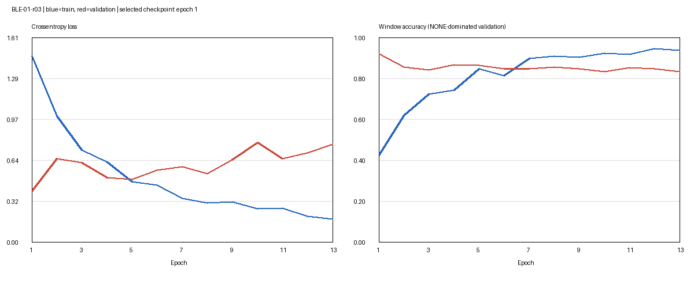

# 실험 1 진행 기록 — BLE 무증강 기준선

> **2026-10-25:** 코드 동작 확인용 테스트였다. 수치와 결정은 참고용이다([README](README.md) 참고).

- 작성: 2026-10-21
- 상태: 센서 기반 주석 검토·분할·무증강 학습·검증 clip replay 완료 / 연속·최종 평가·보드 미실행
- 실험 ID: BLE-01 / 완료 실행: BLE-01-r03
- 기준: [아키텍처 v1](../../archive/ModelArchitecture.md), [공통 규칙](README.md)

## 목적과 가설

현재 2층 CNN이 새 BLE 원본에서 방향 완료와 NONE을 어느 정도 구분하는지 측정한다. 이후 변경의 비교 기준을 확보하는 목적이며, 과거 USB 정확도와 직접 비교하지 않는다. 성능 가설은 아직 확인하지 않았다.

## 출발 사양

| 항목 | 고정할 첫 설정 |
|---|---|
| 입력 | 100 Hz, accX/Y/Z·gyrX/Y/Z, 160행×6축, stride 5행 |
| 시간 | t는 마지막 실제 샘플 시각, 입력 t-1590 ms~t |
| 전처리 | 훈련 원본에서만 구한 축별 고정 평균/표준편차 |
| 정답 | 자연 복귀 완료 e부터 e+150 ms 미만은 방향, 나머지는 NONE |
| 모델 | Conv(16,k5,same) → Pool2 → Dropout .2 → Conv(32,k5,same) → Pool2 → Flatten1280 → Dropout .3 → Dense5 softmax |
| 파라미터 | 설계 기준 9,493개 |
| 학습 | Adam .001, sparse categorical crossentropy, batch 16, 최대 100 epoch |
| 조기 종료 | val_loss, patience 12, 최저 가중치 복원 |
| Seed / 증강 | 20261021 / 없음 |
| NONE | 훈련에서만 총 방향 양성 창 수 수준으로 종류별 고정 추출; 검증은 전체 |
| 초기 후처리 | 점수 .8, margin .2, 같은 방향 2회 / NONE .8 이상 2회로 재무장 |

설계 코드: [ml/model.py](../../../ml/model.py). 위 후처리 설정도 첫 실행에 고정해 기록한다. 이후 문턱 변경은 별도 실행 ID로 구분한다.

## 학습 전 체크리스트와 완료 범위

2026-10-21에 아래 준비를 수행했다. 실제 개수·보류 사유·검토 한계는 [데이터 검토 기록](01-data-review.md)에 남겼다. 센서 기반 정답을 사용한 첫 clip 진단이며, 연속 녹화와 독립적인 완료 시점 확인까지 끝난 것은 아니다.

1. 원본 목록과 해시를 보존한다. 기존 기록상 방향 60개, idle/other 각 3개이며 실행 시 다시 집계한다.
2. `phone-20261021-094346` 방향 40개의 완료 시점 후보를 별도 파일로 생성한다. 기존 첫 세션 주석은 덮어쓰지 않는다. 자동 후보는 확정 정답이 아니다.
3. 두 방향 세션의 파형과 REVIEW를 검토한다. 채택/수정/보류 사유와 e를 기록하고, 버퍼 준비 부족·양성 잘림·유효 양성 창 수를 원본별로 점검한다. 단순히 REVIEW라는 이유로 최종 평가에서 조용히 제외하지 않는다.
4. 첫 방향 세션 `phone-20261021-091621`의 방향별 5개는 최종 평가 보류. 두 번째 방향 세션은 방향별 훈련 8개/검증 2개를 목표로 원본 목록을 고정한다. 검토로 제외하면 실제 수를 기록한다.
5. idle/other는 각각 원본 1개씩 훈련/검증/평가로 지정한다. 배경 원본은 세션 전체 분리가 아니라는 한계를 남긴다.
6. 로컬 입력 생성 경로를 준비한다. 기존 exporter는 원격 배경 조회·validation 미분리·10 ms 시각 차이가 있으므로 그대로 학습에 사용하지 않는다. 파일을 이어 붙이거나 앞부분을 가짜 값으로 채우지 않는다.
7. 분할 중복, 160행·6축·유한 값, 시간 정렬, 훈련 전용 정규화, 클래스별 창 수를 확인한 뒤 학습한다. 개발/최종 연속 녹화도 별도 확보를 시작한다.

## 실행과 평가

무증강 학습 → validation의 전체 clip 독립 replay → 창 지표와 이벤트 지표 기록 순으로 진행한다. 이 단계에서 최종 평가 세션의 모델 성능은 열어보지 않는다.

완료 후 500 ms 이내 같은 방향 발행을 일대일 매칭하는 초기 규칙으로 정검출·누락·방향 오류·중복·조기/복귀 중 발행을 집계한다. 올바른 매칭의 지연 median/p95와 n, 배경 오발행 수와 실제 관측 초를 함께 기록한다. 짧은 clip은 연속 사용 검증과 구분한다.

## 완료 조건

원본·주석·분할·실행 설정과 산출물 경로를 보존하고, 모델이 NONE만 출력하는지까지 포함해 validation 결과를 설명할 수 있으면 기준선 실행 완료다. 임의의 목표 정확도 달성을 완료 조건으로 삼지 않는다. 학습 결과가 나빠도 기록하고 다음 실험의 근거로 쓴다.

## 실제 실행 — 2026-10-21

실행 ID **BLE-01-r03**. Python 3.12.15 / TensorFlow 2.21.0 / Keras 3.15.1 / NumPy 2.5.4, Windows CPU에서 실행했다. 코드: [로컬 학습·replay](../../../ml/baseline.py), [모델](../../../ml/model.py). 분할 seed와 학습 seed는 20261021이며 증강·class weight·라벨 변경·문턱 조정은 하지 않았다.

원본 총 66개에서 훈련 29 / 검증 10 / 최종 평가 보류 22 / 첫 기준선 제외 5개로 고정했다. 방향별 훈련은 UP 6, DOWN 8, LEFT 7, RIGHT 6개다. 평가 원본 22개에는 완료 정답을 보류한 RIGHT 1개를 표시해 포함했다. 해당 원본의 모델 예측은 열어보지 않았다.

정규화 계수는 훈련 원본 10,100행에서만 계산했다. 훈련 전체 1,121창 중 방향 양성 72창과 NONE 72창을 사용했다. 검증은 NONE을 줄이지 않은 전체 570창이다.

| 클래스 | 훈련에 사용한 창 | 검증 창 | 검증 precision | 검증 recall | 검증 F1 |
|---|---:|---:|---:|---:|---:|
| NONE | 72 | 550 | 0.9650 | 0.9527 | 0.9588 |
| UP | 14 | 4 | 0.2000 | 0.2500 | 0.2222 |
| DOWN | 19 | 6 | 0 | 0 | 0 |
| LEFT | 21 | 4 | 0 | 0 | 0 |
| RIGHT | 18 | 6 | 0 | 0 | 0 |

NONE은 idle/other/방향 진행 중/완료 후에서 각 18창씩 원본을 번갈아 추출했다. 첫 판정이 1590 ms라 시작 500 ms 이전 NONE 창은 없었다. 겹치는 창 수를 독립 동작 수로 해석하지 않는다.

### 결과

- 최대 100 epoch 중 13 epoch에 조기 종료. val_loss가 가장 낮은 **epoch 1**을 복원했다. 최저 val_loss **0.40067**. epoch 13 가중치를 평가한 결과가 아니다.
- 검증 창 정확도 **92.11%**, macro F1 **0.2362**. 모두 NONE으로 답하는 비교 기준은 **550/570 = 96.49%**다. 방향 양성 창 20개 중 정답 방향 argmax는 1개뿐이었다.
- 초기 문턱과 2회 연속 후처리에서 **발행 0회, 정검출 0/8, 누락 8/8**. 방향 오류·중복·조기·늦은 미매칭 발행도 각각 0회다. 발행 자체가 없으므로 오발행 0회를 성공 근거로 삼지 않는다.
- 배경 녹화 20초 중 버퍼 준비를 제외한 실제 판정 구간은 **16.82초**, 배경 발행 0회. 10초 clip 두 개에서 각각 1590 ms를 제외한 값이다. 전체 관측 시간은 명목상 마지막 샘플의 10 ms 간격까지 포함한다. 장시간 안정성은 검증하지 않았다.
- 올바른 매칭이 0개라 지연 median/p95는 **산출 불가(n=0)**다. 지연 0 ms로 표기하지 않는다.



### 판단과 다음 실험

첫 무증강 실행을 비교 기준으로 보존하되 **사용 가능한 방향 인식 모델로 채택하지 않는다.** 훈련 loss는 감소했지만 현재 복원 모델과 후처리에서는 방향 명령을 검출하지 못했다. 검증 loss의 NONE 지배, 짧은 양성 구간, 독립 원본 부족, 완료 주석 오차 및 문턱의 영향을 구분해 조사해야 하며 어느 하나를 원인으로 확정하지 않는다.

특히 훈련 4개·검증 2개 원본은 버퍼 준비 때문에 방향 양성 창이 1개만 남는다. 정답 구간만 예측하면 2회 연속 조건을 충족할 수 없는 제약이다. 실험 2에서 고정된 예측 로그로 완료 시점과 NONE 혼동을 먼저 조사하고, 이후 라벨/입력 길이/연속 수집 조건의 변경을 별도 비교한다. 이번 결과를 보고 최종 평가 자료를 열거나 문턱을 조정하지 않았다.

### 문제와 해결·검증 범위

- r01은 환경 버전 수집 시 venv에 pip 모듈이 없어 학습 전에 실패했다. 패키지 메타데이터로 버전을 수집하도록 바꿨다. [실패 로그](BLE-01-r01-training.log).
- r02는 epoch 1 계산 후 Keras의 임시 파일 생성 단계에서 대기해 중단했다. 별도 저장 진단의 스택으로 위치를 확인했고, r03부터 프로젝트 실행 폴더의 `tmp`를 사용해 저장·학습·평가를 완료했다. [r02 로그](BLE-01-r02-training.log). r01/r02 자료는 덮어쓰지 않았다.
- 판정 노출 시간을 단순 창 수×50 ms로 집계하면 clip 끝을 넘어서는 마지막 구간이 포함됨을 확인했다. 결과 보고에서는 실제 녹화 길이−1590 ms로 정정했다. 모델/예측/이벤트 수는 바꾸지 않았고 원래 명목 구간 합계와 정정 사유도 결과 JSON에 남겼다.
- 시간 경계·후처리 잠금/재무장·방향 변경·일대일 매칭·NONE 추출 점검 **7개 통과**. 저장 모델과 best checkpoint를 다시 읽어 검증 예측 570개가 기존 값과 일치함을 확인했다. 원본 66개 SHA-256도 변경되지 않았다.
- 연속 동작 녹화, 최종 평가 추론, seed 반복, int8 변환, 보드·BLE 동시 추론과 사용자 실동작 확인은 미실행이다.

### 근거 파일·재실행

- [원본별 분할](../../../data/splits/ble-v1.json), [주석과 데이터 검토](01-data-review.md).
- [실행 설정·코드 해시](results/BLE-01-r03/config.json), [정규화 계수](results/BLE-01-r03/normalization.json), [환경 버전](results/BLE-01-r03/environment.txt).
- [결과·혼동행렬·원본별 이벤트](results/BLE-01-r03/results.json), [시각별 검증 예측](results/BLE-01-r03/validation-predictions.csv), [학습 이력](results/BLE-01-r03/history.csv), [실행 로그](BLE-01-r03-training.log).
- 로컬 모델: [model.keras](../../../ml/runs/BLE-01-r03/model.keras). 실행 폴더에는 입력 배열·창 목록·코드 사본·주석·분할·최적 모델·미커밋 차이도 보존했다. `ml/runs/`는 Git 제외 경로이며 주요 수치와 로그는 위 문서 폴더에도 복사했다.

```powershell
# 이미 고정된 분할을 사용한다. r03은 덮어쓸 수 없으므로 재실행은 새 ID를 지정한다.
& ml/.venv/Scripts/python.exe ml/baseline.py --train --run-id BLE-01-r04
& ml/.venv/Scripts/python.exe -m unittest discover -s ml -p test_baseline.py
```

파형 검토 그림에는 별도 번들 Python 3.12.14 / Pillow 12.3.0, 후보 생성에는 Node v24.17.0을 사용했다. 첫 분할은 `--prepare`로 만들었으며 이미 존재하는 분할표는 덮어쓰지 않는다.

## 재수집 시 반영 (2026-10-25)

이 실험의 원본은 2026-10-23 삭제됐다. 여기서 드러난 데이터 한계를 [재수집 계획](../../archive/TrainingPlan.md#재수집-계획--2026-10-25)에 반영했다. 위 결과와 결정은 그대로 둔다.

- 방향 원본 27개에서 훈련 양성 창이 72개뿐이었다. 첫 판정이 1590 ms라 2개는 양성 0창으로 빠졌고 6개(훈련 4·검증 2)는 1창만 남았다. → 동작 신호를 1초로 늦춘 4초 클립으로 수집하고, 원본별 양성 창 수를 수집 직후 확인한다.
- 검증 570창 중 96.5%가 NONE이라 val_loss 최저가 epoch 1에 나왔다. → 방향 원본을 늘리고 고정 epoch(개발 평가 v2)를 유지한다.
- 배경 16.82초의 발행 0회는 발행 자체가 없었던 결과다. → idle/other를 세션마다 늘린다.
- `raw_up.1`이 자이로 1002 dps로 ±1000 dps 한계에 닿았다. → ±2000 dps 펌웨어·앱으로 수집한다.
