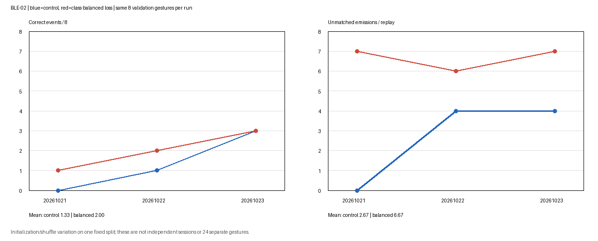

# 실험 2 진행 기록 — NONE 혼동 조사와 클래스 가중치 비교

> **2026-10-25:** 코드 동작 확인용 테스트였다. 수치와 결정은 참고용이다([README](README.md) 참고).

- 날짜: 2026-10-21 (한국 시간)
- 상태: 오류 조사·3 seed×2조건 학습·검증 완료 / 가중치 변경 미채택
- 기준 실행: [실험 1](실험1_진행기록.md)의 BLE-01-r03
- 이번 실행: BLE-02-r01~r06. 최종 평가·연속 녹화·보드 추론은 실행하지 않았다.

## 목적과 가설

실험 1의 명령 정검출 0/8이 어느 구간의 방향↔NONE 혼동에서 나오는지 확인하고, 훈련 loss의 클래스 비중을 균형화하면 달라지는지 비교한다. 데이터 양·라벨 경계·문턱 중 하나가 원인이라고 사전에 확정하지 않는다.

## 먼저 확인한 오류

실험 1의 저장된 검증 예측 570창을 사용했다. 새 모델을 학습하기 전에 각 판정 시각에서 완료 e와 양성 종료 e+150 ms까지의 부호 있는 거리를 계산했다. [시각별 조사 CSV](results/BLE-02/boundary-predictions.csv), [진단 결과](results/BLE-02/diagnosis.json)에 모두 남겼다.

| 구간 | 창 수 | argmax 오분류 | 관찰 |
|---|---:|---:|---|
| idle | 169 | 0 | 모두 NONE |
| other | 169 | 0 | 모두 NONE |
| 방향 완료 전 | 34 | 7 | NONE 목표인데 LEFT |
| 방향 양성 150 ms | 20 | 19 | 19개 모두 NONE으로 누락 |
| 양성 종료 후 | 178 | 19 | NONE 목표인데 LEFT 15/UP 4 |

양성 구간을 완료 후 0~49/50~99/100~149 ms로 나눠 보니 각각 6/6, 6/6, 7/8개가 NONE이었다. 오류가 이 작은 표본의 특정 경계에만 집중됐다는 증거는 없다. 정답 방향의 양성 구간 최고 점수도 원본별 약 0.031~0.344로, 초기 방향 문턱 0.8을 넘지 못했다.

따라서 이번에는 **경계 무시 구간을 추가하지 않았고, NONE 추출량도 바꾸지 않았다.** 특정 idle/other에 오류가 집중된 상황도 아니었다. 원래 계획에서 오류 확인 후 한 요소만 비교한다는 원칙에 따라, 넓게 나타난 방향→NONE 혼동에 대해 클래스 손실 가중치만 시험했다. 이 혼동이 불균형 때문에 생겼다고 확정한 것은 아니다.

## 학습 전에 고정한 비교 조건

[실행 전 프로토콜](results/BLE-02/protocol.json)을 10:49:53 KST에 저장한 뒤 학습했다. seed는 20261021/20261022/20261023, 각 seed에서 기존 설정과 변경 설정을 한 쌍으로 비교했다. 결과를 보고 seed·가중치·채택 규칙을 바꾸지 않았다.

| 항목 | 두 조건 공통 |
|---|---|
| 원본·완료 주석·분할 | 실험 1 그대로, 훈련 29/검증 10/최종 평가 보류 22/제외 5개 |
| 실제 입력 | 실험 1 저장 배열 그대로. 훈련 144창, 검증 전체 570창 |
| 훈련 클래스 수 | NONE72/UP14/DOWN19/LEFT21/RIGHT18 |
| 정규화 | 실험 1 훈련 원본의 평균·표준편차 그대로 |
| 모델 | 입력160×6, Conv2층+Flatten, 9,493 파라미터 |
| 학습 | Adam .001, batch16, 최대100 epoch, 증강 없음 |
| 조기 종료/선택 | **가중치 없는 전체 val_loss** 최저, patience12, 최저 가중치 복원 |
| 후처리 | 방향 .8/margin .2/2연속, NONE .8/2연속 재무장 |
| 이벤트 성공 | 완료 e~e+500 ms 이내 같은 방향 발행을 일대일 매칭 |

**바꾼 요인은 훈련 loss의 class weight 하나다.** 기존 조건은 모두 1, 변경 조건은 훈련 창 개수만으로 `w_c = N / (5 × n_c)`를 계산했다. 가중치의 훈련 표본 평균은 1이고, 클래스별 총 loss 비중을 같게 만드는 설정이다. 샘플 추출과 검증 loss는 바꾸지 않았다.

| 클래스 | 기존 | 변경 |
|---|---:|---:|
| NONE | 1 | 0.400000 |
| UP | 1 | 2.057143 |
| DOWN | 1 | 1.515789 |
| LEFT | 1 | 1.371429 |
| RIGHT | 1 | 1.600000 |

같은 seed 쌍의 초기 가중치가 배열 수준에서 같음을 확인했다. 원래 훈련 창 추출은 seed 20261021로 고정된 상태를 유지하고, 이번 세 seed는 모델 초기화·Dropout·훈련 순서의 변동을 확인한다. 가중 loss로 학습한 조건의 훈련 loss와 기존 조건의 훈련 loss 값은 서로 다른 목적함수이므로 절댓값을 직접 성능 비교로 삼지 않는다.

사전 채택 기준은 정검출 평균이 증가하면서 미매칭 발행 평균은 증가하지 않고, 어느 seed에서도 두 이벤트 지표가 악화되지 않는 경우에만 개발 후보로 유지하는 것이었다. 배포 채택 조건은 아니다.

## 실제 결과

미매칭 발행은 방향 오류·중복·조기 발행·500 ms 이후 발행·배경 발행의 합계다. 조기 발행은 방향이 맞아도 현재 정답 규칙에서 성공으로 세지 않는다. '누락'은 이와 별개로 정해진 시간 안에 올바른 발행이 없었던 동작 수다.

| 실행 | 조건 | seed | 종료/선택 epoch | 창 정확도 | macro F1 | 정검출/8 | 미매칭 발행 |
|---|---|---|---|---:|---:|---:|---:|
| r01 | 기존 | 20261021 | 13/1 | 92.11% | 0.2362 | 0 | 0 |
| r02 | 가중치 | 20261021 | 20/8 | 81.75% | 0.2642 | 1 | 7 |
| r03 | 기존 | 20261022 | 20/8 | 84.39% | 0.3305 | 1 | 4 |
| r04 | 가중치 | 20261022 | 21/9 | 79.82% | 0.3217 | 2 | 6 |
| r05 | 기존 | 20261023 | 19/7 | 86.32% | 0.3373 | 3 | 4 |
| r06 | 가중치 | 20261023 | 22/10 | 78.07% | 0.3049 | 3 | 7 |

| 3 seed 요약 | 기존 평균 [최소, 최대] | 가중치 평균 [최소, 최대] |
|---|---:|---:|
| 정검출/8 | 1.33 [0,3] | 2.00 [1,3] |
| 누락/8 | 6.67 [5,8] | 6.00 [5,7] |
| 미매칭 발행 | 2.67 [0,4] | 6.67 [6,7] |
| macro F1 | 0.3013 [0.2362,0.3373] | 0.2969 [0.2642,0.3217] |
| 창 정확도 | 87.60% [84.39,92.11] | 79.88% [78.07,81.75] |



**매번 같은 검증 방향 원본 8개를 반복 평가한 것이다.** 이를 독립적인 동작 24개 또는 여러 세션의 일반화 성능으로 해석하지 않는다. macro F1도 평균적으로 개선되지 않았으며 작은 차이의 통계적 유의성을 주장하지 않는다.

### 원본별 관찰과 발행 시점

- `raw_down.1`은 기존/변경 모두 세 seed에서 정검출 0/3이었다. 명령이 나온 실행에서는 완료1830 ms보다 90 ms 빠른 1740 ms에 DOWN이 발행됐다.
- `raw_up.3`은 기존/변경 모두 세 seed에서 정검출 0/3이었다. 완료1700 ms보다 60 ms 이른 1640 ms에 UP이 반복 발행됐다. 잠금 상태에서 정답 시점으로 넘어가면 추가 발행이 없을 수 있다.
- `raw_right.10`의 정검출은 기존 1/3, 가중치 0/3이었다. 가중치 조건 세 실행 모두 완료1760 ms 뒤 2040 ms에 LEFT를 발행해 방향 오류가 발생했다.
- `raw_left.2`는 가중치에서 3/3 정검출했지만 이후 500 ms 허용 구간 밖의 추가 발행이 매번 1회 있었다. 현재 집계에서는 `late_unmatched`로 분류한다. 허용 구간 밖 발행을 정검출에 포함하거나 숨기지 않았다.
- 가중치 변경의 조기/방향 오류/늦은 발행은 seed별 4/2/1, 3/2/1, 4/2/1회였다. 중복(허용 구간 내)·배경 발행은 모두 0회였다.

센서 완료 시각 자체에 주석 오차가 있을 수 있고, 조기 발행에는 다른 방향도 섞이므로 이를 전부 '좋은 조기 인식'으로 해석하지 않는다. 정답 정의를 바꾸어 점수를 다시 올리지 않았다. 정답 정책과 실제 원하는 명령 시점을 독립적으로 확인할 후속 근거가 필요하다.

### 지연과 배경 관측

| seed | 기존 지연 median/p95 (n) | 가중치 지연 median/p95 (n) |
|---|---|---|
| 20261021 | 산출 불가 (0) | 250/250 ms (1) |
| 20261022 | 200/200 ms (1) | 160/196 ms (2) |
| 20261023 | 250/457 ms (3) | 160/241 ms (3) |

정확히 매칭된 이벤트만의 지연이며 n이 1~3개뿐이라 안정적인 p95 추정으로 삼을 수 없다. 서로 매칭된 동작 구성도 달라 지연 감소를 독립적인 속도 개선으로 결론내리지 않는다.

배경은 매회 같은 20초 녹화, 준비 시간을 뺀 판정 구간은 16.82초다. 여섯 실행 모두 배경 발행은 0회였지만 관측 시간이 6배로 늘어난 것이 아니며 장시간 오작동률을 검증한 것은 아니다. 이번 미매칭 발행은 방향 clip에서 발생했다.

## 결정과 문제·해결

**이번 클래스 가중치 변경은 채택하지 않는다.** 정검출이 일부 늘었지만 미매칭 발행이 모든 seed에서 증가해 사전 기준을 충족하지 못했다. NONE 창 수, 구조, 입력 길이, 라벨, 문턱을 함께 바꿔 결과를 개선하려는 추가 튜닝은 하지 않았다.

기존 설정도 정검출 0~3/8로 불안정하다. 실험 1의 0/8은 해당 seed 결과로 보존하되 같은 설계가 언제나 발행0회라고 일반화하지 않는다. 이번 비교는 불균형의 단독 원인을 입증하거나 모든 class weight 선택이 부적합함을 입증한 결과도 아니다.

원래 계획의 경계 무시 비교는 경계에만 집중된 오류 근거가 없어 생략했다. 양성 창을 일부 더 없애는 것보다 완료·발행 시점의 정의와 버퍼 준비 문제를 먼저 확인할 필요가 있다. 훈련4개/검증2개의 양성1창 문제는 이번에도 그대로 유지한 제한이다. 다음 실험의 라벨 정책 비교는 개발용 연속 자료와 의도한 명령 시점을 확보한 뒤 진행한다. 현재 3초 clip만으로 연속 사용 개선을 선언하지 않는다.

## 검증과 재현 근거

- Windows CPU / Python3.12.15 / TensorFlow2.21.0 / Keras3.15.1 / NumPy2.5.4. 실행별 정확한 버전·시각·코드/입력 해시는 각 config/environment에 저장했다.
- BLE-02-r01은 BLE-01-r03의 예측 570개를 재현했다(최대 절대 점수 차이 0). 새 제어 조건이 기존 기준선과 일치함을 확인했다.
- 여섯 저장 모델을 재로딩한 예측이 저장 점수와 일치했고, 모든 예측 행이 검증 원본 10개에만 속함을 확인했다. 혼동행렬과 발행 집계를 저장 CSV/이벤트 로그에서 대조했다.
- 두 조건×3 seed 모두 같은 입력·정규화 해시, 같은 모델 코드, 같은 분할을 사용했다. 원본66개 해시 불변, 최종 평가 추론 없음. 기존 시간/이벤트 테스트7개 통과.
- 그림은 번들 Python3.12.14 / Pillow12.3.0으로 생성하고 직접 확인했다. 새 수집·seed별 분할 변경·보드/사용자 실동작 확인은 하지 않았다.

| 근거 | 경로 |
|---|---|
| 오류 조사·비교 프로토콜 | [diagnosis](results/BLE-02/diagnosis.json), [시각별 경계 조사](results/BLE-02/boundary-predictions.csv), [protocol](results/BLE-02/protocol.json) |
| 쌍별 차이·평균·범위·판정 | [summary.json](results/BLE-02/summary.json) |
| r01/r02 결과 | [기존 seed21](results/BLE-02/BLE-02-r01/results.json), [가중치 seed21](results/BLE-02/BLE-02-r02/results.json) |
| r03/r04 결과 | [기존 seed22](results/BLE-02/BLE-02-r03/results.json), [가중치 seed22](results/BLE-02/BLE-02-r04/results.json) |
| r05/r06 결과 | [기존 seed23](results/BLE-02/BLE-02-r05/results.json), [가중치 seed23](results/BLE-02/BLE-02-r06/results.json) |
| 학습 전체 로그 | [training.log](results/BLE-02/training.log) |
| 실행 코드 | [experiment2.py](../../../ml/experiment2.py), [공통 시간·이벤트 처리](../../../ml/baseline.py) |

각 결과 폴더에 config.json, environment.txt, history.csv, validation-predictions.csv도 보존했다. 대용량 로컬 모델·실행 코드 사본은 `ml/runs/BLE-02-r01`~`r06`에 있으며 기존 실험1 모델은 덮어쓰지 않았다. 주요 수치는 문서 경로에도 남겼다.

```powershell
# 이미 실행 완료한 프로토콜/실행 폴더는 덮어쓰지 않는다.
& ml/.venv/Scripts/python.exe ml/experiment2.py --summarize
& ml/.venv/Scripts/python.exe -m unittest discover -s ml -p test_baseline.py
```

## 재수집 시 반영 (2026-10-25)

이 실험의 원본은 2026-10-23 삭제됐다. 여기서 드러난 데이터 한계를 [재수집 계획](../../archive/TrainingPlan.md#재수집-계획--2026-10-25)에 반영했다. 위 결과와 결정은 그대로 둔다.

- 같은 기존 조건에서 seed만 바꿔도 정검출이 0~3/8로 달랐고, 가중치 변경의 차이는 그 범위 안이었다. 검증이 훈련과 같은 세션의 방향 8동작뿐이라 조건 효과를 가를 수 없었다. → 세션 여러 개, 방향별 원본 확대, 세션 단위 분리.
- 방향→NONE 혼동이 양성 150 ms 구간 전체에 퍼져 있었고(20창 중 19개) 특정 경계에 몰리지 않았다. 원본이 적어 데이터 부족과 라벨 문제를 구분할 수 없었다. → 원본을 늘린 뒤 같은 조사를 다시 할 수 있다(미실행).
