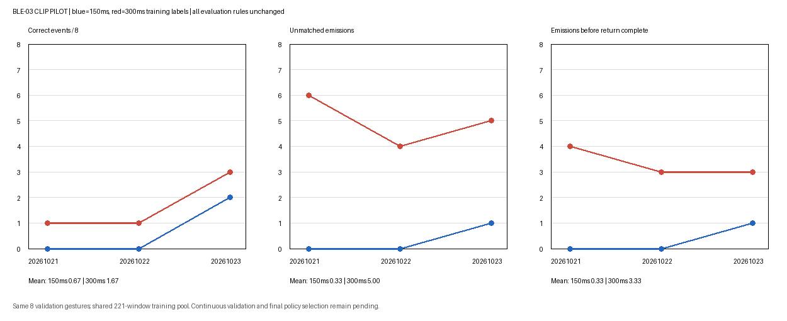

# 실험 3 진행 기록 — 자연 복귀 후 라벨 폭 사전 비교

- 날짜: 2026-10-21 (한국 시간)
- 상태: **기존 clip 사전 비교 완료 / 정식 연속 검증 대기**
- 실행 ID: BLE-03-r01~r06 (3 seed×2조건)
- 결정: 훈련 라벨 폭 300 ms 변경 미채택. 최종 라벨 정책 선정은 미완료.
- 관련: [실험 1](실험1_진행기록.md), [실험 2](실험2_진행기록.md), [공통 규칙](README.md)

## 사용자 목표 확인과 범위 조정

사용자가 원하는 명령 시점은 **“손가락이 자연스럽게 복귀한 뒤”**로 확인했다. 또한 지금은 새로운 연속 데이터를 수집하기 어렵다고 답했다.

원래 계획은 개발용 연속 자료에서 완료 후 라벨과 완료 전 패턴 라벨을 비교하는 것이었다. 복귀 전에 발행하는 목표는 사용자 의도와 맞지 않으므로 이번 후보에서 제외했다. 연속 자료가 없는 상태에서 정식 정책 선택은 보류하고, 현재 clip으로 할 수 있는 **완료 후 훈련 라벨 폭 150/300 ms 사전 비교**로 범위를 조정했다. 새 수집이나 영상 주석을 했다는 의미가 아니다.

이번 비교의 질문은 “자연 복귀 완료 e는 유지하면서 학습용 방향 양성 구간만 넓히면, 완료 후 명령 검출이 좋아지고 조기 발행은 줄어드는가?”다. e는 기존 센서 기반 운영 정답이며 독립적인 영상·사용자 관찰로 확정된 정답은 아니다.

## 비교 전에 고정한 조건

[프로토콜](results/BLE-03/protocol.json)을 10:59:03 KST에 저장한 뒤 학습했다. 두 조건은 다음과 같다.

| 판정 시각 t | 기준 150 ms 훈련 목표 | 대안 300 ms 훈련 목표 |
|---|---|---|
| t < e (방향 이동·복귀 중 포함) | NONE | NONE |
| e ≤ t < e+150 ms | 해당 방향 | 해당 방향 |
| e+150 ≤ t < e+300 ms | NONE | 해당 방향 |
| t ≥ e+300 ms | NONE | NONE |

300 ms는 새로운 완료 시각도, 입력 창 길이도, 추가 대기 시간도 아니다. **완료 이후 방향 정답을 유지하는 훈련 구간의 폭**이다. 양쪽 모두 복귀 중 방향 라벨은 주지 않는다.

### 같은 입력을 사용하는 비교

실험 1~2의 선택된 훈련 144창만 그대로 쓰면, 라벨 폭을 넓혀도 실제로 라벨이 바뀌는 창이 4개뿐이었다. 연장 구간 대부분이 기존 NONE 추출에서 빠져 있었기 때문이다.

따라서 훈련 원본에서 300 ms 정책의 양성 창을 모두 포함하는 입력 집합을 한 번 만들고 **두 조건 모두 같은 221창**을 사용했다. 기존 144창에 77창을 추가한 집합이며 검증 자료로 훈련 창을 고르지 않았다. 두 조건 사이에서 입력·순서·추출 목록을 바꾸지 않고 81창의 라벨만 바꿨다. 기존 144창의 값은 저장된 원래 입력과 배열 수준에서 일치했다.

| 훈련 라벨 폭 | NONE | UP | DOWN | LEFT | RIGHT | 합계 |
|---|---:|---:|---:|---:|---:|---:|
| 150 ms | 149 | 14 | 19 | 21 | 18 | 221 |
| 300 ms | 68 | 32 | 43 | 42 | 36 | 221 |

라벨 정책에 따라 클래스 비율도 함께 바뀌는 효과를 포함한다. 별도의 NONE 재추출·class weight로 이를 보정하지 않았다. 이번 150 ms 조건도 앞선 실험의 144창 조건과 다르므로, 실험 2와 수치를 직접 대조해 라벨 폭 효과로 해석하지 않는다.

### 고정한 학습·평가

- 원본 분할: 훈련29개/검증10개/최종 평가 보류22개/제외5개 그대로. 이전 제외 원본을 이번에 다시 넣지 않았다.
- 입력160×6·stride50 ms, 기존 훈련 원본 정규화, CNN9,493파라미터, 증강 없음, class weight 없음.
- Adam .001, batch16, 최대100epoch, patience12. seed20261021/20261022/20261023을 두 조건에 같은 집합으로 적용했다.
- 동일 seed 쌍의 초기 가중치는 같고 같은 입력 순서 규칙을 썼다. 바꾼 요인은 훈련 양성 라벨 폭 하나다.
- **검증은 양쪽 모두 기존 570창·150 ms 정답 그대로**다. 검증 라벨과 창 정확도 분모를 후보에 맞춰 바꾸지 않았다. 체크포인트도 이 공통의 가중치 없는 val_loss 최저를 선택했다. 따라서 이 결과는 공통 기준으로 선택한 모델의 비교이며, 각 정책 전용 검증 정답으로 선택한 최적 모델의 비교는 아니다.
- 발행 조건은 방향점수 .8/margin .2/같은 방향2회, 확실한 NONE2회 재무장 그대로다.
- 정검출은 두 조건 모두 **e~e+500 ms 이내 같은 방향 발행을 일대일 매칭**한다. e 이전 발행은 방향이 맞아도 조기 발행으로 남긴다. 완료 시각을 옮기거나 성공 허용 구간을 넓혀 점수를 올리지 않았다.

사전 판단 규칙은 정검출 평균 증가, 미매칭 발행 평균 비증가, 어느 seed에서도 두 이벤트 지표 악화 없음일 때만 사전 후보로 유지하는 것이었다. 통과하더라도 연속 자료 없이는 최종 정책으로 채택하지 않도록 정했다.

## 실행 결과

매번 **같은 검증 방향 동작 8개**를 평가했다. 미매칭 발행은 조기·방향 오류·허용 구간 내 중복·500 ms 이후·배경 발행의 합계다.

| 실행 | 폭 | seed | 종료/선택 epoch | 창 정확도 | macro F1 | 정검출/8 | 미매칭 | 조기 발행 |
|---|---:|---|---|---:|---:|---:|---:|---:|
| r01 | 150 ms | 20261021 | 13/1 | 95.79% | 0.1957 | 0 | 0 | 0 |
| r02 | 300 ms | 20261021 | 18/6 | 82.81% | 0.3551 | 1 | 6 | 4 |
| r03 | 150 ms | 20261022 | 15/3 | 95.26% | 0.2396 | 0 | 0 | 0 |
| r04 | 300 ms | 20261022 | 15/3 | 77.89% | 0.3161 | 1 | 4 | 3 |
| r05 | 150 ms | 20261023 | 19/7 | 91.93% | 0.2416 | 2 | 1 | 1 |
| r06 | 300 ms | 20261023 | 18/6 | 77.19% | 0.3365 | 3 | 5 | 3 |

| 3 seed 요약 | 150 ms 평균 [최소, 최대] | 300 ms 평균 [최소, 최대] |
|---|---:|---:|
| 정검출/8 | 0.67 [0,2] | 1.67 [1,3] |
| 누락/8 | 7.33 [6,8] | 6.33 [5,7] |
| 미매칭 발행 | 0.33 [0,1] | 5.00 [4,6] |
| 완료 전 조기 발행 | 0.33 [0,1] | 3.33 [3,4] |
| macro F1 | 0.2256 [0.1957,0.2416] | 0.3359 [0.3161,0.3551] |
| 창 정확도 | 94.33% [91.93,95.79] | 79.30% [77.19,82.81] |

### 목표 시점과 맞지 않은 사례

- 300 ms의 세 seed 모두 `raw_down.1`은 완료1830 ms보다 90 ms 이른1740 ms에 DOWN을 발행했다.
- 300 ms의 세 seed 모두 `raw_up.3`은 완료1700 ms보다 60 ms 이른1640 ms에 UP을 발행했다. 반면150 ms의 seed23은2090 ms에 발행해 완료 후390 ms로 정검출됐다.
- 300 ms에서 `raw_right.1`은 LEFT 조기 발행이 반복됐다. 단순히 원하는 방향을 빠르게 알아본 경우로 모두 해석할 수 없다.
- 300 ms의 미매칭은 seed21에서 조기4+방향 오류2, seed22에서 조기3+늦은1, seed23에서 조기3+늦은2였다. 허용 구간 내 중복·배경 발행은 모두0회였다.

학습 정답을 e 이전에 주지 않았어도 모델 예측이 그 시점을 정확히 지킨다는 보장은 없다. 이번 결과는 폭을 늘리는 것만으로 원하는 발행 시점을 해결하지 못했음을 보여준다. 그렇다고 e의 주석 오류나 특정 모델 원인을 확정한 것은 아니다.

### 지연과 관측 시간

| seed | 150 ms median/p95 (n) | 300 ms median/p95 (n) |
|---|---|---|
| 20261021 | 산출 불가 (0) | 250/250 ms (1) |
| 20261022 | 산출 불가 (0) | 160/160 ms (1) |
| 20261023 | 320/383 ms (2) | 160/241 ms (3) |

매칭된 소수 이벤트만의 지연이다. 서로 검출한 동작 구성이 다르므로 속도 개선으로 단정하지 않는다. 배경은 매회 같은20초, 버퍼 준비를 제외한 판정16.82초에서 발행0회였다. 여섯 실행을 새 관측120초로 계산하지 않는다.

## 판단·한계

**이번 300 ms 변경은 사전 후보로도 채택하지 않는다.** 정검출과 macro F1은 늘었지만, 모든 seed에서 미매칭과 조기 발행이 늘어 사전 규칙 및 사용자 목표에 맞지 않았다. 기존150 ms도 누락이 많으므로 사용 가능한 정책으로 검증된 것은 아니다. 현재 설계 사양은 변경하지 않았다.

다음 한계를 결과와 함께 유지한다.

1. 연속 기록·새로운 세션·재착용을 시험하지 않았다. 기존3초 clip을 이어 붙이지 않았다.
2. 센서 기반 완료 정답의 오차가 남아 있다. 독립적으로 확인한 완료/의도 명령 시각이 없다.
3. 세 seed는 초기화·훈련 순서 변동이다. 같은8동작 반복을 독립24개 동작 또는 모집단 성능으로 해석하지 않는다.
4. 공통150 ms 검증 loss로 모델을 선택했으므로, 넓은 구간을 예측하는 모델에는 그 꼬리 구간이 검증 오차가 될 수 있다. 이를 포함한 현재의 고정 선택 절차에 대한 결과로 한정한다.
5. 훈련 입력은 이번 두 조건에서만221창으로 동일하다. 실험1~2와의 차이를 라벨 폭만의 효과로 비교하지 않는다.
6. 기존 버퍼 준비 부족·제외 원본 문제를 이번 라벨 폭에 맞춰 임의로 다시 처리하지 않았다. 정식 라벨 선택은 연속 자료와 정답 확인 이후로 남긴다.

## 검증·보존한 근거

- 시간 경계/이벤트 점검7개와 복귀 전 NONE·양성 구간의 끝점·버퍼 준비·배경 라벨 점검4개, 총11개 통과.
- 두 조건의221개 입력 일치, 81개 라벨 변경 확인. 기존144개 입력의 재생성 값과 저장값 일치.
- 검증 입력·정답570개가 실험1 원본 배열과 완전히 일치함을 확인했다. 여섯 예측 CSV에 검증 원본10개만 포함되며 최종 평가 원본은 없다.
- 여섯 모델을 저장 후 재로딩해 점수 일치 확인. 초기 가중치·입력/분할/정규화/모델 코드 해시·혼동행렬·이벤트 집계를 대조했다. 센서 원본66개 SHA-256 불변.
- Windows CPU / Python3.12.15 / TensorFlow2.21.0 / Keras3.15.1 / NumPy2.5.4. 그림은 번들 Python3.12.14/Pillow12.3.0으로 생성하고 직접 확인했다.

| 근거 | 파일 |
|---|---|
| 사전 조건·같은 입력 목록 | [protocol.json](results/BLE-03/protocol.json), [train-windows.json](results/BLE-03/train-windows.json) |
| 쌍별 차이·평균·범위·판정 | [summary.json](results/BLE-03/summary.json) |
| seed21 결과 | [150 ms r01](results/BLE-03/BLE-03-r01/results.json), [300 ms r02](results/BLE-03/BLE-03-r02/results.json) |
| seed22 결과 | [150 ms r03](results/BLE-03/BLE-03-r03/results.json), [300 ms r04](results/BLE-03/BLE-03-r04/results.json) |
| seed23 결과 | [150 ms r05](results/BLE-03/BLE-03-r05/results.json), [300 ms r06](results/BLE-03/BLE-03-r06/results.json) |
| 전체 학습 로그 | [training.log](results/BLE-03/training.log) |
| 구현·경계 점검 | [experiment3.py](../../../ml/experiment3.py), [test_experiment3.py](../../../ml/test_experiment3.py) |

각 결과 폴더에 설정/환경/학습 이력/시각별 예측도 보존했다. 대용량 공통 입력은 `ml/runs/BLE-03-inputs/`, 모델·실행 코드 사본은 `ml/runs/BLE-03-r01`~`r06`에 있다. 기존 모델·주석·분할은 덮어쓰지 않았다.

## 연속 수집이 가능해졌을 때

현재는 사용자 사정에 따라 수집을 진행하지 않는다. 이후 [앱의 연속 기록](../../../android/README.md)을 사용해 최소 다음 조건을 확보한다.

- 시작 후3초 이상 가만히 있다가 방향·자연 복귀·idle/other를 섞어 기록한다. 센서가 배터리/BLE로 동작하는 실제 착용 조건과 자세·재착용 여부를 세션 메모에 남긴다.
- 먼저 개발용 약3분 기록을 준비한다. 방향 순서와 동작 시작·이동 끝·복귀 완료를 함께 검토할 근거를 남기되 안내 시각을 실제 완료 시각으로 간주하지 않는다.
- 연속 자료에서는 실제 샘플 누락 시 버퍼/발행 상태를 초기화하고 다시160행을 채운 뒤 판정해야 한다. 현재 clip 전용 입력 코드를 연속 자료에 그대로 적용하지 않는다.
- 원본을 `--keep`으로 복사하고 해시를 확인한다. 최종 평가용 기록은 별도로 수집·보류하고 개발 결과로 계속 튜닝하지 않는다.

정식 실험3의 라벨 선택·연속 평가는 이 자료가 확보된 뒤 재개한다. 이번 사전 비교만으로 그 단계를 완료로 표시하지 않는다.

## 재수집 시 반영 (2026-10-25)

이 실험의 원본은 2026-10-23 삭제됐다. 여기서 드러난 데이터 한계를 [재수집 계획](../../TrainingPlan.md#재수집-계획--2026-10-25)에 반영했다. 위 결과와 결정은 그대로 둔다.

- 연속 자료가 없어 라벨 폭의 정식 선택을 보류했다. → 세션마다 연속 기록 3~5분을 수집하고 개발용과 최종 평가용으로 나눈다. 위 "연속 수집이 가능해졌을 때"의 조건을 그대로 적용한다.
- `raw_down.1`(완료 90 ms 전)·`raw_up.3`(60 ms 전)의 반복 조기 발행이 주석 오차인지 모델 문제인지 가를 독립 근거가 없었다. → 연속 기록의 세션 메모에 의도한 명령 순서를 남긴다. 연속 기록의 명령 시각 주석 도구는 아직 없다.
