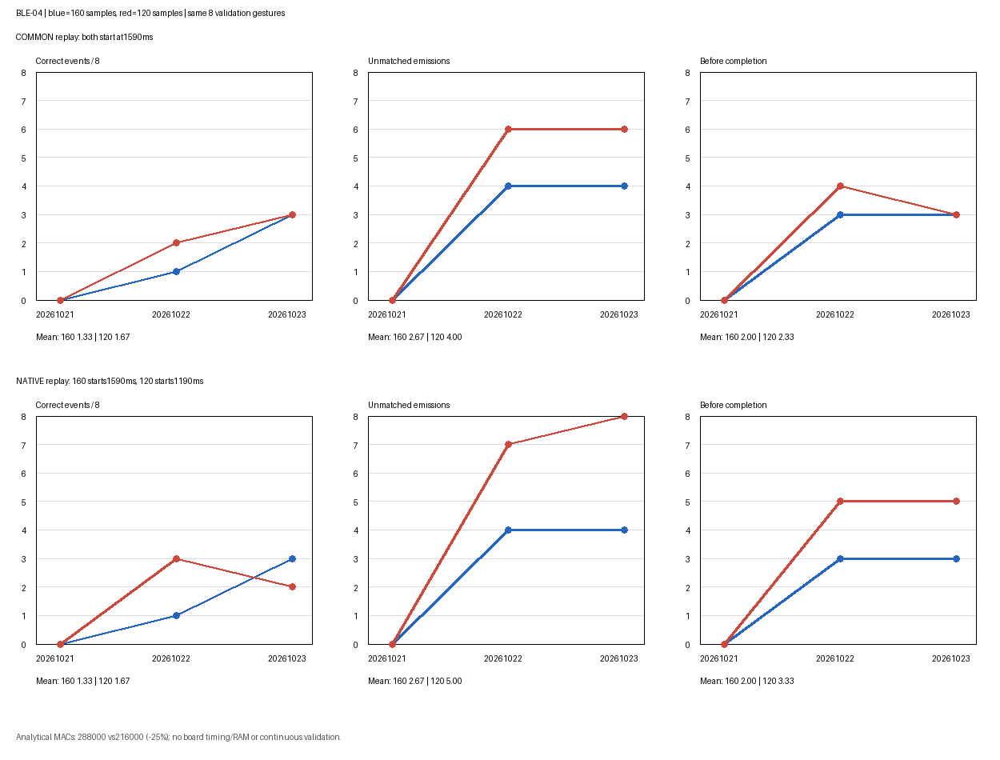

# 실험 4 진행 기록 — 1600/1200 ms 입력 길이 비교

- 날짜: 2026-10-21 (한국 시간)
- 상태: 기존 clip 비교 완료 / 1200 ms 변경 미채택
- 실행 ID: BLE-04-r01~r06 (3 seed×2길이)
- 기준: [실험 1](실험1_진행기록.md)의 BLE-01-r03. [실험 2](실험2_진행기록.md)의 클래스 가중치와 [실험 3](실험3_진행기록.md)의 300 ms 훈련 라벨은 미채택이므로 적용하지 않았다.
- 최종 평가·연속 실사용·보드 추론은 미실행이다. 실험3 정식 연속 검증은 계속 대기 상태다.

## 목적과 비교 설계

160행과120행에서 필요한 과거 맥락·명령 결과·자원 규모가 어떻게 달라지는지 확인한다. 과거 USB 선형 모델의 길이 비교를 현재 BLE CNN 결과로 대신하지 않는다. 사용자 목표인 자연 복귀 후 명령 발행을 유지한다.

[프로토콜](results/BLE-04/protocol.json)을 11:06:34 KST에 고정한 뒤 학습했다. seed20261021/20261022/20261023을 양쪽에 같은 집합으로 적용했다.

- 원본·완료e·분할·정규화·훈련 목표를 고정했다. 훈련29개 원본에서 선택한 **동일한144창**을 사용하며,120행 입력은160행의 마지막120행만 남겼다. 같은 끝 시각 t를 사용하고 미래 값을 추가하지 않았다.
- 훈련 클래스 수는 NONE72/UP14/DOWN19/LEFT21/RIGHT18, 라벨은 e≤t<e+150 ms만 방향이다. 실험3의221창을 사용하지 않았다.
- CNN의 필터16/32, kernel5/5, Pool2, Dropout .2/.3, Flatten→Dense5를 유지했다. `build_model(window_samples=...)`로 길이를 지정하게 했으며 기본값160은 그대로다.
- 같은 seed 쌍의 convolution 초기값은 배열 수준에서 일치했다. Flatten 크기에 따라 Dense의 크기가 달라지므로 전체 가중치를 동일하게 맞출 수는 없다. 따라서 길이 변화에는 **모델 용량 감소 효과도 함께 포함**된다.
- Adam .001, batch16, 최대100epoch, val_loss patience12, 최저 가중치 복원, 증강·class weight 없음. 모델 선택은 아래 공통 시각 검증의 가중치 없는 val_loss를 사용했다.
- 후처리 .8/margin .2/같은 방향2회, 확실한 NONE2회 재무장, 성공 구간 e~e+500 ms 일대일 매칭을 유지했다. e 이전 발행은 성공으로 바꾸지 않았다.

## 공통 시각과 시작 시점 차이를 나누어 평가

| 평가 | 160행 | 120행 | 확인할 것 |
|---|---|---|---|
| 공통 시각 | t≥1590 ms,570창 | 같은570창 | 판정 시점·정답을 맞춘 입력 맥락 비교 |
| 각 길이 준비 후 | t≥1590 ms,570창 | t≥1190 ms,650창 | 이른 시작으로 추가되는 기회와 발행 잠금 영향 |

120행은 첫/끝 샘플의 시각 차이가1190 ms,160행은1590 ms다. 모두 새5행마다50 ms 간격으로 판정한다. 명목상1.2/1.6초 분량과 첫/끝 timestamp 차이를 구분했다.

각 평가에서 파일 시작 시 후처리를 초기화한다.120행의 준비 후 재생은1190 ms부터 끝까지 상태를 유지한다.1190~1540 ms에 발생한 발행을 지운 다음1590 ms부터 다시 세지 않았다. 따라서 같은 시각의 점수가 같아도 앞선 발행과 잠금 상태로 이벤트 결과는 달라질 수 있다.

공통 정답은 NONE550/UP4/DOWN6/LEFT4/RIGHT6이다.120행 준비 후 재생에서는 NONE626와 방향별6창으로 총650창이 된다. 검증 동작 자체는 매회 같은8개다.

### 버퍼 준비로 잘린 정답

`raw_left.2`(완료1490 ms)와`raw_up.8`(완료1480 ms)는160행에서 양성1창만 남지만120행에서는 각각3창을 확보한다. 나머지6개 동작은 양쪽 모두3창이다. 현재 검증8개에서는 두 조건 모두 양성0창인 이벤트는 없지만,160행의2개는 정답 구간만 예측할 경우2회 연속 발행 조건을 만족할 수 없다. [원본별 집계](results/BLE-04/startup-coverage.json)에 기록했다.

이른 판정 창80개는 **평가에만 추가**했고, 학습은 양쪽 모두1590 ms 이후의 원래144창을 유지했다. 기존 제외5개도 다시 넣지 않았다. 이 시험은 각 길이에 맞춰 수집·학습 데이터를 최적화한 결과가 아니다.

## 자원 규모

| 항목 | 160행 | 120행 |
|---|---:|---:|
| Pool2회 뒤 크기 | 40×32 | 30×32 |
| Flatten | 1280 | 960 |
| 파라미터 | 9,493 | 7,893 |
| 파라미터 float32 값 | 37,972 bytes | 31,572 bytes |
| 입력 float32 버퍼 | 3,840 bytes | 2,880 bytes |
| Conv/Dense MAC/판정 | 288,000 | 216,000 |
| 20회/초일 때 MAC/초 | 5.76M | 4.32M |

120행은 MAC와 입력 버퍼가25%, 파라미터 수가 약16.9% 감소한다. MAC는 수식으로 계산한 값이며 모델 크기는 생성된 레이어/파라미터에서 확인했다. 파일 형식·중간 특징·런타임 비용은 별도다. **실제 보드의 속도·peak RAM·전력 절감으로 측정한 수치는 아니다.**

## 공통 시각 결과

| 실행 | 입력 | seed | 종료/선택 epoch | 창 정확도 | macro F1 | 정검출/8 | 미매칭 발행 | 조기 발행 |
|---|---:|---|---|---:|---:|---:|---:|---:|
| r01 | 160행 | 20261021 | 13/1 | 92.11% | 0.2362 | 0 | 0 | 0 |
| r02 | 120행 | 20261021 | 13/1 | 94.21% | 0.1942 | 0 | 0 | 0 |
| r03 | 160행 | 20261022 | 20/8 | 84.39% | 0.3305 | 1 | 4 | 3 |
| r04 | 120행 | 20261022 | 27/15 | 84.56% | 0.3134 | 2 | 6 | 4 |
| r05 | 160행 | 20261023 | 19/7 | 86.32% | 0.3373 | 3 | 4 | 3 |
| r06 | 120행 | 20261023 | 28/16 | 86.84% | 0.3167 | 3 | 6 | 3 |

| 3 seed 요약 | 160행 평균 [최소,최대] | 120행 평균 [최소,최대] |
|---|---:|---:|
| 정검출/8 | 1.33 [0,3] | 1.67 [0,3] |
| 미매칭 발행 | 2.67 [0,4] | 4.00 [0,6] |
| 조기 발행 | 2.00 [0,3] | 2.33 [0,4] |
| macro F1 | 0.3013 [0.2362,0.3373] | 0.2748 [0.1942,0.3167] |
| 창 정확도 | 87.60% [84.39,92.11] | 88.54% [84.56,94.21] |

미매칭 발행은 조기·방향 오류·허용 구간 내 중복·500 ms 이후·배경 발행을 합한 값이다. 정검출과 미매칭을 함께 보며 창 정확도 상승만으로 성공이라 판단하지 않았다.

## 각 길이 준비 시점부터 재생한 결과

160행은 공통 시각 결과와 같다.120행은 추가80창을 포함한650창을 상태를 유지하며 재생했다.

| seed | 160행 정검출/미매칭/조기 | 120행 정검출/미매칭/조기 |
|---|---|---|
| 20261021 | 0 / 0 / 0 | 0 / 0 / 0 |
| 20261022 | 1 / 4 / 3 | 3 / 7 / 5 |
| 20261023 | 3 / 4 / 3 | 2 / 8 / 5 |
| 평균 | 1.33 / 2.67 / 2.00 | 1.67 / 5.00 / 3.33 |

### 시작이 빨라졌을 때 달라진 사례

- 120행 seed22에서`raw_up.8`은 완료1480 ms 뒤1490 ms에 UP이 나가 정검출됐다.160행에서는 아직 입력이 준비되지 않은 시각이다.
- 120행 seed23에서`raw_down.4`는 공통 시각 재생에서는 완료1710 ms 뒤1790 ms의 DOWN이 정검출됐다. 준비 시점부터 재생하면1340 ms에 잘못된 UP을 일찍 내보낸 뒤 잠금이 유지되어 뒤의 정상 발행이 사라졌다. 이 원본은 정검출에서 누락으로 바뀌었다.
- 120행 두 seed에서`raw_right.10`은1490/1540 ms의 이른 RIGHT 뒤2040 ms의 LEFT 방향 오류도 발생했다. 준비가 빨라진 효과를 모두 올바른 조기 검출로 볼 수 없다.

같은 시각 부분의 softmax 점수는 공통/준비 후 재생에서 일치했음을 확인했다. 위 차이는 초반 발행 이력에 따른 후처리 상태 차이를 포함한다.

`raw_down.4`의1340 ms UP 발행과1790 ms 잠금 상태는 [시각별 상태 추적](results/BLE-04/down4-lock-trace.json)으로 확인했다.

### 지연과 배경 관측

| seed | 160행 median/p95(n) | 120행 공통 median/p95(n) | 120행 준비 후 median/p95(n) |
|---|---|---|---|
| 20261021 | 산출 불가(0) | 산출 불가(0) | 산출 불가(0) |
| 20261022 | 200/200 ms(1) | 320/383 ms(2) | 250/376 ms(3) |
| 20261023 | 250/457 ms(3) | 250/376 ms(3) | 320/383 ms(2) |

매칭된 소수 이벤트만의 지연이고 동작 구성도 달라 속도 개선의 근거로 삼지 않는다. 배경은 매번 같은20초다. 공통 판정 구간은16.82초,120행 준비 후는17.62초이며 모두 발행0회였다. 반복 실행을 새로운 관측 시간이나 장시간 안정성으로 해석하지 않는다.

## 결정과 한계

**1200 ms 변경은 이번 개발 후보로 채택하지 않는다.** 사전 기준은 공통/준비 후 재생 모두에서 각 seed의 정검출을 유지하고 미매칭·조기 발행을 늘리지 않으면서 계산량을 줄이는 것이었다. 계산량은 줄지만 seed22/23에서 발행 오류가 늘었고, 준비 후 seed23은 정검출도 줄어 기준을 충족하지 못했다.

1600 ms를 현재 비교 기준으로 유지한다. 이것이 최적 입력 길이나 사용 가능한 모델임을 입증한 것은 아니다. 짧은 입력에 맞춘 새 훈련 자료나 발행 제어를 포함한 실사용 성능은 확인하지 않았다.

- 길이를 줄이면 Dense 크기도 줄어 맥락 손실과 모델 용량 효과가 섞인다.
- 같은 검증8동작에서 초기화/훈련 순서3개만 반복했다. 독립24동작이나 세션 일반화 결과가 아니다.
- 기존 센서 기반 완료 정답과 단일 세션 방향 검증의 한계를 유지한다. 새 연속 자료·재착용·실제 폰 명령·보드 실행은 없다.
- 원래 제외한 원본을120행에서 다시 검토하지 않았고,1190~1540 ms의 추가 판정 창을 훈련하지 않았다. 길이마다 최적 수집·훈련을 한 비교로 일반화하지 않는다.

## 검증·근거

- 기존11개에 최신120행 선택·준비 시각·미래 참조 방지·파일 경계 점검4개를 추가해 총15개 테스트 통과.
- 원본66개 SHA-256 불변, 훈련144창·공통검증570창/정답이 기존 배열과 일치.120행은160행 끝120행과 완전히 일치했다.
- 여섯 저장 모델 재로딩 후 점수 일치, 각 결과의 혼동행렬/이벤트 합계 재집계 일치. 예측에는 검증 원본10개만 있으며 최종 평가 추론은 없다.
- 160행 seed21은 BLE-01-r03과 최대 점수 차이0으로 일치했다.160행 세 seed도 실험2의 같은 seed 기존 조건 예측과 일치했다.
- 기본`build_model()`은160행/9,493파라미터를 유지한다.120행의7,893파라미터와 레이어 크기도 실제 생성 모델에서 확인했다.
- Windows CPU / Python3.12.15 / TensorFlow2.21.0 / Keras3.15.1 / NumPy2.5.4. 비교 PNG는 번들 Python3.12.14/Pillow12.3.0으로 생성하고 직접 확인했다.

| 근거 | 파일 |
|---|---|
| 고정 조건·해시·자원 수식 | [protocol.json](results/BLE-04/protocol.json) |
| 버퍼 준비와 양성 창 | [startup-coverage.json](results/BLE-04/startup-coverage.json), [120행 판정 목록](results/BLE-04/native120-windows.json) |
| 쌍별 차이·평균·범위·판정 | [summary.json](results/BLE-04/summary.json) |
| seed21 결과 | [160행 r01](results/BLE-04/BLE-04-r01/results.json), [120행 r02](results/BLE-04/BLE-04-r02/results.json) |
| seed22 결과 | [160행 r03](results/BLE-04/BLE-04-r03/results.json), [120행 r04](results/BLE-04/BLE-04-r04/results.json) |
| seed23 결과 | [160행 r05](results/BLE-04/BLE-04-r05/results.json), [120행 r06](results/BLE-04/BLE-04-r06/results.json) |
| 전체 학습 로그 | [training.log](results/BLE-04/training.log) |
| 구현·테스트 | [experiment4.py](../../../ml/experiment4.py), [test_experiment4.py](../../../ml/test_experiment4.py), [모델 정의](../../../ml/model.py) |

결과 폴더에는 설정/환경/모델 요약/학습 이력/공통·준비 후 예측 CSV를 보존했다. 공통 입력은`ml/runs/BLE-04-inputs/`, 모델과 코드 사본은`ml/runs/BLE-04-r01`~`r06`에 있다. 기존 실험 파일은 덮어쓰지 않았다. 다음 구조 비교는 현재160행·150 ms 라벨 기준을 유지하고 별도 프로토콜로 수행한다.

## 재수집 시 반영 (2026-10-25)

이 실험의 원본은 2026-10-23 삭제됐다. 여기서 드러난 데이터 한계를 [재수집 계획](../../TrainingPlan.md#재수집-계획--2026-10-25)에 반영했다. 위 결과와 결정은 그대로 둔다.

- 160행에서 `raw_left.2`(완료 1490 ms)·`raw_up.8`(1480 ms)은 양성 1창만 남았다. 입력 길이의 효과와 버퍼 준비로 잘린 정답의 효과가 섞였다. → 동작 신호를 1초로 늦춘 4초 클립을 쓴다. 이 혼동 없이 길이를 다시 비교할지는 새 데이터로 판단한다(미실행).
- 같은 8동작을 3 seed로 반복해 120행의 증감이 seed 범위 안이었다. → 방향 원본과 세션을 늘린다.
