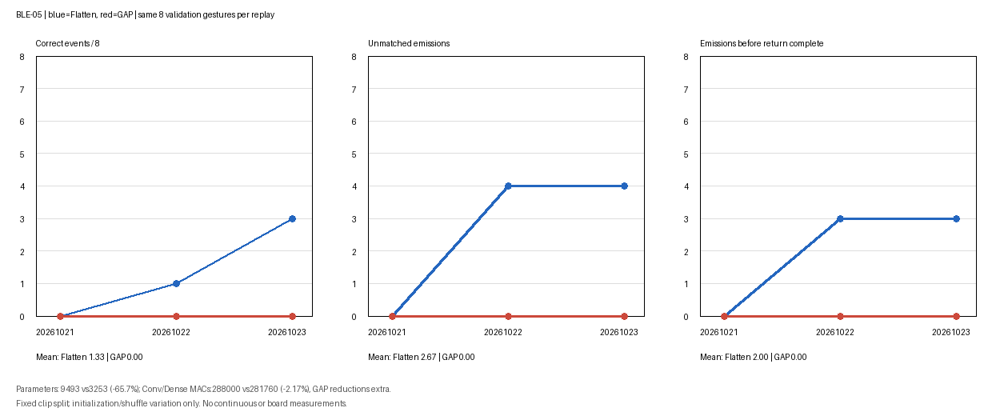

# 실험 5 진행 기록 — Flatten과 GAP 비교

> **2026-10-25:** 코드 동작 확인용 테스트였다. 수치와 결정은 참고용이다([README](README.md) 참고).

- 날짜: 2026-10-21 (한국 시간)
- 상태: 기존 clip의 3 seed×2구조 비교 완료 / GAP 변경 미채택
- 실행 ID: BLE-05-r01~r06
- 기준: [실험 1](실험1_진행기록.md)의 BLE-01-r03, 160행·150 ms 라벨·무증강 모델
- 실험2의 클래스 가중치, 실험3의300 ms 라벨, 실험4의120행 입력은 미채택이므로 적용하지 않았다.
- 연속·최종 평가·보드 추론은 미실행이다. 과거 USB GAP 실험의 수치를 이번 결과로 사용하지 않는다.

## 목적과 고정 조건

Flatten 대신 시간 평균인 GlobalAveragePooling1D를 쓰면 모델을 줄이면서 복귀 후 방향 명령 성능을 유지할 수 있는지 확인한다. 읽기 방식과 모델 용량이 동시에 바뀌므로 시간 위치 정보 하나의 효과로 단정하지 않는다.

[프로토콜](results/BLE-05/protocol.json)을 11:14:22 KST에 저장한 뒤 학습했다. seed20261021/20261022/20261023으로 같은 조건을 세 쌍 비교했다.

| 항목 | 두 구조의 공통 설정 |
|---|---|
| 입력 | 100 Hz 6축,160행,50 ms마다 판정, 첫 판정1590 ms |
| 원본 분할 | 훈련29/검증10/최종 평가 보류22/제외5개 그대로 |
| 실제 입력 배열 | 실험1 저장 훈련144창·검증570창과 정답 그대로 |
| 훈련 클래스 수 | NONE72/UP14/DOWN19/LEFT21/RIGHT18 |
| 검증 클래스 수 | NONE550/UP4/DOWN6/LEFT4/RIGHT6 |
| 정규화·라벨 | 훈련 원본 고정 계수, 자연 복귀 완료e~e+150 ms만 방향 |
| CNN 앞부분 | Conv16,k5→Pool2→Dropout .2→Conv32,k5→Pool2 |
| 학습 | Adam .001, batch16, 최대100epoch, 증강·class weight 없음 |
| 조기 종료 | 같은 전체 검증 val_loss 최저, patience12, 최저 가중치 복원 |
| 발행 | 점수 .8/margin .2/같은 방향2회, 확실한 NONE2회 재무장 |
| 성공 | e~e+500 ms 이내 같은 방향 일대일 매칭, e 이전 발행은 조기 오류 |

**바꾼 요인은 읽기 레이어다.** Pool2 뒤40×32 특징에 Flatten 또는 GAP를 적용하고, 그 뒤는 동일하게 Dropout .3→Dense5 softmax를 연결했다. 중간 Dense 은닉층은 추가하지 않았다.

같은 seed 쌍의 convolution 초기 가중치가 일치함을 확인했다. Dense의 입력 크기는1280/32로 달라 전체 초기 가중치를 동일하게 맞출 수 없다. 비율이 같은 Dropout .3도 실제 비활성화할 특징 수가 달라지는 점을 함께 기록한다.

사전 채택 기준은 각 seed에서 정검출이 감소하지 않고 미매칭·조기 발행이 늘지 않으면서 파라미터가 줄어드는 경우에만 개발 후보로 유지하는 것이었다. 최종 배포 채택 기준은 아니다.

## 구조와 자원 규모

| 항목 | Flatten | GAP |
|---|---:|---:|
| 읽기 전 특징 | 40×32 | 40×32 |
| 읽기 후 특징 | 1280 | 32 |
| 출력 Dense 파라미터 | 6,405 | 165 |
| 전체 파라미터 | 9,493 | 3,253 |
| float32 파라미터 값 | 37,972 bytes | 13,012 bytes |
| 입력 float32 버퍼 | 3,840 bytes | 3,840 bytes |
| Conv/Dense MAC/판정 | 288,000 | 281,760 |

전체 파라미터는 약65.7% 감소하지만 convolution은 같아서 Conv/Dense MAC 감소는 약2.17%다. GAP 자체의40시점×32채널 평균에는 추가로 덧셈1,248회와 스케일/나눗셈32회가 필요하며 위 MAC 표에는 포함하지 않았다. 다른 activation/pooling/메모리 접근 비용도 별도다.

모델 파라미터와 레이어 크기는 실제 생성 모델에서 확인했고 MAC는 수식 계산이다. 전체 peak RAM·Flash·보드 실행 시간·전력은 측정하지 않았다. 파라미터 감소율을 실제 실행 속도나 전체 RAM 감소율로 해석하지 않는다.

## 결과

매번 같은 검증 방향8동작과 배경20초를 독립 clip으로 재생했다. 체크포인트는 각 실행의 val_loss 최저로 복원했다.

| 실행 | 구조 | seed | 종료/선택 epoch | 최저 val_loss | 창 정확도 | macro F1 | 정검출/8 | 미매칭 발행 |
|---|---|---|---|---:|---:|---:|---:|---:|
| r01 | Flatten | 20261021 | 13/1 | 0.40067 | 92.11% | 0.2362 | 0 | 0 |
| r02 | GAP | 20261021 | 13/1 | 0.86042 | 66.84% | 0.1603 | 0 | 0 |
| r03 | Flatten | 20261022 | 20/8 | 0.44506 | 84.39% | 0.3305 | 1 | 4 |
| r04 | GAP | 20261022 | 13/1 | 0.84818 | 65.44% | 0.1582 | 0 | 0 |
| r05 | Flatten | 20261023 | 19/7 | 0.48055 | 86.32% | 0.3373 | 3 | 4 |
| r06 | GAP | 20261023 | 15/3 | 0.69673 | 96.49% | 0.1964 | 0 | 0 |

| 3 seed 요약 | Flatten 평균 [최소,최대] | GAP 평균 [최소,최대] |
|---|---:|---:|
| 정검출/8 | 1.33 [0,3] | 0 [0,0] |
| 누락/8 | 6.67 [5,8] | 8 [8,8] |
| 미매칭 발행 | 2.67 [0,4] | 0 [0,0] |
| 조기 발행 | 2.00 [0,3] | 0 [0,0] |
| macro F1 | 0.3013 [0.2362,0.3373] | 0.1716 [0.1582,0.1964] |
| 창 정확도 | 87.60% [84.39,92.11] | 76.26% [65.44,96.49] |

미매칭은 조기·방향 오류·허용 구간 내 중복·500 ms 이후·배경 발행의 합계다. GAP의 세 선택 모델은 명령 자체를 전혀 발행하지 않아 이 수치가0이었다. 오작동 감소의 성공 근거로 보지 않는다.

### GAP의 창 예측과 원본별 실패

- 세 GAP 모델 모두 방향 양성20창을 전부 NONE으로 분류했다. UP/DOWN/LEFT/RIGHT의 창 recall은 모두0, 각 방향 동작2개씩도 모두 누락됐다.
- GAP seed21은`idle.1`의169창을 LEFT로 분류했고 seed22도 같은169창과`raw_right.10`의8창을 LEFT로 분류했다. 다만 현재 발행 조건을 통과하는 명령은 없었다. GAP가 모든 시각을 NONE으로 분류했다고 표현하지 않는다.
- GAP seed23은570창 모두 NONE이었다. 이때 정확도96.49%는 NONE550/전체570과 정확히 같고, 방향 인식 성공은 아니다.
- 방향 양성 구간의 정답 방향 최고 점수는 GAP seed별 약0.218/0.204/0.196이었다. 초기 점수 문턱0.8에 도달하지 못했다. 결과를 보고 문턱을 낮추는 추가 튜닝은 하지 않았다.

### 지연과 관측 시간

GAP는 정검출이 없어 세 실행 모두 지연 median/p95가 **산출 불가(n=0)**다.0 ms로 기록하지 않는다. Flatten은 seed21 n=0, seed22 median/p95 200/200 ms(n=1), seed23 250/457 ms(n=3)였다. 표본이 매우 작고 검출 동작도 달라 속도 우열을 판단할 수 없다.

배경은 매회 같은20초 녹화이며 버퍼 준비를 제외한 판정 구간16.82초에서 모든 실행의 배경 발행이0회였다. 반복 모델 수만큼 관측 시간을 더하지 않는다. GAP 일부 실행의 idle 창 분류 오류와 실제 후처리 발행을 구분한다.

## 결정과 해석의 한계

**GAP 변경은 이번 개발 후보로 채택하지 않는다.** 모델은 작아졌지만 seed22/23에서 정검출이 감소해 사전 기준을 충족하지 못했다. 현재160행·Flatten을 비교 기준으로 유지한다. Flatten 역시0~3/8로 인식이 부족하며 사용 가능한 모델로 확정된 것은 아니다.

GAP는 시간 위치별 특징을 평균내므로 완료 시점과 관련된 위치 단서가 약해졌을 가능성은 있다. 그러나 convolution이 국소 순서 특징을 채널에 표현할 수 있으므로 모든 시간 순서 정보가 반드시 사라졌다고 단정할 수 없다. 읽기 방식·Dense 용량·Dropout에 적용되는 특징 수가 함께 바뀌었고, 현재 학습/검증 선택 절차와 작은 원본 수의 영향도 분리하지 못했다.

이번 결과는 **현재 설정에서 선택된 GAP 체크포인트의 실패**를 재현한 것이다. GAP 전체가 이 태스크에 부적합하거나 다른 학습/선택 절차에서도 항상 실패한다는 증거는 아니다. 과거 USB 실험의 최종 코드 부재 문제를 이번에는 코드·모델·정확한 수치와 반복 실행을 보존하는 방식으로 보완했다.

같은 검증8동작을 세 seed로 반복한 것이며 독립24동작·여러 사용자·새 세션 결과가 아니다. 센서 기반 완료 정답·양성1창 원본·세션 분리의 한계와 실험3의 연속 자료 대기 상태도 유지한다. 최종 평가와 보드 실동작은 확인하지 않았다.

## 검증과 근거

- 기존15개 점검에 기본 Flatten 호환성·GAP 출력 계약 점검2개를 추가해 총17개 테스트 통과.
- 기본`build_model()`은160×6·Flatten·9,493파라미터를 유지한다. GAP의32특징·3,253파라미터·5클래스 유한 출력/합1을 확인했다.
- Flatten 세 실행의 검증 점수570개가 실험2의 같은 seed 제어 조건과 일치했다. 입력·정답·정규화·분할이 바뀌지 않았음을 해시로 대조했다.
- 여섯 저장 모델을 재로딩해 예측 일치, 혼동행렬·이벤트 합계 재집계 일치, 검증 원본10개만 예측 행에 포함됨을 확인했다. 원본66개 SHA-256 불변, 최종 평가 추론 없음.
- Windows CPU / Python3.12.15 / TensorFlow2.21.0 / Keras3.15.1 / NumPy2.5.4. 그림은 번들 Python3.12.14/Pillow12.3.0으로 생성하고 직접 확인했다.

| 근거 | 파일 |
|---|---|
| 고정 조건·해시·자원 수식 | [protocol.json](results/BLE-05/protocol.json) |
| 쌍별 차이·평균·범위·판정 | [summary.json](results/BLE-05/summary.json) |
| seed21 결과 | [Flatten r01](results/BLE-05/BLE-05-r01/results.json), [GAP r02](results/BLE-05/BLE-05-r02/results.json) |
| seed22 결과 | [Flatten r03](results/BLE-05/BLE-05-r03/results.json), [GAP r04](results/BLE-05/BLE-05-r04/results.json) |
| seed23 결과 | [Flatten r05](results/BLE-05/BLE-05-r05/results.json), [GAP r06](results/BLE-05/BLE-05-r06/results.json) |
| 전체 학습 로그 | [training.log](results/BLE-05/training.log) |
| 구현·테스트 | [experiment5.py](../../../ml/experiment5.py), [test_experiment5.py](../../../ml/test_experiment5.py), [모델 정의](../../../ml/model.py) |

각 실행 폴더에 설정·환경·모델 요약·학습 이력·시각별 예측을 보존했다. 모델과 실행 코드 사본은`ml/runs/BLE-05-r01`~`r06`에 있으며 입력 배열은 해시로 고정한`ml/runs/BLE-01-r03/inputs.npz`를 공유했다. 기존 원본·주석·모델을 덮어쓰지 않았다. 이후 증강×깊이 비교는160행·Flatten·150 ms 라벨을 출발점으로 별도 설계한다.

## 재수집 시 반영 (2026-10-25)

이 실험의 원본은 2026-10-23 삭제됐다. 여기서 드러난 데이터 한계를 [재수집 계획](../../archive/TrainingPlan.md#재수집-계획--2026-10-25)에 반영했다. 위 결과와 결정은 그대로 둔다.

- GAP 세 모델 모두 방향 양성 20창을 전부 NONE으로 분류했다. 방향 8동작·양성 20창의 검증으로는 구조 탓인지 데이터 양 탓인지 구분할 수 없었다. → 원본을 늘린 뒤 구조 비교를 다시 할지 판단한다.
- GAP seed21·22가 `idle.1` 169창을 LEFT로 분류했지만 검증 배경이 idle·other 각 1개뿐이라 배경 일반화를 볼 수 없었다. → 자세·동작을 바꾼 idle/other를 세션마다 수집한다.
