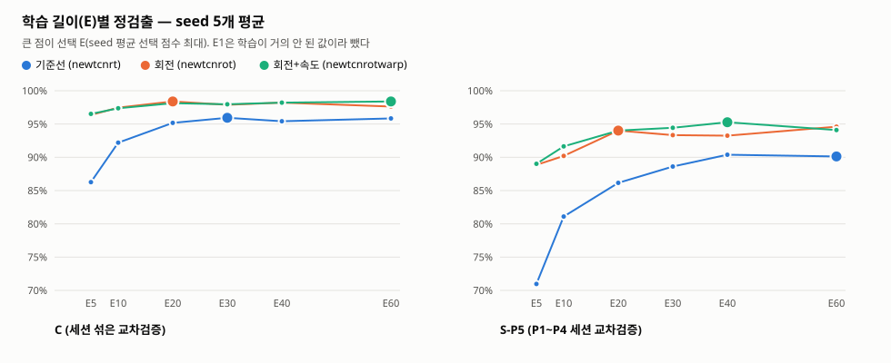

# 새 e(복귀 50% 하강) 라벨 비교 — 2026-10-26

## 질문

기존 e(완전히 멈춘 시점)는 복귀 뒤 작은 떨림까지 기다려 늦게 잡히고, e 앞뒤 50 ms 창이 거의 같아(주축 자이로 변화 중앙값 6.8 dps, 복귀 피크 대비 2%) 모델이 NONE/방향 경계를 구분하기 어렵다고 판단했다. e를 복귀 도중으로 옮기면 나아지는가?

## 바꾼 것과 유지한 것

| 항목 | 기존 | 새 |
|---|---|---|
| e | 99% 에너지 뒤 180 ms 안정 시작(`suggest-gesture-completions.js`) | r: 복귀 피크 뒤 주축 자이로가 피크의 50%로 내려온 첫 시점(`tools/derive-return-labels.js`) |
| 방향 라벨 | e ≤ t < e+150 ms | r ≤ t < r+150 ms. 제외 구간 없음, 나머지 NONE |
| 채점 구간 | [e, e+500 ms] | [복귀 피크, r+500 ms] |

- r의 50 ms 변화 중앙값은 145 dps(피크 대비 49%)로 기존 e보다 경계가 뚜렷하다. r은 복귀 피크보다 중앙값 60 ms 뒤, 기존 e보다 중앙값 270 ms 앞이다. 296개 모두 라벨 창 3개를 확보했다.
- 유지: 데이터(P1~P5, 방향 296·배경 40), 분할 6개(C, S-P1~P5), fold, seed 5개, NONE 1:1 추출, 2층 CNN, 60 epoch·E 후보 7개, 발행 규칙(.8/.2/2회 연속/NONE 2회 재무장), E 선택 규칙.
- 두 라벨 조건(old/new)을 같은 PC에서 모두 학습하고, 각 결과를 두 채점으로 매겼다. 실행기는 `ml/v2_return.py`.

## 재현성

기존 라벨 재학습을 zoon의 V2-*-cal 결과와 비교했다(S-P5 seed 20261021). E1·E5는 같았지만 이후 epoch는 fold마다 정검출이 1~3개 달랐다. 같은 코드·seed라도 CPU별 부동소수점 차이로 보이며, 그래서 비교 기준은 이 PC의 old 재학습이다. 기존 채점의 선택 E 정검출률은 zoon 결과와 거의 같다(C 17.8%, S-P1 12.3%, S-P2 11.4%, S-P3 26.6%(zoon 26.8%), S-P4 9.6%, S-P5 35.9%(zoon 34.4%)).

## 결과 (새 채점, 각 조건의 선택 E, seed 5개 평균 [범위])

| 분할 | old 라벨 | new 라벨 | 배경 오발행/10초 클립 old→new | 지연 중앙값(발행−r) old→new |
|---|---|---|---|---|
| C | E20 93.9% [92–95] | E30 81.6% [79–85] | 0.67→0.35 | 192→40 ms |
| S-P1 | E5 52.3% [45–61] | E20 68.7% [60–76] | 0.34→0.18 | 230→42 ms |
| S-P2 | E5 56.3% [47–67] | E5 71.7% [69–77] | 0.35→0.13 | 224→46 ms |
| S-P3 | E10 55.4% [47–64] | E5 53.6% [52–56] | 0.53→0.16 | 250→52 ms |
| S-P4 | E10 50.7% [41–67] | E20 53.9% [47–59] | 0.57→0.16 | 226→58 ms |
| S-P5 | E5 66.7% [53–72] | E5 72.5% [69–76] | 0.44→0.19 | 232→52 ms |

E를 10·20·60으로 고정해도 방향은 같다: 세션 보류(S)에서는 new가 같거나 높고, C에서는 old가 높다(E20: C 93.9→79.2, S-P1 40.8→68.7).

## 해석

1. **채점 기준의 효과가 가장 크다.** old 라벨 모델을 기존 채점으로 매기면 9.6~35.9%지만, 새 채점으로는 50.7~93.9%다. 기존 모델도 대부분 복귀 피크~r+500 ms 안에서 발행하고 있었고, 낮은 점수의 큰 부분은 e가 늦게 잡힌 탓으로 보인다(영상 확인 없음).
2. **new 라벨은 반응이 빠르고 배경 오발행이 적다.** 발행 지연이 약 180 ms 줄고, 배경 오발행은 모든 분할에서 절반 안팎으로 줄었다.
3. **세션 보류(S)에서는 new가 같거나 낫고, C에서는 old가 낫다.** C는 같은 세션의 클립을 학습·검증에 함께 쓰므로, 처음 보는 자세에 대한 일반화는 S가 더 가깝다. 다만 S-P3·S-P4는 차이가 seed 범위 안이다.
4. **새 문제: 가는 덩어리에서의 반대 방향 발행.** new 라벨은 복귀 피크 전 조기 발행 클립이 늘었다(8.5~24.3%, old 1.1~13.7%). 선택 E 전체에서 가는 피크~끝점 사이 조기 발행이 old 19건 → new 360건이고, 그중 355건이 반대 방향이다. 예: 위 동작의 Y+ 덩어리가 줄어드는 순간을 아래 동작의 복귀(Y+ 덩어리 하강)로 보고 "아래"를 발행한다. 라벨 지점이 "덩어리 하강"이라 앞선 반대 덩어리 유무를 충분히 쓰지 못한 것으로 보인다.

## 한계

- 개발용 교차검증 결과다. 최종 평가 자료는 없고(336개 모두 어느 분할에서든 검증에 쓰였다), 채점 구간과 r은 같은 센서값에서 자동으로 정했으며 영상·사람 확인이 없다.
- 새 채점 구간은 결과를 보기 전에 정했지만, 두 라벨 모두 같은 구간으로 매겼으므로 라벨 비교에는 공정하나 절대 수치는 기존 채점과 비교할 수 없다.
- 배경은 10초 클립 40개뿐이다.

## 다음 후보

- 반대 방향 발행 줄이기: 학습 NONE 추출에서 "가는 덩어리 하강" 창을 따로 묶어 반드시 포함(현재 1:1 추출에서는 in_progress NONE 중 일부만 뽑힌다).
- r 비율(50%)을 30%·70%로 바꿔 비교.

## 파일

- 요약: `summary.json` (패널 = 라벨×분할, 채점별 E마다 seed 지표)
- seed별 결과: `results/<label>-<split>/seed-<seed>.json.gz` (원본은 `ml/runs/return-label-01/results/`, 깃 제외)
- 실행 로그: `logs/`
- 재현: `node tools/derive-return-labels.js` → `ml/.venv/Scripts/python.exe ml/v2_return.py run-all` → `summarize`

## 추가 비교: 끝점 근처 NONE 강제 포함(newhard) — 2026-10-26

- 목적: 가는 덩어리 하강 때의 반대 방향 발행을 줄인다.
- 바꾼 것: new 라벨 그대로, 학습 NONE 추출만 변경. `v2.choose_training`이 고른 in_progress NONE 수(예: S-P5 fold 0에서 134개)는 유지하고 그 절반을 "가는 피크 ~ 복귀 피크"에 끝나는 창(후보 1,227개)에서 클립을 돌아가며 뽑았다. idle·other·post_completion 선택과 NONE 총량은 그대로다.
- 결과(새 채점, 선택 E, seed 평균, new → newhard): C 81.6→73.5%, S-P1 68.7→62.4%, S-P2 71.7→67.7%, S-P3 53.6→49.4%, S-P4 53.9→56.3%, S-P5 72.5→72.8%. 조기 발행 클립은 모든 분할에서 늘었고(예: S-P1 8.5→19.3%), 배경 오발행도 같거나 늘었다.
- 가는 피크~끝점의 반대 방향 조기 발행은 355→596건(E20 고정 411→617건)으로 오히려 늘었다.
- 해석(결과를 본 뒤의 추정): 뽑힌 끝점 근처 창의 대부분이 "끝점~복귀 피크"(돌아오는 덩어리가 솟는 중)라, 정답(돌아오는 덩어리가 줄어드는 중)과 앞선 덩어리는 같고 마지막 기울기만 다른 대비를 가르쳤다. 이 대비는 "마지막 덩어리의 하강 = 방향"이라는 꼬리 규칙을 강화해, 가는 덩어리 하강에서의 반대 방향 발행을 늘렸을 수 있다. 필요한 대비는 꼬리는 같고 앞선 덩어리 유무가 다른 창(가는 피크~끝점)이다.
- 결정: newhard는 채택하지 않는다. 다음 후보는 어려운 NONE을 "가는 피크~끝점" 창(클립당 중앙값 3개, 전체 1,025개)으로만 좁힌 비교다.
- 파일: `summary-hard.json`(old/new/newhard 전체), `results/newhard-*/seed-*.json.gz`.

## 추가 비교: 끝점 이하 NONE 강제 포함(newpre) — 2026-10-26

- 바꾼 것: newhard와 같은 방식으로, in_progress 몫의 절반을 끝 시각이 끝점 이하인 창(볼록 하나 이하, 296개 클립 전체 2,110개, S-P5 fold 0 후보 1,399개)에서 뽑았다. newhard의 실패 추정(끝점 이후 창이 마지막 기울기만 다른 대비를 가르침)을 피한 조건이다.
- 결과(새 채점, 선택 E, new → newpre): C 81.6→79.3%, S-P1 68.7→59.5%, S-P2 71.7→70.0%, S-P3 53.6→50.9%, S-P4 53.9→51.6%, S-P5 72.5→71.3%. 배경 오발행은 비슷하거나 조금 늘었다.
- 가는 피크~끝점 반대 방향 조기 발행: 선택 E 355→342건, E20 고정 411→438건으로 사실상 그대로다.
- 해석: "볼록 하나로 끝나는 창"을 NONE으로 더 넣어도 혼동이 줄지 않았다. 예시 부족만으로는 설명되지 않고, 모델이 창 앞쪽 덩어리를 활용하지 못하는 쪽(합성곱이 약 0.15초 범위만 보고 두 덩어리 관계를 Flatten 뒤 위치마다 배워야 함)이 더 유력해졌다(추정).
- 결정: 채택하지 않는다. 다음 후보는 창 안 누적 자이로(시작 자세 대비 회전각) 입력 채널 추가, 또는 수용 영역을 넓힌 구조.
- 파일: `summary-pre.json`(old/new/newhard/newpre 전체), `results/newpre-*/seed-*.json.gz`.

## 코드 정리 — 2026-10-26

newhard·newpre는 채택하지 않았으므로 `ml/v2_return.py`에서 해당 코드(NONE 추출 변경, `summarize --out`)를 걷어내고 커밋 `e63b718` 버전으로 되돌렸다. 위 기록과 `summary-hard.json`·`summary-pre.json`·`results/newhard-*`·`results/newpre-*`는 보존한다. 두 조건을 재현하려면 커밋 `699e79b`의 `ml/v2_return.py`를 쓴다.

## 추가 비교: 회전각 입력 채널(newangle) — 2026-10-26

- 문제 정의: 모델이 창 끝의 "볼록 하나가 줄어드는 모양"만 보고 판정해, 창 앞쪽에 반대 부호 볼록이 있었는지를 쓰지 못한다. 그래서 한 방향 동작이 끝점에 다다르는 순간을 반대 방향 동작의 복귀로 착각한다.
- 바꾼 것: new 라벨 그대로, 입력에 회전각 3채널 추가(9채널). 회전각은 클립별 자이로 중앙값을 영점으로 뺀 뒤 창 시작부터 누적(deg/s × 0.01 s)하고 45도로 나눈 값이다. 영점 보정 없이 누적하면 원시 자이로의 약 10 dps 치우침으로 1.6초에 약 16도가 쌓여 구분이 흐려졌다. 모델은 같은 구조에 첫 Conv 입력 채널만 늘어 9,733 파라미터다(기존 9,493). `model.py`·`v2.py`는 바꾸지 않았다.
- 입력 확인(주축 회전각 중앙값, 끝점 / r+150 ms): 위 +50.8° / −4.0°, 아래 −63.7° / +0.2°, 왼쪽 +31.3° / −0.7°, 오른쪽 −22.6° / +4.0°. 헷갈리던 두 상황이 20~60° 대 0° 근처로 갈린다.
- 결과(새 채점, 선택 E, seed 평균 [범위], new → newangle): C 81.6 [79–85] → 91.7% [90–93], S-P1 68.7 [60–76] → 75.0% [59–82], S-P2 71.7 [69–77] → 75.3% [65–81], S-P3 53.6 [52–56] → 62.8% [59–66], S-P4 53.9 [47–59] → 59.7% [52–63], S-P5 72.5 [69–76] → 73.5% [62–81].
- E 고정에서도 같은 방향이다(E20: C 79.2→83.9, S-P2 65.0→75.8, S-P3 53.9→61.6, S-P4 53.9→58.7, S-P5 66.5→66.0 / E60: S-P1 46.3→62.3, S-P2 51.3→75.3, S-P5 54.0→70.5). 배경 오발행은 E 고정 비교에서 같거나 줄었다(E20 0.14~0.29 vs 0.16~0.37). 선택 E 비교의 S-P1·S-P2 배경 증가(0.18→0.22, 0.13→0.23)는 선택 E가 달라진 영향이 섞였다.
- 가는 피크~끝점 반대 방향 조기 발행: 선택 E 355→221건(−38%), E20 고정 411→297건. 끝점~복귀 피크 반대 방향도 365→253건.
- 발행 지연(발행−r) 중앙값은 38~58 ms로 new와 비슷하다.
- 해석: 혼동의 일부는 "앞선 덩어리 정보를 모델이 꺼내 쓰지 못함"에서 왔고, 그 정보를 창 끝 값으로 직접 주면 줄어든다는 가설과 맞는다. 다만 반대 방향 조기 발행이 여전히 수백 건 남아 완전히 해결되지는 않았다.
- 한계: 영점을 클립 전체 중앙값으로 잡아 비인과적이다. 실시간에는 정지 구간에서 갱신하는 영점 추정으로 바꿔 다시 확인해야 한다. 개발용 교차검증이며 독립 최종 평가는 없다.
- 파일: `summary-angle.json`(old/new/newangle), `results/newangle-*/seed-*.json.gz`. 실행기 `ml/v2_return.py`의 `newangle` 조건.

## 추가 비교: TCN(newtcn) — 2026-10-27

- 바꾼 것: newangle과 같은 입력(회전각 포함 9채널)·라벨·NONE 추출·학습 설정에서 모델만 TCN으로 바꿨다. `model.build_tcn`: 인과 팽창 합성곱, 커널 3, dilation 1·2·4·8·16·49(수용 영역 161샘플로 160샘플 창을 덮음), 16채널, 블록당 합성곱 1개(ReLU, 드롭아웃 0.1) + 잔차 덧셈(첫 블록은 1×1로 채널 맞춤), 정규화 없음, 마지막 시점 16특징 → Dense(5). 4,613 파라미터(newangle CNN 9,733).
- 사전 확인: 구조 테스트(`ml/test_tcn.py`: 인과성, 창 맨 앞 샘플이 판정에 닿음, 127샘플 구성은 0~32번이 닿지 않음, 크기), 같은 seed 두 번 학습 점수 차이 0.0, fold당 학습 65~75초(CNN 약 3배).
- 사전에 정한 비교 기준: 1순위 가는 피크~끝점 반대 방향 조기 발행(newangle 221건), 2순위 S 분할 정검출률, 함께 배경 오발행·무발행·지연.
- 결과(새 채점, 선택 E, seed 평균 [범위], newangle → newtcn): C 91.7 [90–93] → 98.0% [98–98], S-P1 75.0 [59–82] → 73.0% [62–86], S-P2 75.3 [65–81] → 84.7% [79–90], S-P3 62.8 [59–66] → 71.8% [68–76], S-P4 59.7 [52–63] → 65.3% [62–69], S-P5 73.5 [62–81] → 85.5% [82–88]. TCN은 모든 분할에서 E60이 선택됐다.
- E60 고정에서는 6개 분할 모두 상승(S-P1 62.3→73.0, S-P5 70.5→85.5 등). E10·E20에서도 S-P1을 빼면 같거나 상승.
- 1순위 지표: 가는 피크~끝점 반대 방향 조기 발행은 선택 E 221→248건, E20 고정 297→510건으로 줄지 않았다. 끝점~복귀 피크 반대 방향은 253→144건으로 줄었다.
- 조기 발행 클립 비율은 6개 중 5개 분할에서 감소(예: C 14.2→7.7%, S-P1 13.1→4.7%). 무발행은 S-P1(14.5→25.0%)을 빼면 감소. 배경 오발행은 분할마다 엇갈린다(S-P1 0.22→0.09, S-P4 0.14→0.24/10초 클립). 발행 지연 중앙값 38~58 → 54~62 ms.
- 해석: TCN은 전체 정검출률을 일관되게 올렸지만, 겨냥한 "가는 볼록 하강에서의 반대 방향 발행"은 줄이지 못했다. 이 혼동은 구조(수용 영역)만으로는 해결되지 않는 것으로 보인다(추정). 정검출 향상은 무발행·복귀 중 반대 발행 감소에서 주로 왔다.
- 한계: 회전각 영점이 클립 중앙값(비인과). 개발용 교차검증. 배경 10초 클립 40개.
- 파일: `summary-tcn.json`(old/new/newangle/newtcn), `results/newtcn-*/seed-*.json.gz`.

## 가리기 측정과 TCN + 끝점 근처 NONE(newtcnhard) — 2026-10-27

- 가리기 측정(`ml/runs/figures/occlusion.py`, 깃 제외): newtcn S-P2 seed 20261021을 다시 학습(저장 점수와 차이 0)하고, 반대 방향이 발행된 창 3개(P5 `raw_left.2` 2040 ms, P4 `raw_down.15` 2340 ms, P5 `raw_right.10` 1890 ms, 반대 점수 0.90~0.99)에서 구간(10샘플)·채널 묶음을 0으로 바꿨다. 세 창 모두 반대 판정은 창 끝 100~200 ms 전 가는 피크 부근 0.1초의 자이로에서 나왔다(그 구간만 가려도 반대 점수가 거의 사라짐). 앞쪽 정지·동작 시작 구간은 영향이 없고, 회전각 채널 전체를 가려도 반대 점수 변화는 0.02~0.10이었다. 모델은 "최근 0.1~0.2초의 큰 피크 하나"로 판정하고 먼 문맥과 회전각을 쓰지 않는다.
- 구조 분석: 마지막 시점에서 각 과거 샘플까지의 경로 수는 합성곱만이면 거의 균일(샘플당 4~5개)하지만, 잔차 연결이 있으면 가까운 0~40샘플이 평균 약 40개, 120샘플보다 먼 곳은 약 12개로 최근 쪽에 몰린다. 학습 초기의 최근 편향 근거이며, 학습된 의존도는 위 측정으로 확인했다.
- 분할: 이번 비교부터 C, S-P2, S-P5만 쓴다(사용자 결정).
- newtcnhard: newtcn과 같고 학습 NONE만 바꿨다. `v2.choose_training`이 고른 in_progress NONE 수를 유지하고 그 절반을 "가는 피크~끝점"에 끝나는 창에서 뽑았다(S-P5 fold 0: 이 구간 창 41 → 67개, 후보 643개, 다른 NONE 선택은 동일). 구현은 `v2.fold_sets(none_fn=...)`와 `v2_return.outbound_none_chooser`.
- 새 지표 `clean_success_rate`: 정답 발행이 있고 클립 안의 모든 발행이 같은 방향인 비율(반대 명령 뒤 정답이 나온 경우 제외).
- 결과(새 채점, 선택 E, newtcn → newtcnhard): 정검출률 C 98.0→96.4%, S-P2 84.7→82.7%, S-P5 85.5→85.7%. 깨끗한 성공률 C 91.0→84.7%, S-P2 75.8→76.9%, S-P5 80.2→79.5%. 배경 오발행 0.37→0.38, 0.21→0.18, 0.15→0.14.
- 가는 피크~끝점 반대 방향 조기 발행(세 분할 합계): 선택 E 151→187건, E20 297→273건, E60 151→203건. 줄지 않았다. 채택하지 않는다.
- 해석(추정): 추가 분량이 작았고(1,074개 학습 창 중 26개 변경), 회전각 채널은 45도로만 나눠 값이 1 안팎이라 수 단위인 정규화 자이로보다 영향력이 약해 무시되기 쉽다.
- 실행 메모: 실행 중 PC 절전으로 진행 중이던 7개 작업의 fold 하나가 약 9,080초로 기록됐다. 결과(결정적 학습)에는 영향이 없다.
- 파일: `summary-tcnhard.json`, `results/newtcnhard-*/seed-*.json.gz`.

## 회전각 채널 정규화(newtcnnorm) — 2026-10-27

- 문제: 다른 6채널은 학습 원본의 축별 평균·표준편차로 정규화되는데, 회전각은 45도로만 나눠 학습 창 표준편차가 0.24~0.39로 다른 채널(0.99~1.42)의 3~5분의 1이었다. 가리기 측정에서 모델은 회전각을 거의 쓰지 않았다.
- 바꾼 것: newtcn과 같고, 회전각 3채널을 fold 학습 창(선택된 학습 창)의 축별 평균·표준편차로 정규화해 학습·검증 창 모두에 적용했다(검증 창은 통계에 쓰지 않음). 분할은 C, S-P5만(사용자 결정, 시간 절약).
- 결과(새 채점, 선택 E, seed 평균 [범위], newtcn → newtcnnorm):
  - C: 정검출 98.0 [98–98] → 97.9% [97–99], 깨끗한 성공 91.0 → 95.9%, 조기 발행 클립 7.7 → 2.9%, 배경 오발행 0.37 → 0.25 /10초 클립, 지연 56 → 52 ms
  - S-P5: 정검출 85.5 [82–88] → 92.3% [89–94], 깨끗한 성공 80.2 → 91.1%, 조기 발행 클립 4.9 → 1.9%, 무발행 12.9 → 6.5%, 배경 0.15 → 0.14, 지연 58 → 56 ms
- E 고정에서도 같은 방향이다(E20 깨끗한 성공 C 82.4→95.2, S-P5 72.7→85.5 / E60 C 91.0→96.1, S-P5 80.2→90.5). 배경 오발행은 E20·E60 모두 감소.
- 가는 피크~끝점 반대 방향 조기 발행(두 분할 합계): 선택 E 82 → 21건(−74%), E20 175 → 44건, E60 82 → 19건. 끝점~복귀 피크 반대 방향도 52 → 12건.
- 가리기 비교(`ml/runs/figures/occlusion_compare.py`, S-P5 fold 2, seed 20261021, E60, 두 모델 모두 저장 점수와 차이 0): newtcn이 반대 방향(점수 0.99~1.00)을 낸 창 3개 중 2개는 newtcnnorm에서 NONE 1.00으로 바뀌었다. 남은 1개(`raw_right.11` 1740 ms, 반대 0.91)는 회전각을 가리면 반대 점수가 0.91 줄어, 이제 모델이 회전각을 판정에 쓰고 창 앞쪽 약 0.6초 구간의 회전각까지 본다는 것을 보여준다.
- 해석: 반대 방향 발행의 주된 원인은 모델 구조보다 회전각 채널의 스케일이었다. 정보를 주고도 크기가 작아 학습에서 무시되던 것이, 크기를 맞추자 판정 근거로 쓰였다(가리기 측정으로 확인).
- 한계: 회전각 영점이 클립 중앙값(비인과). 개발용 교차검증, 분할 2개. 실시간 영점 추정에서도 같은 효과인지는 미확인.
- 파일: `summary-tcnnorm.json`, `results/newtcnnorm-*/seed-*.json.gz`.

## 인과적 영점(newtcnrt) — 2026-10-27

- 바꾼 것: newtcnnorm과 같고 회전각 영점만 클립 0~900 ms(동작 신호 1초 전 정지 구간) 자이로 중앙값으로 바꿨다. 첫 판정(1590 ms) 전 데이터만 쓰므로 인과적이며, 실기기에서 동작 전 정지 구간으로 갱신하는 영점 추정에 해당한다. idle/other 클립도 같은 규칙.
- 두 영점 차이(축별 최대): 방향 클립 중앙값 0.56 dps, 상위 10% 2.59 dps, 3 dps 초과 24개(최대 19.2). idle/other는 중앙값 1.82 dps, 3 dps 초과 14개(최대 31.6, 처음부터 움직인 other 클립).
- 결과(새 채점, 선택 E, seed 평균 [범위], newtcnnorm → newtcnrt): C 정검출 97.9 → 97.3% [96–98], 깨끗한 성공 95.9 → 95.6%, 배경 0.25 → 0.25 / S-P5 정검출 92.3 → 91.8% [91–93], 깨끗한 성공 91.1 → 90.0%, 무발행 6.5 → 7.1%, 배경 0.14 → 0.18.
- 가는 피크~끝점 반대 방향 조기 발행: 선택 E 21 → 22건, E20 44 → 38건, E60 19 → 21건.
- E 고정 깨끗한 성공: E20 C 95.2→95.1, S-P5 85.5→86.4 / E60 C 96.1→95.7, S-P5 90.5→90.0.
- 결론: 인과적 영점으로도 회전각 정규화 효과는 거의 그대로 유지된다(차이는 seed 범위 안). newtcnrt(새 e 라벨, 회전각 정규화, 인과 영점, TCN 4,613 파라미터)가 현재 실시간 적용이 가능한 가장 좋은 조건이다.
- 한계: 정지 구간이 동작 직전에 항상 있다고 가정했다(수집 앱의 1초 대기). 연속 사용에서 정지 구간이 짧거나 없을 때의 영점 추정은 미검증. 개발용 교차검증, 분할 2개.
- 파일: `summary-tcnrt.json`, `results/newtcnrt-*/seed-*.json.gz`.

## 영점 오차 내성 — 2026-10-27

- 방법(`ml/runs/figures/bias_robustness.py`, 깃 제외): newtcnrt를 seed 20261021, 선택 E(C E30, S-P5 E40)로 fold별 재학습(C 5 fold, S-P5 4 fold). 학습은 정상 영점(0~900 ms 중앙값) 그대로이고, 검증 창 회전각 계산에만 영점 오차를 넣었다(클립·축마다 ±오차, 무작위 부호).
- 결과(깨끗한 성공률 C / S-P5): 0 dps 96.6 / 88.2%, 2 dps 96.2 / 85.7%, 5 dps 89.0 / 83.5%, 10 dps 74.6 / 63.7%, 20 dps 45.8 / 30.8%. 가는 피크~끝점 반대 발행(C / S-P5): 3/0, 4/0, 8/0, 13/4, 14/12건. 배경 오발행은 오차가 클수록 줄었는데, 발행 자체가 줄어든 결과다.
- 해석: 2 dps까지는 거의 영향이 없고 5 dps부터 떨어지기 시작해 10 dps 이상에서 크게 무너진다. 원시 자이로 치우침(약 10 dps)을 보정하지 않으면 쓸 수 없고, 실기기 영점 추정 오차는 2~3 dps 이내가 목표다.
- 한계: seed 1개, 개발용 교차검증. 실기기 영점 추적의 실제 오차는 미측정.
- 다음 후보: 학습 시 영점에 무작위 오차를 섞어 내성 확대.

## 같은 환경 기준선 재실행(newtcnrt, 태그 hyunj-pc-20261027) — 2026-10-27

- 목적: 증강 비교(계획 `docs/superpowers/plans/2026-10-27-v2-augmentation.md`)의 기준값을 증강을 돌릴 PC에서 만든다. 기존 newtcnrt는 다른 PC에서 나왔다.
- 코드: 단계 0 정리 뒤의 코드(학습 데이터는 정리 전과 13개 fold에서 비트 단위로 같음 확인). 조건은 newtcnrt 그대로, 분할 C·S-P5 × seed 5 = 10회.
- 환경: Windows 11, Intel Core Ultra 5 125H(14코어·18 논리), RAM 15.6 GB, Python 3.12.15, NumPy 2.5.4, TensorFlow 2.21.0, 스레드 1·결정성 연산·oneDNN 끔, `run-all --parallel 2`(여유 메모리가 1.8 GB라 동시 2개). seed 1회 실행 C 354–401초, S-P5 251–307초. epoch당 업데이트 C 71–72, S-P5 67–68.
- 결과(새 채점, seed 5개 평균, 정검출 = `clean_success_rate`):

| 분할 | | 선택 E | 정검출 | success | 무발행 | 조기 발행 클립 | 배경 오발행/클립 | 지연 중앙값 |
|---|---|---|---|---|---|---|---|---|
| C | 기존 PC | E30 | 95.6% [92.8–97.5] | 97.3% | 1.7% | 2.6% | 0.253 | 50 ms |
| C | 이 PC | E60 | 96.0% [94.1–97.5] | 97.9% | 1.2% | 2.6% | 0.240 | 52 ms |
| S-P5 | 기존 PC | E40 | 90.0% [86.9–93.2] | 91.8% | 7.1% | 2.1% | 0.181 | 56 ms |
| S-P5 | 이 PC | E60 | 90.1% [88.6–92.8] | 90.8% | 8.3% | 1.3% | 0.163 | 58 ms |

- S-P5는 P1~P4 세션 교차검증(방향 237개)이며 P5 자세의 성능이 아니다.
- 재현성: 평균 차이는 0.5%p 이내지만, 같은 seed끼리는 PC에 따라 크게 다르다. E60 고정 정검출의 seed별 차이는 C −0.8~+0.8%p, S-P5 −2.5~+5.5%p(seed 20261022: 85.2→90.7%). 선택 E도 C 30→60, S-P5 40→60으로 바뀌었다. 증강 효과로 기대하는 크기와 비슷하므로, 증강 조건은 반드시 이 기준선과 같은 PC·환경에서 비교한다.
- 파일: `summary-base-hyunj-pc-20261027.json`, `results/hyunj-pc-20261027/newtcnrt-*/seed-*.json.gz`, `logs/hyunj-pc-20261027/`. 기존 newtcnrt 로그·결과는 그대로다(`run-all`은 이제 로그가 있으면 시작하지 않고, `--tag`로 폴더를 나눈다).

## 증강 실행 PC 기준선(newtcnrt, 태그 zoon-pc-20261027) — 2026-10-27

- 목적: 증강 비교를 이 PC에서 하기로 해(사용자 결정) 같은 PC·환경의 기준값을 다시 만든다. 위 hyunj-pc 기준선과 다른 PC다.
- 코드: `266b61b`(단계 0 정리·보완 뒤), 조건 newtcnrt 그대로, 분할 C·S-P5 × seed 5 = 10회. 실행 전 ml 테스트 49개 통과.
- 환경: Windows 11, Intel Core i5-13600KF(14코어·20 논리), RAM 31.9 GB, Python 3.12.10, NumPy 2.5.4, TensorFlow 2.21.0, 스레드 1·결정성 연산·oneDNN 끔, `run-all --parallel 3`. seed 1회 실행 C 344–356초, S-P5 249–278초(fold당 55–79초). epoch당 업데이트 C 71–72, S-P5 67–68.
- 문제/해결: 처음 `--parallel 10`으로 시작했을 때 10개 모두 fold 0의 검증 예측에서 메모리 부족(`ResourceExhaustedError`, OOM)으로 실패했다. 실물 메모리 여유는 18.5 GB였지만 커밋 여유가 9.7 GB(전체 33.9 GB)뿐이었다. 결과 파일은 생기지 않았고 OOM 로그 10개만 남아 지운 뒤 `--parallel 3`으로 다시 돌려 실패 0(19분)으로 끝냈다. 증강 조건도 같은 `--parallel 3`으로 돌린다.
- 결과(새 채점, seed 5개 평균, 정검출 = `clean_success_rate`):

| 분할 | 실행 PC | 선택 E | 정검출 | success | 무발행 | 조기 발행 클립 | 배경 오발행/클립 | 지연 중앙값 |
|---|---|---|---|---|---|---|---|---|
| C | 처음 PC | E30 | 95.6% [92.8–97.5] | 97.3% | 1.7% | 2.6% | 0.253 | 50 ms |
| C | hyunj-pc | E60 | 96.0% [94.1–97.5] | 97.9% | 1.2% | 2.6% | 0.240 | 52 ms |
| C | 이 PC | E30 | 95.9% [92.8–97.0] | 97.4% | 1.7% | 2.2% | 0.273 | 50 ms |
| S-P5 | 처음 PC | E40 | 90.0% [86.9–93.2] | 91.8% | 7.1% | 2.1% | 0.181 | 56 ms |
| S-P5 | hyunj-pc | E60 | 90.1% [88.6–92.8] | 90.8% | 8.3% | 1.3% | 0.163 | 58 ms |
| S-P5 | 이 PC | E60 | 90.1% [88.6–92.8] | 90.8% | 8.3% | 1.3% | 0.163 | 58 ms |

- 재현성(관찰): 이 PC와 hyunj-pc는 S-P5의 모든 E·두 채점에서 seed별 집계가 같았다. C는 seed 20261023 하나만 E10부터 달랐고(E60 정검출 0.8%p, 클립 1개) 나머지 4개는 같았다. 이 차이로 선택 E 규칙이 E30과 E60의 아주 작은 점수 차로 갈렸다(이 PC E30 95.9%, E60 95.8%). 처음 PC와는 S-P5 E60 seed별로 −2.5~+5.5%p 다르다. 처음 PC 결과는 단계 0 이전 코드로 만들어졌으므로 차이의 원인을 CPU·라이브러리로 확정하지 않는다.
- S-P5는 P1~P4 세션 교차검증(방향 237개)이며 P5 자세의 성능이 아니다.
- 증강 판정(계획 §3.2)의 기준은 이 PC 값이다: C 정검출 95.9%(E30), S-P5 정검출 90.1%(E60), 배경 오발행 C 0.273·S-P5 0.163건/클립, S-P5 무발행 8.3%.
- 파일: `summary-base-zoon-pc-20261027.json`, `results/zoon-pc-20261027/newtcnrt-*/seed-*.json.gz`, `logs/zoon-pc-20261027/newtcnrt-*`.

## 회전 증강(newtcnrot, 태그 zoon-pc-20261027) — 2026-10-27

- 목적: 계획 §6. 증강이 없는 newtcnrt에 학습 원본 회전 사본만 더해 세션 간 일반화 개발 지표(S-P5 교차검증)가 오르는지 본다.
- 조건: newtcnrt + 학습 원본(방향·배경)마다 회전 사본 2개. R = R_tilt·R_y(θ), θ ~ U(±30°), X-Z 평면 임의 축(방향각 ~ U(0°, 360°)) 둘레 φ ~ U(±15°). acc' = R·acc, gyro' = R(gyro − b) + b(b = 원본 0~890 ms 자이로 축별 중앙값). 회전각 영점은 사본의 0~890 ms에서 다시 잡는다. 난수는 `default_rng([20261027, 클립 경로 해시, 사본 번호])`로 fold와 무관하게 고정. 검증 원본은 변형하지 않는다.
- 코드: `ml/v2_return.py`(`rotate_augmenter` 등), 테스트 `ml/test_v2_rotate.py` 9개(전체 58개 통과).
- 실행: 기준선과 같은 PC·venv·`--parallel 3`, C·S-P5 × seed 5 = 10회, 실패 0, 1,914초. seed 1회 실행 C 576–659초, S-P5 290–485초. 학습 원본 사본 C fold 422–428개, S-P5 402–406개(생략·제외 창 0). epoch당 업데이트 C 211–214(기준 71–72), S-P5 200–202(기준 67–68)로 약 3배.
- 영점 추정기 영향(측정, 판정 아님): 사본에서 다시 잡은 영점과 b의 축 최대 차이 — 방향 사본 592개 중앙값 0.088·p90 0.421·최대 5.181 dps(2 dps 초과 6개), 배경 사본 80개 0.301·2.292·9.186 dps(13개). 창 끝 회전각으로는 1.59배(방향 최대 8.2도).
- 결과(새 채점, seed 5개 평균, 정검출 = `clean_success_rate`, 선택 E):

| 분할 | 조건 | 선택 E | 정검출 | success | 무발행 | 조기 발행 클립 | 배경 오발행/클립 | 지연 중앙값 |
|---|---|---|---|---|---|---|---|---|
| C | newtcnrt | E30 | 95.9% [92.8–97.0] | 97.4% | 1.7% | 2.2% | 0.273 | 50 ms |
| C | newtcnrot | E20 | 98.4% [98.3–98.7] | 98.5% | 0.6% | 1.0% | 0.173 | 60 ms |
| S-P5 | newtcnrt | E60 | 90.1% [88.6–92.8] | 90.8% | 8.3% | 1.3% | 0.163 | 58 ms |
| S-P5 | newtcnrot | E20 | 94.0% [92.8–95.4] | 94.9% | 4.0% | 1.2% | 0.163 | 52 ms |

- seed별 정검출(선택 E, seed 20261021~25): C 기준 97.0·96.2·96.6·97.0·92.8 → 회전 98.3·98.3·98.3·98.3·98.7(5/5 개선). S-P5 기준 88.6·90.7·89.9·92.8·88.6 → 회전 94.1·92.8·95.4·93.2·94.5(같은 seed 차이 +5.5·+2.1·+5.5·+0.4·+5.9%p, 5/5 개선).
- 계획 §3.2 판정(결과 보기 전 고정한 기준): S-P5 정검출 +3.9%p(기준 +1%p 이상)·5/5 개선 — 충족. C 정검출 +2.5%p(감소 1%p 이내) — 충족. 배경 오발행 C 0.173 ≤ 0.273, S-P5 0.1625 = 0.1625(기준 평균 이하) — 충족(S-P5는 같은 값). S-P5 무발행 4.0% ≤ 8.3% — 충족. **네 기준을 모두 만족해 채택한다.** 새 기준 조건은 newtcnrot이다.
- 같은 E 비교(판정에 쓰지 않음): E20 C 95.2→98.4%, S-P5 86.2→94.0%. E60 C 95.8→97.6%, S-P5 90.1→94.6%. 같은 E에서도 모든 E(10·20·30·60)에서 S-P5는 5/5 seed 개선.
- 업데이트 수가 비슷한 지점 비교(판정에 쓰지 않음): 회전 E10 대 기준 E30 — C 97.5 대 95.9%, S-P5 90.2 대 88.6%. 회전 E20 대 기준 E60 — C 98.4 대 95.8%, S-P5 94.0 대 90.1%. 업데이트를 맞춰도 회전 쪽이 높아, 효과가 학습량 증가만으로 설명되지는 않는다(원본 반복 대조는 하지 않았다).
- 반대 방향 조기 발행(두 분할·seed 5개 합계): 가는 피크~끝점 선택 E 16→6건, E20 42→6건, E60 24→2건. 끝점~복귀 피크 선택 E 6→3건, E20 13→3건, E60 6→10건.
- 대가: C 지연 중앙값 50→60 ms(S-P5는 58→52 ms). 다른 방향 발행(`wrong_direction`, seed 합) S-P5 4→10건, C 2→0건.
- 한계: 개발용 교차검증·분할 2개, 독립 최종 평가 없음. 회전 범위는 같은 5개 세션에서 측정한 축 차이로 정했고, 증강 난수가 고정이라 seed 범위에 증강 표본 변동은 들어 있지 않다. 새 사람·새 날짜·연속 사용·중력 방향이 크게 다른 착용은 대신하지 않는다. S-P5는 P1~P4 세션 교차검증이다.
- 파일: `summary-aug-rot.json`(newtcnrt·newtcnrot 둘 다, 태그 zoon-pc-20261027), `results/zoon-pc-20261027/newtcnrot-*/seed-*.json.gz`, `logs/zoon-pc-20261027/newtcnrot-*`.
- 다음(계획): 단계 2 속도 증강은 §7.3 점검(경계 불연속·동작 구간 잘림·NONE 구성·반응 시간)을 통과해야 실행한다. 계획은 newtcnrt 기준으로 따로 비교하게 돼 있으나 회전이 채택돼 기준이 바뀌었으므로, 속도 비교의 기준을 newtcnrt로 둘지 newtcnrot로 둘지 실행 전에 정한다.

## 회전 + 속도 증강(newtcnrotwarp, 태그 zoon-pc-20261027) — 2026-10-27

- 목적: 계획 §7(3차 개정). 채택된 newtcnrot의 회전 사본에 속도 변형을 더해, **회전에 속도를 더한 효과**를 본다. 속도 단독 효과와 두 증강의 상호작용은 분리하지 않는다.
- 조건: newtcnrot과 같은 회전 사본(같은 R·같은 사본 이름 `#rot1`·`#rot2`)에 s ~ 로그 균등(0.8, 1.25), 890 ms 고정점 속도 변형. 0~890 ms(영점 구간 90행)는 그대로, 900 ms부터 원본 시각 890 + (t − 890)/s 값을 보간하고 자이로는 영점을 뺀 뒤 1/s배, 라벨 r′ = 890 + s(r − 890). 배경·동작 시작 < 900 ms·양성 창 수가 줄어드는 사본·경계 점프 > 2 dps 사본은 회전만(newtcnrot 사본 그대로).
- 코드: `d1dcb1f`(`ml/v2_return.py` `rotate_warp_augmenter`), 테스트 `ml/test_v2_rotwarp.py` 14개. 학습 전 점검 `diagnostics/rotwarp-preflight-01`·`-02`: 9개 fold 모두 선택 양성·NONE 창 수, NONE 구성, epoch당 업데이트가 newtcnrot과 같고, 속도 적용 사본 536개(회전만: 배경 80·동작 시작 < 900 ms 46·경계 점프 초과 10)의 양성 창 1,608개 모두 보존, 경계 점프 최대 1.974 dps.
- 실행: 같은 PC·venv·`--parallel 3`, 10회 실패 0, 2,632초(seed 1회 C 740–799초, S-P5 616–630초. newtcnrot보다 길다). 결과 JSON의 epoch당 업데이트(C 211–214, S-P5 200–202)와 fold별 사본 처리 결과가 학습 전 점검과 같다.

| 분할 | 조건 | 선택 E | 정검출 | seed별 정검출 | 무발행 | 배경 오발행/클립 |
|---|---|---|---|---|---|---|
| C | newtcnrot | E20 | 98.39% | 98.3·98.3·98.3·98.3·98.7 | 0.6% | 0.173 |
| C | newtcnrotwarp | E60 | 98.39% | 98.3·97.9·98.3·99.2·98.3 | 0.7% | 0.247 |
| S-P5 | newtcnrot | E20 | 94.01% | 94.1·92.8·95.4·93.2·94.5 | 4.0% | 0.163 |
| S-P5 | newtcnrotwarp | E40 | 95.27% | 95.8·94.1·96.2·94.1·96.2 | 2.8% | 0.200 |

- 계획 §3.2 판정(기준값은 `summary-aug-rot.json` newtcnrot 반올림 전):

| 기준 | 문턱 | newtcnrotwarp | 결과 |
|---|---|---|---|
| S-P5 정검출 +1%p 이상 | ≥ 0.950084 | 0.952743 | 충족 |
| S-P5 같은 seed 4/5 이상 개선 | 4/5 | 5/5(+1.7·+1.3·+0.8·+0.8·+1.7%p) | 충족 |
| C 정검출 감소 1%p 이내 | ≥ 0.973898 | 0.983898(같음) | 충족 |
| 배경 오발행 C | ≤ 0.173333 | 0.246667 | **미충족** |
| 배경 오발행 S-P5 | ≤ 0.162500 | 0.200000 | **미충족** |
| S-P5 무발행 | ≤ 0.039662 | 0.027848 | 충족 |

- **판정: 미채택.** S-P5 정검출은 문턱을 넘었지만 배경 오발행이 두 분할 모두 늘었다(C +42%, S-P5 +23%). 기준 조건은 newtcnrot으로 유지한다.

- 보조 지표(선택 E, 판정에 쓰지 않음): 무발행 S-P5 4.0 → 2.8%, 반대 방향 조기 발행(가는 피크~끝점, seed 합) C 2 → 0·S-P5 4 → 1건, 다른 방향 발행(seed 합) S-P5 10 → 6·C 0 → 1건, 지연 중앙값 C 60 → 60·S-P5 52 → 56 ms, 조기 발행 클립 C 1.0 → 0.8%·S-P5 1.2 → 1.4%. 배경 오발행만 뚜렷하게 나빠졌다.

- E 의존성(판정에 쓰지 않음): 선택 E가 newtcnrot(E20)보다 길다(C E60, S-P5 E40). 같은 E20에서는 S-P5 94.0 대 94.0%(같은 seed 3/5 개선), C 98.1 대 98.4%다. S-P5의 정검출 이득은 E 선택에 기대는 부분이 있다. 배경 오발행은 E20에서도 C 0.233 대 0.173, S-P5 0.181 대 0.163으로 회전+속도 쪽이 높다.
- 한계: 개발용 교차검증·분할 2개, 독립 최종 평가 없음. 속도 범위·회전 범위 모두 같은 5개 세션에서 정했고, 증강 난수 고정이라 seed 범위에 증강 표본 변동이 없다. 배경 오발행 기준이 평균 이하라 작은 증가도 미채택이 된다(결과 보기 전 고정한 기준).
- 파일: `summary-aug-rotwarp.json`(세 조건, 태그 zoon-pc-20261027), `results/zoon-pc-20261027/newtcnrotwarp-*/seed-*.json.gz`, `logs/zoon-pc-20261027/newtcnrotwarp-*`, 그림 `figures/aug-*.svg`(`tools/plot-return-label-aux.py`로 생성).
