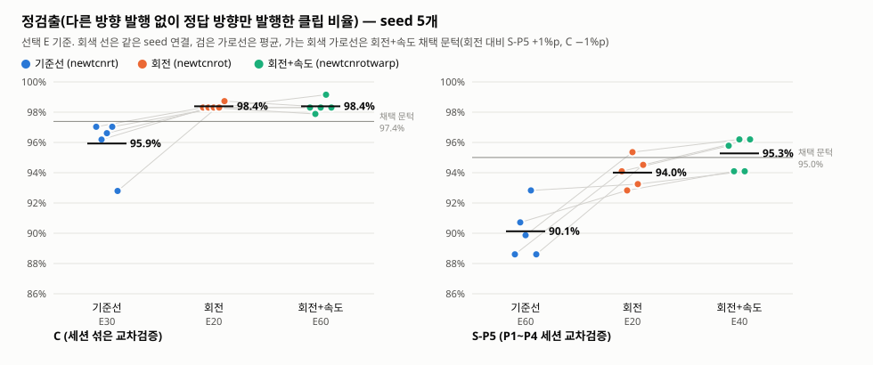
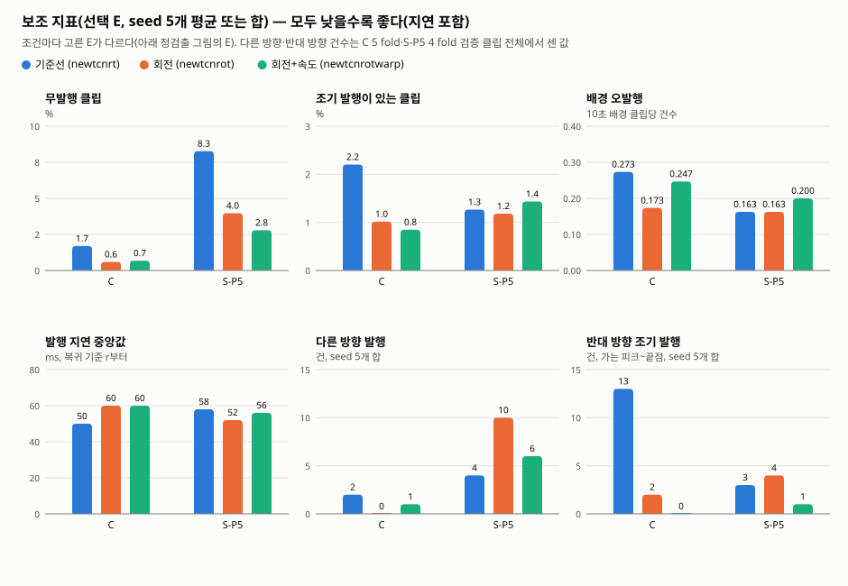

# 새 e(복귀 50% 하강) 라벨 비교 — 2026-10-26

## 질문

기존 e(완전히 멈춘 시점)는 복귀 뒤 작은 떨림까지 기다려 늦게 잡히고, e 앞뒤 50 ms 창이 거의 같아(주축 자이로 변화 중앙값 6.8 dps, 복귀 피크 대비 2%) 모델이 NONE/방향 경계를 구분하기 어렵다고 판단했다. e를 복귀 도중으로 옮기면 나아지는가?

## 바꾼 것과 유지한 것

| 항목 | 기존 | 새 |
|---|---|---|
| e | 99% 에너지 뒤 180 ms 안정 시작(`suggest-gesture-completions.js`) | r: 복귀 피크 뒤 주축 자이로가 피크의 50%로 내려온 첫 시점(`tools/derive-return-labels.js`) |
| 방향 라벨 | e ≤ t < e+150 ms | r ≤ t < r+150 ms. 제외 구간 없음, 나머지 NONE |
| 채점 구간 | [e, e+500 ms] | [복귀 피크, r+500 ms] |

- r의 50 ms 변화 중앙값은 145 dps(피크 대비 49%)로 기존 e보다 경계가 뚜렷하다. r은 복귀 피크보다 중앙값 60 ms 뒤, 기존 e보다 중앙값 270 ms 앞이다. 296개 모두 라벨 창 3개를 확보했다.
- 유지: 데이터(P1~P5, 방향 296·배경 40), 분할 6개(C, S-P1~P5), fold, seed 5개, NONE 1:1 추출, 2층 CNN, 60 epoch·E 후보 7개, 발행 규칙(.8/.2/2회 연속/NONE 2회 재무장), E 선택 규칙.
- 두 라벨 조건(old/new)을 같은 PC에서 모두 학습하고, 각 결과를 두 채점으로 매겼다. 실행기는 `ml/v2_return.py`.

## 재현성

기존 라벨 재학습을 zoon의 V2-*-cal 결과와 비교했다(S-P5 seed 20261021). E1·E5는 같았지만 이후 epoch는 fold마다 정검출이 1~3개 달랐다. 같은 코드·seed라도 CPU별 부동소수점 차이로 보이며, 그래서 비교 기준은 이 PC의 old 재학습이다. 기존 채점의 선택 E 정검출률은 zoon 결과와 거의 같다(C 17.8%, S-P1 12.3%, S-P2 11.4%, S-P3 26.6%(zoon 26.8%), S-P4 9.6%, S-P5 35.9%(zoon 34.4%)).

## 실행 PC 이름 — 2026-10-29 정리

아래 절들의 "이 PC"는 그 절을 쓴 PC를 가리켜 서로 다르다. 어느 PC에서 돌렸는지는 tag와 결과 JSON의 `env`(venv 경로·CPU)로 판단한다. 2026-10-29부터 아래 이름으로 적는다.

| 이름 | 작업 폴더(venv) | CPU(`env.cpu`) / 논리 코어 | 이 PC에서 나온 tag |
|---|---|---|---|
| **zoon_computer** | `C:\Users\zoonc\Desktop\RingPilot` | Intel64 Family 6 Model 183(Core i5-13600KF) / 20, RAM 31.9 GiB | `zoon-pc-20261027`, `noacc-zoon-pc-20261029` |
| user 경로 PC | `C:\Users\user\Desktop\prj\watch` | AMD64 Family 25 Model 117 / 16 | `base334-20261028`, `curated320-20261028`, `soft-20261029`, `rotations-20261029`, `noacc-20261029` |
| hyunj 경로 PC | `C:\Users\hyunj\Desktop\프로젝트\RingPilot` | Intel64 Family 6 Model 170 / 18 | `hyunj-pc-20261027` |

- tag가 없는 초기 결과(`results/<조건>-<분할>/`)에는 `env`가 없어 PC를 확인할 수 없다.
- 공통 소프트웨어: Python 3.12.10, NumPy 2.5.4, TensorFlow 2.21.0, `TF_ENABLE_ONEDNN_OPTS=0`, `TF_DETERMINISTIC_OPS=1`(zoon_computer·user 경로 PC 결과 JSON 기준).
- zoon_computer에서 새로 돌리는 실행은 tag에 `zoon_computer`를 넣는다(예: `zoon_computer-<내용>-<날짜>`). 2026-10-29 Task 3용 실행 `noacc-zoon-pc-20261029`는 이름을 정하기 전에 시작해 tag를 바꾸지 않았다(결과 JSON 안의 `tag` 값과 폴더 이름이 맞아야 해서).

## 결과 (새 채점, 각 조건의 선택 E, seed 5개 평균 [범위])

| 분할 | old 라벨 | new 라벨 | 배경 오발행/10초 클립 old→new | 지연 중앙값(발행−r) old→new |
|---|---|---|---|---|
| C | E20 93.9% [92–95] | E30 81.6% [79–85] | 0.67→0.35 | 192→40 ms |
| S-P1 | E5 52.3% [45–61] | E20 68.7% [60–76] | 0.34→0.18 | 230→42 ms |
| S-P2 | E5 56.3% [47–67] | E5 71.7% [69–77] | 0.35→0.13 | 224→46 ms |
| S-P3 | E10 55.4% [47–64] | E5 53.6% [52–56] | 0.53→0.16 | 250→52 ms |
| S-P4 | E10 50.7% [41–67] | E20 53.9% [47–59] | 0.57→0.16 | 226→58 ms |
| S-P5 | E5 66.7% [53–72] | E5 72.5% [69–76] | 0.44→0.19 | 232→52 ms |

E를 10·20·60으로 고정해도 방향은 같다: 세션 보류(S)에서는 new가 같거나 높고, C에서는 old가 높다(E20: C 93.9→79.2, S-P1 40.8→68.7).

## 해석

1. **채점 기준의 효과가 가장 크다.** old 라벨 모델을 기존 채점으로 매기면 9.6~35.9%지만, 새 채점으로는 50.7~93.9%다. 기존 모델도 대부분 복귀 피크~r+500 ms 안에서 발행하고 있었고, 낮은 점수의 큰 부분은 e가 늦게 잡힌 탓으로 보인다(영상 확인 없음).
2. **new 라벨은 반응이 빠르고 배경 오발행이 적다.** 발행 지연이 약 180 ms 줄고, 배경 오발행은 모든 분할에서 절반 안팎으로 줄었다.
3. **세션 보류(S)에서는 new가 같거나 낫고, C에서는 old가 낫다.** C는 같은 세션의 클립을 학습·검증에 함께 쓰므로, 처음 보는 자세에 대한 일반화는 S가 더 가깝다. 다만 S-P3·S-P4는 차이가 seed 범위 안이다.
4. **새 문제: 가는 덩어리에서의 반대 방향 발행.** new 라벨은 복귀 피크 전 조기 발행 클립이 늘었다(8.5~24.3%, old 1.1~13.7%). 선택 E 전체에서 가는 피크~끝점 사이 조기 발행이 old 19건 → new 360건이고, 그중 355건이 반대 방향이다. 예: 위 동작의 Y+ 덩어리가 줄어드는 순간을 아래 동작의 복귀(Y+ 덩어리 하강)로 보고 "아래"를 발행한다. 라벨 지점이 "덩어리 하강"이라 앞선 반대 덩어리 유무를 충분히 쓰지 못한 것으로 보인다.

## 한계

- 개발용 교차검증 결과다. 최종 평가 자료는 없고(336개 모두 어느 분할에서든 검증에 쓰였다), 채점 구간과 r은 같은 센서값에서 자동으로 정했으며 영상·사람 확인이 없다.
- 새 채점 구간은 결과를 보기 전에 정했지만, 두 라벨 모두 같은 구간으로 매겼으므로 라벨 비교에는 공정하나 절대 수치는 기존 채점과 비교할 수 없다.
- 배경은 10초 클립 40개뿐이다.

## 다음 후보

- 반대 방향 발행 줄이기: 학습 NONE 추출에서 "가는 덩어리 하강" 창을 따로 묶어 반드시 포함(현재 1:1 추출에서는 in_progress NONE 중 일부만 뽑힌다).
- r 비율(50%)을 30%·70%로 바꿔 비교.

## 파일

- 요약: `summary.json` (패널 = 라벨×분할, 채점별 E마다 seed 지표)
- seed별 결과: `results/<label>-<split>/seed-<seed>.json.gz` (원본은 `ml/runs/return-label-01/results/`, 깃 제외)
- 실행 로그: `logs/`
- 재현: `node tools/derive-return-labels.js` → `ml/.venv/Scripts/python.exe ml/v2_return.py run-all` → `summarize`

## 추가 비교: 끝점 근처 NONE 강제 포함(newhard) — 2026-10-26

- 목적: 가는 덩어리 하강 때의 반대 방향 발행을 줄인다.
- 바꾼 것: new 라벨 그대로, 학습 NONE 추출만 변경. `v2.choose_training`이 고른 in_progress NONE 수(예: S-P5 fold 0에서 134개)는 유지하고 그 절반을 "가는 피크 ~ 복귀 피크"에 끝나는 창(후보 1,227개)에서 클립을 돌아가며 뽑았다. idle·other·post_completion 선택과 NONE 총량은 그대로다.
- 결과(새 채점, 선택 E, seed 평균, new → newhard): C 81.6→73.5%, S-P1 68.7→62.4%, S-P2 71.7→67.7%, S-P3 53.6→49.4%, S-P4 53.9→56.3%, S-P5 72.5→72.8%. 조기 발행 클립은 모든 분할에서 늘었고(예: S-P1 8.5→19.3%), 배경 오발행도 같거나 늘었다.
- 가는 피크~끝점의 반대 방향 조기 발행은 355→596건(E20 고정 411→617건)으로 오히려 늘었다.
- 해석(결과를 본 뒤의 추정): 뽑힌 끝점 근처 창의 대부분이 "끝점~복귀 피크"(돌아오는 덩어리가 솟는 중)라, 정답(돌아오는 덩어리가 줄어드는 중)과 앞선 덩어리는 같고 마지막 기울기만 다른 대비를 가르쳤다. 이 대비는 "마지막 덩어리의 하강 = 방향"이라는 꼬리 규칙을 강화해, 가는 덩어리 하강에서의 반대 방향 발행을 늘렸을 수 있다. 필요한 대비는 꼬리는 같고 앞선 덩어리 유무가 다른 창(가는 피크~끝점)이다.
- 결정: newhard는 채택하지 않는다. 다음 후보는 어려운 NONE을 "가는 피크~끝점" 창(클립당 중앙값 3개, 전체 1,025개)으로만 좁힌 비교다.
- 파일: `summary-hard.json`(old/new/newhard 전체), `results/newhard-*/seed-*.json.gz`.

## 추가 비교: 끝점 이하 NONE 강제 포함(newpre) — 2026-10-26

- 바꾼 것: newhard와 같은 방식으로, in_progress 몫의 절반을 끝 시각이 끝점 이하인 창(볼록 하나 이하, 296개 클립 전체 2,110개, S-P5 fold 0 후보 1,399개)에서 뽑았다. newhard의 실패 추정(끝점 이후 창이 마지막 기울기만 다른 대비를 가르침)을 피한 조건이다.
- 결과(새 채점, 선택 E, new → newpre): C 81.6→79.3%, S-P1 68.7→59.5%, S-P2 71.7→70.0%, S-P3 53.6→50.9%, S-P4 53.9→51.6%, S-P5 72.5→71.3%. 배경 오발행은 비슷하거나 조금 늘었다.
- 가는 피크~끝점 반대 방향 조기 발행: 선택 E 355→342건, E20 고정 411→438건으로 사실상 그대로다.
- 해석: "볼록 하나로 끝나는 창"을 NONE으로 더 넣어도 혼동이 줄지 않았다. 예시 부족만으로는 설명되지 않고, 모델이 창 앞쪽 덩어리를 활용하지 못하는 쪽(합성곱이 약 0.15초 범위만 보고 두 덩어리 관계를 Flatten 뒤 위치마다 배워야 함)이 더 유력해졌다(추정).
- 결정: 채택하지 않는다. 다음 후보는 창 안 누적 자이로(시작 자세 대비 회전각) 입력 채널 추가, 또는 수용 영역을 넓힌 구조.
- 파일: `summary-pre.json`(old/new/newhard/newpre 전체), `results/newpre-*/seed-*.json.gz`.

## 코드 정리 — 2026-10-26

newhard·newpre는 채택하지 않았으므로 `ml/v2_return.py`에서 해당 코드(NONE 추출 변경, `summarize --out`)를 걷어내고 커밋 `e63b718` 버전으로 되돌렸다. 위 기록과 `summary-hard.json`·`summary-pre.json`·`results/newhard-*`·`results/newpre-*`는 보존한다. 두 조건을 재현하려면 커밋 `699e79b`의 `ml/v2_return.py`를 쓴다.

## 추가 비교: 회전각 입력 채널(newangle) — 2026-10-26

- 문제 정의: 모델이 창 끝의 "볼록 하나가 줄어드는 모양"만 보고 판정해, 창 앞쪽에 반대 부호 볼록이 있었는지를 쓰지 못한다. 그래서 한 방향 동작이 끝점에 다다르는 순간을 반대 방향 동작의 복귀로 착각한다.
- 바꾼 것: new 라벨 그대로, 입력에 회전각 3채널 추가(9채널). 회전각은 클립별 자이로 중앙값을 영점으로 뺀 뒤 창 시작부터 누적(deg/s × 0.01 s)하고 45도로 나눈 값이다. 영점 보정 없이 누적하면 원시 자이로의 약 10 dps 치우침으로 1.6초에 약 16도가 쌓여 구분이 흐려졌다. 모델은 같은 구조에 첫 Conv 입력 채널만 늘어 9,733 파라미터다(기존 9,493). `model.py`·`v2.py`는 바꾸지 않았다.
- 입력 확인(주축 회전각 중앙값, 끝점 / r+150 ms): 위 +50.8° / −4.0°, 아래 −63.7° / +0.2°, 왼쪽 +31.3° / −0.7°, 오른쪽 −22.6° / +4.0°. 헷갈리던 두 상황이 20~60° 대 0° 근처로 갈린다.
- 결과(새 채점, 선택 E, seed 평균 [범위], new → newangle): C 81.6 [79–85] → 91.7% [90–93], S-P1 68.7 [60–76] → 75.0% [59–82], S-P2 71.7 [69–77] → 75.3% [65–81], S-P3 53.6 [52–56] → 62.8% [59–66], S-P4 53.9 [47–59] → 59.7% [52–63], S-P5 72.5 [69–76] → 73.5% [62–81].
- E 고정에서도 같은 방향이다(E20: C 79.2→83.9, S-P2 65.0→75.8, S-P3 53.9→61.6, S-P4 53.9→58.7, S-P5 66.5→66.0 / E60: S-P1 46.3→62.3, S-P2 51.3→75.3, S-P5 54.0→70.5). 배경 오발행은 E 고정 비교에서 같거나 줄었다(E20 0.14~0.29 vs 0.16~0.37). 선택 E 비교의 S-P1·S-P2 배경 증가(0.18→0.22, 0.13→0.23)는 선택 E가 달라진 영향이 섞였다.
- 가는 피크~끝점 반대 방향 조기 발행: 선택 E 355→221건(−38%), E20 고정 411→297건. 끝점~복귀 피크 반대 방향도 365→253건.
- 발행 지연(발행−r) 중앙값은 38~58 ms로 new와 비슷하다.
- 해석: 혼동의 일부는 "앞선 덩어리 정보를 모델이 꺼내 쓰지 못함"에서 왔고, 그 정보를 창 끝 값으로 직접 주면 줄어든다는 가설과 맞는다. 다만 반대 방향 조기 발행이 여전히 수백 건 남아 완전히 해결되지는 않았다.
- 한계: 영점을 클립 전체 중앙값으로 잡아 비인과적이다. 실시간에는 정지 구간에서 갱신하는 영점 추정으로 바꿔 다시 확인해야 한다. 개발용 교차검증이며 독립 최종 평가는 없다.
- 파일: `summary-angle.json`(old/new/newangle), `results/newangle-*/seed-*.json.gz`. 실행기 `ml/v2_return.py`의 `newangle` 조건.

## 추가 비교: TCN(newtcn) — 2026-10-27

- 바꾼 것: newangle과 같은 입력(회전각 포함 9채널)·라벨·NONE 추출·학습 설정에서 모델만 TCN으로 바꿨다. `model.build_tcn`: 인과 팽창 합성곱, 커널 3, dilation 1·2·4·8·16·49(수용 영역 161샘플로 160샘플 창을 덮음), 16채널, 블록당 합성곱 1개(ReLU, 드롭아웃 0.1) + 잔차 덧셈(첫 블록은 1×1로 채널 맞춤), 정규화 없음, 마지막 시점 16특징 → Dense(5). 4,613 파라미터(newangle CNN 9,733).
- 사전 확인: 구조 테스트(`ml/test_tcn.py`: 인과성, 창 맨 앞 샘플이 판정에 닿음, 127샘플 구성은 0~32번이 닿지 않음, 크기), 같은 seed 두 번 학습 점수 차이 0.0, fold당 학습 65~75초(CNN 약 3배).
- 사전에 정한 비교 기준: 1순위 가는 피크~끝점 반대 방향 조기 발행(newangle 221건), 2순위 S 분할 정검출률, 함께 배경 오발행·무발행·지연.
- 결과(새 채점, 선택 E, seed 평균 [범위], newangle → newtcn): C 91.7 [90–93] → 98.0% [98–98], S-P1 75.0 [59–82] → 73.0% [62–86], S-P2 75.3 [65–81] → 84.7% [79–90], S-P3 62.8 [59–66] → 71.8% [68–76], S-P4 59.7 [52–63] → 65.3% [62–69], S-P5 73.5 [62–81] → 85.5% [82–88]. TCN은 모든 분할에서 E60이 선택됐다.
- E60 고정에서는 6개 분할 모두 상승(S-P1 62.3→73.0, S-P5 70.5→85.5 등). E10·E20에서도 S-P1을 빼면 같거나 상승.
- 1순위 지표: 가는 피크~끝점 반대 방향 조기 발행은 선택 E 221→248건, E20 고정 297→510건으로 줄지 않았다. 끝점~복귀 피크 반대 방향은 253→144건으로 줄었다.
- 조기 발행 클립 비율은 6개 중 5개 분할에서 감소(예: C 14.2→7.7%, S-P1 13.1→4.7%). 무발행은 S-P1(14.5→25.0%)을 빼면 감소. 배경 오발행은 분할마다 엇갈린다(S-P1 0.22→0.09, S-P4 0.14→0.24/10초 클립). 발행 지연 중앙값 38~58 → 54~62 ms.
- 해석: TCN은 전체 정검출률을 일관되게 올렸지만, 겨냥한 "가는 볼록 하강에서의 반대 방향 발행"은 줄이지 못했다. 이 혼동은 구조(수용 영역)만으로는 해결되지 않는 것으로 보인다(추정). 정검출 향상은 무발행·복귀 중 반대 발행 감소에서 주로 왔다.
- 한계: 회전각 영점이 클립 중앙값(비인과). 개발용 교차검증. 배경 10초 클립 40개.
- 파일: `summary-tcn.json`(old/new/newangle/newtcn), `results/newtcn-*/seed-*.json.gz`.

## 가리기 측정과 TCN + 끝점 근처 NONE(newtcnhard) — 2026-10-27

- 가리기 측정(`ml/runs/figures/occlusion.py`, 깃 제외): newtcn S-P2 seed 20261021을 다시 학습(저장 점수와 차이 0)하고, 반대 방향이 발행된 창 3개(P5 `raw_left.2` 2040 ms, P4 `raw_down.15` 2340 ms, P5 `raw_right.10` 1890 ms, 반대 점수 0.90~0.99)에서 구간(10샘플)·채널 묶음을 0으로 바꿨다. 세 창 모두 반대 판정은 창 끝 100~200 ms 전 가는 피크 부근 0.1초의 자이로에서 나왔다(그 구간만 가려도 반대 점수가 거의 사라짐). 앞쪽 정지·동작 시작 구간은 영향이 없고, 회전각 채널 전체를 가려도 반대 점수 변화는 0.02~0.10이었다. 모델은 "최근 0.1~0.2초의 큰 피크 하나"로 판정하고 먼 문맥과 회전각을 쓰지 않는다.
- 구조 분석: 마지막 시점에서 각 과거 샘플까지의 경로 수는 합성곱만이면 거의 균일(샘플당 4~5개)하지만, 잔차 연결이 있으면 가까운 0~40샘플이 평균 약 40개, 120샘플보다 먼 곳은 약 12개로 최근 쪽에 몰린다. 학습 초기의 최근 편향 근거이며, 학습된 의존도는 위 측정으로 확인했다.
- 분할: 이번 비교부터 C, S-P2, S-P5만 쓴다(사용자 결정).
- newtcnhard: newtcn과 같고 학습 NONE만 바꿨다. `v2.choose_training`이 고른 in_progress NONE 수를 유지하고 그 절반을 "가는 피크~끝점"에 끝나는 창에서 뽑았다(S-P5 fold 0: 이 구간 창 41 → 67개, 후보 643개, 다른 NONE 선택은 동일). 구현은 `v2.fold_sets(none_fn=...)`와 `v2_return.outbound_none_chooser`.
- 새 지표 `clean_success_rate`: 정답 발행이 있고 클립 안의 모든 발행이 같은 방향인 비율(반대 명령 뒤 정답이 나온 경우 제외).
- 결과(새 채점, 선택 E, newtcn → newtcnhard): 정검출률 C 98.0→96.4%, S-P2 84.7→82.7%, S-P5 85.5→85.7%. 깨끗한 성공률 C 91.0→84.7%, S-P2 75.8→76.9%, S-P5 80.2→79.5%. 배경 오발행 0.37→0.38, 0.21→0.18, 0.15→0.14.
- 가는 피크~끝점 반대 방향 조기 발행(세 분할 합계): 선택 E 151→187건, E20 297→273건, E60 151→203건. 줄지 않았다. 채택하지 않는다.
- 해석(추정): 추가 분량이 작았고(1,074개 학습 창 중 26개 변경), 회전각 채널은 45도로만 나눠 값이 1 안팎이라 수 단위인 정규화 자이로보다 영향력이 약해 무시되기 쉽다.
- 실행 메모: 실행 중 PC 절전으로 진행 중이던 7개 작업의 fold 하나가 약 9,080초로 기록됐다. 결과(결정적 학습)에는 영향이 없다.
- 파일: `summary-tcnhard.json`, `results/newtcnhard-*/seed-*.json.gz`.

## 회전각 채널 정규화(newtcnnorm) — 2026-10-27

- 문제: 다른 6채널은 학습 원본의 축별 평균·표준편차로 정규화되는데, 회전각은 45도로만 나눠 학습 창 표준편차가 0.24~0.39로 다른 채널(0.99~1.42)의 3~5분의 1이었다. 가리기 측정에서 모델은 회전각을 거의 쓰지 않았다.
- 바꾼 것: newtcn과 같고, 회전각 3채널을 fold 학습 창(선택된 학습 창)의 축별 평균·표준편차로 정규화해 학습·검증 창 모두에 적용했다(검증 창은 통계에 쓰지 않음). 분할은 C, S-P5만(사용자 결정, 시간 절약).
- 결과(새 채점, 선택 E, seed 평균 [범위], newtcn → newtcnnorm):
  - C: 정검출 98.0 [98–98] → 97.9% [97–99], 깨끗한 성공 91.0 → 95.9%, 조기 발행 클립 7.7 → 2.9%, 배경 오발행 0.37 → 0.25 /10초 클립, 지연 56 → 52 ms
  - S-P5: 정검출 85.5 [82–88] → 92.3% [89–94], 깨끗한 성공 80.2 → 91.1%, 조기 발행 클립 4.9 → 1.9%, 무발행 12.9 → 6.5%, 배경 0.15 → 0.14, 지연 58 → 56 ms
- E 고정에서도 같은 방향이다(E20 깨끗한 성공 C 82.4→95.2, S-P5 72.7→85.5 / E60 C 91.0→96.1, S-P5 80.2→90.5). 배경 오발행은 E20·E60 모두 감소.
- 가는 피크~끝점 반대 방향 조기 발행(두 분할 합계): 선택 E 82 → 21건(−74%), E20 175 → 44건, E60 82 → 19건. 끝점~복귀 피크 반대 방향도 52 → 12건.
- 가리기 비교(`ml/runs/figures/occlusion_compare.py`, S-P5 fold 2, seed 20261021, E60, 두 모델 모두 저장 점수와 차이 0): newtcn이 반대 방향(점수 0.99~1.00)을 낸 창 3개 중 2개는 newtcnnorm에서 NONE 1.00으로 바뀌었다. 남은 1개(`raw_right.11` 1740 ms, 반대 0.91)는 회전각을 가리면 반대 점수가 0.91 줄어, 이제 모델이 회전각을 판정에 쓰고 창 앞쪽 약 0.6초 구간의 회전각까지 본다는 것을 보여준다.
- 해석: 반대 방향 발행의 주된 원인은 모델 구조보다 회전각 채널의 스케일이었다. 정보를 주고도 크기가 작아 학습에서 무시되던 것이, 크기를 맞추자 판정 근거로 쓰였다(가리기 측정으로 확인).
- 한계: 회전각 영점이 클립 중앙값(비인과). 개발용 교차검증, 분할 2개. 실시간 영점 추정에서도 같은 효과인지는 미확인.
- 파일: `summary-tcnnorm.json`, `results/newtcnnorm-*/seed-*.json.gz`.

## 인과적 영점(newtcnrt) — 2026-10-27

- 바꾼 것: newtcnnorm과 같고 회전각 영점만 클립 0~900 ms(동작 신호 1초 전 정지 구간) 자이로 중앙값으로 바꿨다. 첫 판정(1590 ms) 전 데이터만 쓰므로 인과적이며, 실기기에서 동작 전 정지 구간으로 갱신하는 영점 추정에 해당한다. idle/other 클립도 같은 규칙.
- 두 영점 차이(축별 최대): 방향 클립 중앙값 0.56 dps, 상위 10% 2.59 dps, 3 dps 초과 24개(최대 19.2). idle/other는 중앙값 1.82 dps, 3 dps 초과 14개(최대 31.6, 처음부터 움직인 other 클립).
- 결과(새 채점, 선택 E, seed 평균 [범위], newtcnnorm → newtcnrt): C 정검출 97.9 → 97.3% [96–98], 깨끗한 성공 95.9 → 95.6%, 배경 0.25 → 0.25 / S-P5 정검출 92.3 → 91.8% [91–93], 깨끗한 성공 91.1 → 90.0%, 무발행 6.5 → 7.1%, 배경 0.14 → 0.18.
- 가는 피크~끝점 반대 방향 조기 발행: 선택 E 21 → 22건, E20 44 → 38건, E60 19 → 21건.
- E 고정 깨끗한 성공: E20 C 95.2→95.1, S-P5 85.5→86.4 / E60 C 96.1→95.7, S-P5 90.5→90.0.
- 결론: 인과적 영점으로도 회전각 정규화 효과는 거의 그대로 유지된다(차이는 seed 범위 안). newtcnrt(새 e 라벨, 회전각 정규화, 인과 영점, TCN 4,613 파라미터)가 현재 실시간 적용이 가능한 가장 좋은 조건이다.
- 한계: 정지 구간이 동작 직전에 항상 있다고 가정했다(수집 앱의 1초 대기). 연속 사용에서 정지 구간이 짧거나 없을 때의 영점 추정은 미검증. 개발용 교차검증, 분할 2개.
- 파일: `summary-tcnrt.json`, `results/newtcnrt-*/seed-*.json.gz`.

## 영점 오차 내성 — 2026-10-27

- 방법(`ml/runs/figures/bias_robustness.py`, 깃 제외): newtcnrt를 seed 20261021, 선택 E(C E30, S-P5 E40)로 fold별 재학습(C 5 fold, S-P5 4 fold). 학습은 정상 영점(0~900 ms 중앙값) 그대로이고, 검증 창 회전각 계산에만 영점 오차를 넣었다(클립·축마다 ±오차, 무작위 부호).
- 결과(깨끗한 성공률 C / S-P5): 0 dps 96.6 / 88.2%, 2 dps 96.2 / 85.7%, 5 dps 89.0 / 83.5%, 10 dps 74.6 / 63.7%, 20 dps 45.8 / 30.8%. 가는 피크~끝점 반대 발행(C / S-P5): 3/0, 4/0, 8/0, 13/4, 14/12건. 배경 오발행은 오차가 클수록 줄었는데, 발행 자체가 줄어든 결과다.
- 해석: 2 dps까지는 거의 영향이 없고 5 dps부터 떨어지기 시작해 10 dps 이상에서 크게 무너진다. 원시 자이로 치우침(약 10 dps)을 보정하지 않으면 쓸 수 없고, 실기기 영점 추정 오차는 2~3 dps 이내가 목표다.
- 한계: seed 1개, 개발용 교차검증. 실기기 영점 추적의 실제 오차는 미측정.
- 다음 후보: 학습 시 영점에 무작위 오차를 섞어 내성 확대.

## 같은 환경 기준선 재실행(newtcnrt, 태그 hyunj-pc-20261027) — 2026-10-27

- 목적: 증강 비교(계획 `docs/superpowers/plans/2026-10-27-v2-augmentation.md`)의 기준값을 증강을 돌릴 PC에서 만든다. 기존 newtcnrt는 다른 PC에서 나왔다.
- 코드: 단계 0 정리 뒤의 코드(학습 데이터는 정리 전과 13개 fold에서 비트 단위로 같음 확인). 조건은 newtcnrt 그대로, 분할 C·S-P5 × seed 5 = 10회.
- 환경: Windows 11, Intel Core Ultra 5 125H(14코어·18 논리), RAM 15.6 GB, Python 3.12.15, NumPy 2.5.4, TensorFlow 2.21.0, 스레드 1·결정성 연산·oneDNN 끔, `run-all --parallel 2`(여유 메모리가 1.8 GB라 동시 2개). seed 1회 실행 C 354–401초, S-P5 251–307초. epoch당 업데이트 C 71–72, S-P5 67–68.
- 결과(새 채점, seed 5개 평균, 정검출 = `clean_success_rate`):

| 분할 | | 선택 E | 정검출 | success | 무발행 | 조기 발행 클립 | 배경 오발행/클립 | 지연 중앙값 |
|---|---|---|---|---|---|---|---|---|
| C | 기존 PC | E30 | 95.6% [92.8–97.5] | 97.3% | 1.7% | 2.6% | 0.253 | 50 ms |
| C | 이 PC | E60 | 96.0% [94.1–97.5] | 97.9% | 1.2% | 2.6% | 0.240 | 52 ms |
| S-P5 | 기존 PC | E40 | 90.0% [86.9–93.2] | 91.8% | 7.1% | 2.1% | 0.181 | 56 ms |
| S-P5 | 이 PC | E60 | 90.1% [88.6–92.8] | 90.8% | 8.3% | 1.3% | 0.163 | 58 ms |

- S-P5는 P1~P4 세션 교차검증(방향 237개)이며 P5 자세의 성능이 아니다.
- 재현성: 평균 차이는 0.5%p 이내지만, 같은 seed끼리는 PC에 따라 크게 다르다. E60 고정 정검출의 seed별 차이는 C −0.8~+0.8%p, S-P5 −2.5~+5.5%p(seed 20261022: 85.2→90.7%). 선택 E도 C 30→60, S-P5 40→60으로 바뀌었다. 증강 효과로 기대하는 크기와 비슷하므로, 증강 조건은 반드시 이 기준선과 같은 PC·환경에서 비교한다.
- 파일: `summary-base-hyunj-pc-20261027.json`, `results/hyunj-pc-20261027/newtcnrt-*/seed-*.json.gz`, `logs/hyunj-pc-20261027/`. 기존 newtcnrt 로그·결과는 그대로다(`run-all`은 이제 로그가 있으면 시작하지 않고, `--tag`로 폴더를 나눈다).

## 증강 실행 PC 기준선(newtcnrt, 태그 zoon-pc-20261027) — 2026-10-27

- 목적: 증강 비교를 이 PC에서 하기로 해(사용자 결정) 같은 PC·환경의 기준값을 다시 만든다. 위 hyunj-pc 기준선과 다른 PC다.
- 코드: `266b61b`(단계 0 정리·보완 뒤), 조건 newtcnrt 그대로, 분할 C·S-P5 × seed 5 = 10회. 실행 전 ml 테스트 49개 통과.
- 환경: Windows 11, Intel Core i5-13600KF(14코어·20 논리), RAM 31.9 GB, Python 3.12.10, NumPy 2.5.4, TensorFlow 2.21.0, 스레드 1·결정성 연산·oneDNN 끔, `run-all --parallel 3`. seed 1회 실행 C 344–356초, S-P5 249–278초(fold당 55–79초). epoch당 업데이트 C 71–72, S-P5 67–68.
- 문제/해결: 처음 `--parallel 10`으로 시작했을 때 10개 모두 fold 0의 검증 예측에서 메모리 부족(`ResourceExhaustedError`, OOM)으로 실패했다. 실물 메모리 여유는 18.5 GB였지만 커밋 여유가 9.7 GB(전체 33.9 GB)뿐이었다. 결과 파일은 생기지 않았고 OOM 로그 10개만 남아 지운 뒤 `--parallel 3`으로 다시 돌려 실패 0(19분)으로 끝냈다. 증강 조건도 같은 `--parallel 3`으로 돌린다.
- 결과(새 채점, seed 5개 평균, 정검출 = `clean_success_rate`):

| 분할 | 실행 PC | 선택 E | 정검출 | success | 무발행 | 조기 발행 클립 | 배경 오발행/클립 | 지연 중앙값 |
|---|---|---|---|---|---|---|---|---|
| C | 처음 PC | E30 | 95.6% [92.8–97.5] | 97.3% | 1.7% | 2.6% | 0.253 | 50 ms |
| C | hyunj-pc | E60 | 96.0% [94.1–97.5] | 97.9% | 1.2% | 2.6% | 0.240 | 52 ms |
| C | 이 PC | E30 | 95.9% [92.8–97.0] | 97.4% | 1.7% | 2.2% | 0.273 | 50 ms |
| S-P5 | 처음 PC | E40 | 90.0% [86.9–93.2] | 91.8% | 7.1% | 2.1% | 0.181 | 56 ms |
| S-P5 | hyunj-pc | E60 | 90.1% [88.6–92.8] | 90.8% | 8.3% | 1.3% | 0.163 | 58 ms |
| S-P5 | 이 PC | E60 | 90.1% [88.6–92.8] | 90.8% | 8.3% | 1.3% | 0.163 | 58 ms |

- 재현성(관찰): 이 PC와 hyunj-pc는 S-P5의 모든 E·두 채점에서 seed별 집계가 같았다. C는 seed 20261023 하나만 E10부터 달랐고(E60 정검출 0.8%p, 클립 1개) 나머지 4개는 같았다. 이 차이로 선택 E 규칙이 E30과 E60의 아주 작은 점수 차로 갈렸다(이 PC E30 95.9%, E60 95.8%). 처음 PC와는 S-P5 E60 seed별로 −2.5~+5.5%p 다르다. 처음 PC 결과는 단계 0 이전 코드로 만들어졌으므로 차이의 원인을 CPU·라이브러리로 확정하지 않는다.
- S-P5는 P1~P4 세션 교차검증(방향 237개)이며 P5 자세의 성능이 아니다.
- 증강 판정(계획 §3.2)의 기준은 이 PC 값이다: C 정검출 95.9%(E30), S-P5 정검출 90.1%(E60), 배경 오발행 C 0.273·S-P5 0.163건/클립, S-P5 무발행 8.3%.
- 파일: `summary-base-zoon-pc-20261027.json`, `results/zoon-pc-20261027/newtcnrt-*/seed-*.json.gz`, `logs/zoon-pc-20261027/newtcnrt-*`.

## 회전 증강(newtcnrot, 태그 zoon-pc-20261027) — 2026-10-27

- 목적: 계획 §6. 증강이 없는 newtcnrt에 학습 원본 회전 사본만 더해 세션 간 일반화 개발 지표(S-P5 교차검증)가 오르는지 본다.
- 조건: newtcnrt + 학습 원본(방향·배경)마다 회전 사본 2개. R = R_tilt·R_y(θ), θ ~ U(±30°), X-Z 평면 임의 축(방향각 ~ U(0°, 360°)) 둘레 φ ~ U(±15°). acc' = R·acc, gyro' = R(gyro − b) + b(b = 원본 0~890 ms 자이로 축별 중앙값). 회전각 영점은 사본의 0~890 ms에서 다시 잡는다. 난수는 `default_rng([20261027, 클립 경로 해시, 사본 번호])`로 fold와 무관하게 고정. 검증 원본은 변형하지 않는다.
- 코드: `ml/v2_return.py`(`rotate_augmenter` 등), 테스트 `ml/test_v2_rotate.py` 9개(전체 58개 통과).
- 실행: 기준선과 같은 PC·venv·`--parallel 3`, C·S-P5 × seed 5 = 10회, 실패 0, 1,914초. seed 1회 실행 C 576–659초, S-P5 290–485초. 학습 원본 사본 C fold 422–428개, S-P5 402–406개(생략·제외 창 0). epoch당 업데이트 C 211–214(기준 71–72), S-P5 200–202(기준 67–68)로 약 3배.
- 영점 추정기 영향(측정, 판정 아님): 사본에서 다시 잡은 영점과 b의 축 최대 차이 — 방향 사본 592개 중앙값 0.088·p90 0.421·최대 5.181 dps(2 dps 초과 6개), 배경 사본 80개 0.301·2.292·9.186 dps(13개). 창 끝 회전각으로는 1.59배(방향 최대 8.2도).
- 결과(새 채점, seed 5개 평균, 정검출 = `clean_success_rate`, 선택 E):

| 분할 | 조건 | 선택 E | 정검출 | success | 무발행 | 조기 발행 클립 | 배경 오발행/클립 | 지연 중앙값 |
|---|---|---|---|---|---|---|---|---|
| C | newtcnrt | E30 | 95.9% [92.8–97.0] | 97.4% | 1.7% | 2.2% | 0.273 | 50 ms |
| C | newtcnrot | E20 | 98.4% [98.3–98.7] | 98.5% | 0.6% | 1.0% | 0.173 | 60 ms |
| S-P5 | newtcnrt | E60 | 90.1% [88.6–92.8] | 90.8% | 8.3% | 1.3% | 0.163 | 58 ms |
| S-P5 | newtcnrot | E20 | 94.0% [92.8–95.4] | 94.9% | 4.0% | 1.2% | 0.163 | 52 ms |

- seed별 정검출(선택 E, seed 20261021~25): C 기준 97.0·96.2·96.6·97.0·92.8 → 회전 98.3·98.3·98.3·98.3·98.7(5/5 개선). S-P5 기준 88.6·90.7·89.9·92.8·88.6 → 회전 94.1·92.8·95.4·93.2·94.5(같은 seed 차이 +5.5·+2.1·+5.5·+0.4·+5.9%p, 5/5 개선).
- 계획 §3.2 판정(결과 보기 전 고정한 기준): S-P5 정검출 +3.9%p(기준 +1%p 이상)·5/5 개선 — 충족. C 정검출 +2.5%p(감소 1%p 이내) — 충족. 배경 오발행 C 0.173 ≤ 0.273, S-P5 0.1625 = 0.1625(기준 평균 이하) — 충족(S-P5는 같은 값). S-P5 무발행 4.0% ≤ 8.3% — 충족. **네 기준을 모두 만족해 채택한다.** 새 기준 조건은 newtcnrot이다.
- 같은 E 비교(판정에 쓰지 않음): E20 C 95.2→98.4%, S-P5 86.2→94.0%. E60 C 95.8→97.6%, S-P5 90.1→94.6%. 같은 E에서도 모든 E(10·20·30·60)에서 S-P5는 5/5 seed 개선.
- 업데이트 수가 비슷한 지점 비교(판정에 쓰지 않음): 회전 E10 대 기준 E30 — C 97.5 대 95.9%, S-P5 90.2 대 88.6%. 회전 E20 대 기준 E60 — C 98.4 대 95.8%, S-P5 94.0 대 90.1%. 업데이트를 맞춰도 회전 쪽이 높아, 효과가 학습량 증가만으로 설명되지는 않는다(원본 반복 대조는 하지 않았다).
- 반대 방향 조기 발행(두 분할·seed 5개 합계): 가는 피크~끝점 선택 E 16→6건, E20 42→6건, E60 24→2건. 끝점~복귀 피크 선택 E 6→3건, E20 13→3건, E60 6→10건.
- 대가: C 지연 중앙값 50→60 ms(S-P5는 58→52 ms). 다른 방향 발행(`wrong_direction`, seed 합) S-P5 4→10건, C 2→0건.
- 한계: 개발용 교차검증·분할 2개, 독립 최종 평가 없음. 회전 범위는 같은 5개 세션에서 측정한 축 차이로 정했고, 증강 난수가 고정이라 seed 범위에 증강 표본 변동은 들어 있지 않다. 새 사람·새 날짜·연속 사용·중력 방향이 크게 다른 착용은 대신하지 않는다. S-P5는 P1~P4 세션 교차검증이다.
- 파일: `summary-aug-rot.json`(newtcnrt·newtcnrot 둘 다, 태그 zoon-pc-20261027), `results/zoon-pc-20261027/newtcnrot-*/seed-*.json.gz`, `logs/zoon-pc-20261027/newtcnrot-*`.
- 다음(계획): 단계 2 속도 증강은 §7.3 점검(경계 불연속·동작 구간 잘림·NONE 구성·반응 시간)을 통과해야 실행한다. 계획은 newtcnrt 기준으로 따로 비교하게 돼 있으나 회전이 채택돼 기준이 바뀌었으므로, 속도 비교의 기준을 newtcnrt로 둘지 newtcnrot로 둘지 실행 전에 정한다.

## 회전 + 속도 증강(newtcnrotwarp, 태그 zoon-pc-20261027) — 2026-10-27

- 목적: 계획 §7(3차 개정). 채택된 newtcnrot의 회전 사본에 속도 변형을 더해, **회전에 속도를 더한 효과**를 본다. 속도 단독 효과와 두 증강의 상호작용은 분리하지 않는다.
- 조건: newtcnrot과 같은 회전 사본(같은 R·같은 사본 이름 `#rot1`·`#rot2`)에 s ~ 로그 균등(0.8, 1.25), 890 ms 고정점 속도 변형. 0~890 ms(영점 구간 90행)는 그대로, 900 ms부터 원본 시각 890 + (t − 890)/s 값을 보간하고 자이로는 영점을 뺀 뒤 1/s배, 라벨 r′ = 890 + s(r − 890). 배경·동작 시작 < 900 ms·양성 창 수가 줄어드는 사본·경계 점프 > 2 dps 사본은 회전만(newtcnrot 사본 그대로).
- 코드: `d1dcb1f`(`ml/v2_return.py` `rotate_warp_augmenter`), 테스트 `ml/test_v2_rotwarp.py` 14개. 학습 전 점검 `diagnostics/rotwarp-preflight-01`·`-02`: 9개 fold 모두 선택 양성·NONE 창 수, NONE 구성, epoch당 업데이트가 newtcnrot과 같고, 속도 적용 사본 536개(회전만: 배경 80·동작 시작 < 900 ms 46·경계 점프 초과 10)의 양성 창 1,608개 모두 보존, 경계 점프 최대 1.974 dps.
- 실행: 같은 PC·venv·`--parallel 3`, 10회 실패 0, 2,632초(seed 1회 C 740–799초, S-P5 616–630초. newtcnrot보다 길다). 결과 JSON의 epoch당 업데이트(C 211–214, S-P5 200–202)와 fold별 사본 처리 결과가 학습 전 점검과 같다.

| 분할 | 조건 | 선택 E | 정검출 | seed별 정검출 | 무발행 | 배경 오발행/클립 |
|---|---|---|---|---|---|---|
| C | newtcnrot | E20 | 98.39% | 98.3·98.3·98.3·98.3·98.7 | 0.6% | 0.173 |
| C | newtcnrotwarp | E60 | 98.39% | 98.3·97.9·98.3·99.2·98.3 | 0.7% | 0.247 |
| S-P5 | newtcnrot | E20 | 94.01% | 94.1·92.8·95.4·93.2·94.5 | 4.0% | 0.163 |
| S-P5 | newtcnrotwarp | E40 | 95.27% | 95.8·94.1·96.2·94.1·96.2 | 2.8% | 0.200 |

- 계획 §3.2 판정(기준값은 `summary-aug-rot.json` newtcnrot 반올림 전):

| 기준 | 문턱 | newtcnrotwarp | 결과 |
|---|---|---|---|
| S-P5 정검출 +1%p 이상 | ≥ 0.950084 | 0.952743 | 충족 |
| S-P5 같은 seed 4/5 이상 개선 | 4/5 | 5/5(+1.7·+1.3·+0.8·+0.8·+1.7%p) | 충족 |
| C 정검출 감소 1%p 이내 | ≥ 0.973898 | 0.983898(같음) | 충족 |
| 배경 오발행 C | ≤ 0.173333 | 0.246667 | **미충족** |
| 배경 오발행 S-P5 | ≤ 0.162500 | 0.200000 | **미충족** |
| S-P5 무발행 | ≤ 0.039662 | 0.027848 | 충족 |

- **판정: 미채택.** S-P5 정검출은 문턱을 넘었지만 배경 오발행이 두 분할 모두 늘었다(C +42%, S-P5 +23%). 기준 조건은 newtcnrot으로 유지한다.

- 보조 지표(선택 E, 판정에 쓰지 않음): 무발행 S-P5 4.0 → 2.8%, 반대 방향 조기 발행(가는 피크~끝점, seed 합) C 2 → 0·S-P5 4 → 1건, 다른 방향 발행(seed 합) S-P5 10 → 6·C 0 → 1건, 지연 중앙값 C 60 → 60·S-P5 52 → 56 ms, 조기 발행 클립 C 1.0 → 0.8%·S-P5 1.2 → 1.4%. 배경 오발행만 뚜렷하게 나빠졌다.

- E 의존성(판정에 쓰지 않음): 선택 E가 newtcnrot(E20)보다 길다(C E60, S-P5 E40). 같은 E20에서는 S-P5 94.0 대 94.0%(같은 seed 3/5 개선), C 98.1 대 98.4%다. S-P5의 정검출 이득은 E 선택에 기대는 부분이 있다. 배경 오발행은 E20에서도 C 0.233 대 0.173, S-P5 0.181 대 0.163으로 회전+속도 쪽이 높다.
- 한계: 개발용 교차검증·분할 2개, 독립 최종 평가 없음. 속도 범위·회전 범위 모두 같은 5개 세션에서 정했고, 증강 난수 고정이라 seed 범위에 증강 표본 변동이 없다. 배경 오발행 기준이 평균 이하라 작은 증가도 미채택이 된다(결과 보기 전 고정한 기준).
- 파일: `summary-aug-rotwarp.json`(세 조건, 태그 zoon-pc-20261027), `results/zoon-pc-20261027/newtcnrotwarp-*/seed-*.json.gz`, `logs/zoon-pc-20261027/newtcnrotwarp-*`, 그림 `figures/aug-*.svg`(`tools/plot-return-label-aux.py`로 생성).

## 약한 동작 제외 효과(newtcnrot, 태그 base334-20261028·curated320-20261028) — 2026-10-28

- 질문: 약한 동작 14개(복귀 세기 < 같은 방향 중앙값의 0.6배, [데이터 큐레이션 기록](../../../데이터큐레이션기록.md))를 학습·평가에서 빼면 나아지는가.
- 실행: 같은 PC(이 PC)·같은 코드에서 334개(제외 전, 커밋 `a61f059`의 별도 작업 폴더)와 320개(제외 후, `ea20a1e`)로 newtcnrot를 C·S-P5 × seed 5개 학습. `--parallel 5`, 실행 중 대기 모드 차단. 첫 320개 실행은 PC 대기 모드로 S-P5가 약 1시간 40분 멈췄다 이어졌다(결정적 학습이라 결과 영향 없음).
- 비교는 **남은 방향 클립 280개만**으로 한다(334개 결과도 이 클립만 채점). 정검출 = clean, seed 평균. 오류는 seed 5개 합.

| 분할 | E | 334개 학습 | 320개 학습 |
|---|---|---|---|
| C | 20 | 98.8% (무발행 5, 다른 방향 3, 같은 방향 시점 5), 배경 0.26 | 98.8% (11, 0, 2), 배경 0.16 |
| C | 30 | 99.1% (2, 5, 3), 0.22 | 99.2% (7, 2, 0), 0.18 |
| C | 60 | 99.1% (2, 3, 5), 0.24 | 98.6% (4, 8, 3), 0.20 |
| S-P5 | 20 | **96.2%** (25, 10, 7), 0.16 | **91.9%** (66, 18, 7), 0.19 |
| S-P5 | 30 | 95.4% (21, 18, 12), 0.16 | 95.2% (38, 9, 7), 0.16 |
| S-P5 | 60 | 96.1% (22, 11, 11), 0.13 | 95.9% (31, 9, 6), 0.18 |

- 결과: **같은 클립 기준으로 나아지지 않았다.** 320개 학습은 무발행이 늘었다(S-P5 E20 25 → 66건, 대부분 P2). 늘어난 무발행은 약한 쪽 클립에 몰리지 않았다(E20 놓친 클립의 상대 세기 중앙값 0.93). 약한 동작을 학습에서 빼면 방향 양성 창이 줄어 모델이 전반적으로 덜 발행하는 것으로 보인다. S-P5 배경 오발행도 E60에서 0.13 → 0.18로 늘었다.
- 320개 자체 수치(선택 E): C 99.2%(E30), S-P5 95.9%(E60). 336개 기준(zoon-pc) 98.4%·94.0%보다 높은 것은 평가에서 어려운 클립이 빠진 효과다.
- 파일: `summary-base334.json`, `summary-curated320.json`, `results/base334-20261028/`, `results/curated320-20261028/`, `logs/` 같은 태그. 비교 스크립트 `ml/runs/figures/compare_curated.py`(깃 제외).
- **결정(같은 날): 약한 동작은 학습에 넣고 평가에서만 뺀다(A안).** 데이터는 334개로 되돌리고 목록을 `data/annotations/ble-v2/eval-excluded.json`(현재 `weak-gestures.json`)에 두었다. 당시 `v2_return.py summarize`가 이 목록의 방향 클립을 정검출·E 선택 점수에서 뺐다(현재는 `--exclude-weak`일 때만). A안의 학습은 `base334-20261028` 실행과 같으므로(같은 PC·코드·데이터, 결정적 학습) 재학습 없이 다시 요약했다(`summary-evalweak-334.json`).

| 분할 | 이전 기준(zoon-pc 336, 선택 E) | A: 334 학습·280 평가(선택 E) | B: 320 학습·280 평가(선택 E) |
|---|---|---|---|
| C | 98.4% (E20), 배경 0.17 | **99.3% (E40)**, 배경 0.21 | 99.2% (E30), 0.18 |
| S-P5 | 94.0% (E20), 배경 0.16 | **96.2% (E20)**, 배경 0.16 | 95.9% (E60), 0.18 |

- 약한 동작 14개에서 A안 모델의 동작(seed 5개 × 해당 fold, 참고): C E40 70번 중 정검출 66·무발행 4, S-P5 E20 65번 중 정검출 37·무발행 28. 두 분할 모두 다른 방향 발행은 0건이었다.

## 결정: 속도 증강 채택, 약한 동작 평가 포함 — 2026-10-28

- 사용자 결정: 약하게 움직여도 조작되면 피로가 줄어 의미가 있다. 회전+속도 증강(newtcnrotwarp)을 채택하고, 약한 동작 14개를 평가에 다시 넣는다. 배경 오발행 증가는 약하고 빠른 동작을 학습한 데서 오는 부작용으로 보고 받아들인다(배경 클립에 속도 변형은 적용하지 않는다). 모델 선택 규칙은 정검출 우선, 배경 오발행은 정검출이 잡음 범위 안에서 비슷할 때만 쓴다.
- 코드: 목록 파일을 `data/annotations/ble-v2/weak-gestures.json`으로 바꾸고, `summarize`는 기본으로 모든 방향 클립을 쓰며 `by_epoch[E]["weak"]`에 약한 동작 검출률을 따로 적는다(`--exclude-weak`이면 A안처럼 뺀다). 테스트 `ml/test_v2_weak.py`.
- 지난번 결과(zoon-pc-20261027, gz 사본)로 약한 동작 검출률을 다시 셌다. 재학습 없음. 정검출은 지금 데이터에 없는 P5 2개를 빼고 계산했다(C만 해당. S-P5 교차검증에는 P5가 없다).

| 분할 | 조건 | E | 전체 정검출 | 배경 오발행 | 약한 동작 정검출 | 약한 동작 seed별 |
|---|---|---|---|---|---|---|
| C | newtcnrot | E20(선택) | 98.80% | 0.173 | 92.9% (14개) | 93·93·93·93·93 |
| C | newtcnrotwarp | E60(선택) | 98.80% | 0.247 | 92.9% | 100·86·93·93·93 |
| S-P5 | newtcnrot | E20(선택) | 94.01% | 0.163 | 60.0% (13개) | 62·54·69·62·54 |
| S-P5 | newtcnrotwarp | E40(선택) | 95.27% | 0.200 | **78.5%** | 77·69·92·69·85 |
| S-P5 | newtcnrotwarp | E20 | 94.01% | 0.181 | 72.3% | 77·69·85·77·54 |

- 해석: 속도 증강은 약한 동작 검출을 S-P5에서 크게 올렸다(seed 4/5 개선). C는 약한 동작이 대부분 정검출이라 차이가 없다.
- 한계: 다른 PC·336개 데이터의 결과다. 이 PC 기준값은 하이퍼파라미터 튜닝을 시작할 때 첫 시도(newtcnrotwarp, 가중치 저장 포함)로 만든다.

## 부드러운 라벨(newtcnrotwarpsoft, 태그 soft-20261029) — 2026-10-29, S-P5만

- 조건: newtcnrotwarp + 부드러운 라벨. 방향 목표 r~r+150 = 1(지금과 같음), r+150~r+300 = 0.75·0.5·0.25, 복귀 피크~r = 0 → 0.6, 복귀 피크 전 = 0. 속도 사본은 옮긴 r′·복귀 피크′ 기준. 기존 학습 창 선택은 그대로 두고 목표가 0과 1 사이인 창을 모두 더했고, 손실은 categorical cross-entropy.
- 실행: 이 PC, S-P5 × seed 5, 기준선 newtcnrotwarp도 같은 태그로 함께(`--parallel 10`, 대기 모드 차단). 약한 동작 포함 평가.
- 혼입 요인: 더한 창이 많아(S-P5 fold 0 기준 학습 창 3,222 → 5,527, epoch당 업데이트 202 → 346) 라벨 효과와 학습량 효과가 섞인다. 회전각 정규화 통계도 학습 창에서 다시 계산돼 조금 달라진다(6축 입력은 같음 확인).
- 발행 문턱 0.8(지금 규칙): 부드러운 라벨이 크게 나쁘다. 선택 E 정검출 95.78%(E30) → 93.00%(E60), 무발행 13 → 53건. 점수 최고값이 전반적으로 낮아져 0.8을 덜 넘는다.
- 부드러운 라벨은 점수의 뜻을 바꾸므로 저장된 점수로 문턱만 바꿔 다시 채점했다(재학습 없음, `ml/runs/figures/rescore_threshold.py`). 오류는 약한 동작을 뺀 방향 클립 1,055번 기준 seed 합, 약한 동작은 65번 중.

| 조건 | 문턱 | 선택 E | 정검출 | seed별 | 무발행 | 다른 방향 | 같은 방향 조기 | 약한 동작 정검출 | 배경 오발행 |
|---|---|---|---|---|---|---|---|---|---|
| newtcnrotwarp | 0.8 | E30 | **95.78%** | 94.1·94.5·95.4·97.0·97.9 | 13 | 8 | 13 | 49 | 0.194 |
| newtcnrotwarp | 0.7 | E30 | 95.61% | | 8 | 11 | 17 | 49 | 0.219 |
| newtcnrotwarp | 0.6 | E30 | 95.44% | | 7 | 13 | 23 | 54 | 0.250 |
| newtcnrotwarpsoft | 0.8 | E60 | 93.00% | 92.4·89.5·95.4·94.5·93.2 | 53 | 7 | 0 | 42 | 0.138 |
| newtcnrotwarpsoft | 0.7 | E60 | 94.51% | | 40 | 7 | 1 | 48 | 0.156 |
| newtcnrotwarpsoft | 0.6 | E60 | **96.12%** | 96.6·93.2·97.9·96.2·96.6 | 27 | 8 | 1 | 55 | 0.181 |

- 결과: 각자 가장 좋은 문턱끼리(기준선 0.8, 부드러운 라벨 0.6) 정검출은 95.78 대 96.12%로 잡음 범위 안이고 같은 seed 2/5만 개선. 오류 구성은 크게 다르다. 부드러운 라벨은 **같은 방향 조기 발행이 13 → 1건**으로 거의 사라지고 다른 방향 발행은 비슷(8 대 8), 대신 무발행이 13 → 27건으로 늘었다. 지연 중앙값은 55 → 70 ms로 늦다. 약한 동작 정검출 49 → 55/65, 배경 오발행 0.194 → 0.181.
- 해석: 경계 창을 부드럽게 가르치자 모델이 r 전후로 확신을 덜 갖게 되어(점수 최고값이 낮아짐) 일찍 튀는 발행은 줄었지만, 점수가 문턱을 넘는 시점도 늦어지고 적어졌다. 기대했던 "봉우리가 넓어져 무발행이 줄어드는" 효과는 0.8 문턱에서는 나오지 않았다.
- 판단: 아직 채택하지 않는다. 문턱 0.6은 결과를 본 뒤 고른 값이고, 학습량 혼입도 남아 있다. 튜닝 후보로 남긴다(앞쪽 구간 없이 뒤쪽만, 더한 창 수를 줄여 학습량 맞추기, 문턱과 함께 탐색).
- 파일: `summary-soft.json`, `results/soft-20261029/`, `logs/soft-20261029/`.
- 롤백(같은 날, 사용자 요청): 부드러운 라벨 코드(`newtcnrotwarpsoft` 조건, `soft_weight`·`soft_window_fn`·`soft_chooser`, 속도 사본의 복귀 피크 이동, `v2.fit_snapshots`의 categorical 손실, `ml/test_v2_soft.py`)를 되돌렸다. 기록·결과 파일과 run-all·summarize `--splits` 옵션은 남겼다. 다시 시험하려면 커밋 `2a5b9b1`의 코드를 쓴다.

## 채점 구간 변경: extreme_window = [끝점, r+200 ms] — 2026-10-29

- 사용자 결정: 옳은 방향이면 빨리 발행되는 것은 나쁘지 않다. 채점 시작을 복귀 피크에서 **끝점**(가는 동작 주축 자이로가 0을 지나 복귀가 시작되는 순간, `extreme_ms`)으로 당기고, 끝은 r+500에서 **r+200**으로 줄인다. 끝점은 294개 모두에 있고 복귀 피크보다 40~390 ms(중앙값 160) 앞이다.
- 계기: newtcnrotwarp(이 PC, S-P5, E30)의 같은 방향 조기 발행 13건은 모두 끝점 뒤, 복귀 피크 10~60 ms 앞(판정 한 칸 차)이었다. 가는 동작·끝점에서 터진 발행은 없었다.
- 코드: `ml/v2_return.py` `SCORINGS`에 `extreme_window` 추가(`EXTREME_AFTER_R_MS = 200`), `rescored()`가 저장된 결과의 new_window 발행 기록(시각·방향)을 새 구간으로 다시 분류한다. 발행 규칙은 구간과 무관하므로 재학습 없이 같다. `summarize`가 자동으로 적용한다. 새 실행은 세 구간 모두로 채점한다.
- 다시 채점(선택 E는 구간마다 다시 고름, 약한 동작 포함 평가, C의 zoon 결과는 지금 데이터에 없는 P5 2개 제외):

| 결과 | 분할 | new_window(복귀 피크~r+500) | extreme_window(끝점~r+200) | 같은 방향 시점 오류 |
|---|---|---|---|---|
| 이 PC newtcnrot | C | 98.97% (E40) | 99.15% (E40) | 3 → 1 |
| 이 PC newtcnrot | S-P5 | 94.09% (E20) | 94.85% (E60) | 7 → 6 |
| 이 PC newtcnrotwarp | S-P5 | 95.78% (E30) | **96.37%** (E30) | 13 → 6 |
| zoon newtcnrot | S-P5 | 94.01% (E20) | 94.35% (E20) | 8 → 4 |
| zoon newtcnrotwarp | S-P5 | 95.27% (E40) | 95.86% (E40) | 13 → 6 |
| zoon newtcnrot | C | 98.80% (E20) | 99.15% (E20) | 4 → 0 |
| zoon newtcnrotwarp | C | 98.80% (E60) | 99.23% (E60) | 5 → 0 |

- 남은 같은 방향 시점 오류는 모두 늦은 발행이다. 이 PC newtcnrotwarp S-P5의 6건은 `raw_right.13`(2건)·`raw_right.15`(4건, P1~P4 세션)에서 r+210~270 ms에 발행돼 r+200을 조금 넘었다(이전 구간에서는 정답). 무발행·다른 방향 발행 수는 구간과 무관해 그대로다.
- 이전 표의 수치(new_window)는 당시 기준으로 그대로 둔다. 이후 비교는 extreme_window로 한다.
- **끝을 r+300 ms로 늘림(같은 날, 사용자 결정, 잠정).** 실기기에서 체감 지연을 확인하기 전까지의 값이다. 다시 채점(선택 E):

| 결과 | 분할 | 끝점~r+300 | seed별 | 지연 중앙값(r 기준) | 무발행 | 다른 방향 | 같은 방향 시점 |
|---|---|---|---|---|---|---|---|
| 이 PC newtcnrot | C | 99.23% (E40) | 99.1·100.0·99.1·98.7·99.1 | 59 ms | 7 | 2 | 0 |
| 이 PC newtcnrot | S-P5 | 95.36% (E60) | 95.4·93.2·97.5·94.9·95.8 | 58 ms | 44 | 11 | 0 |
| 이 PC newtcnrotwarp | S-P5 | **96.88%** (E30) | 95.8·95.4·97.5·97.5·98.3 | 54 ms | 29 | 8 | 0 |
| zoon newtcnrotwarp | S-P5 | 96.37% (E40) | 96.2·95.4·97.5·94.9·97.9 | 54 ms | 33 | 10 | 0 |
| zoon newtcnrotwarp | C | 99.23% (E60) | 98.7·99.6·99.1·99.6·99.1 | 60 ms | 8 | 1 | 0 |

- 같은 방향 시점 오류는 모두 사라졌다. 남은 오류는 무발행과 다른 방향 발행뿐이다(약한 동작 포함 평가).

## 분할 S-P1~S-P4 실행(newtcnrotwarp, 태그 rotations-20261029) — 2026-10-29

- 목적: 현재 조건(newtcnrotwarp, 채점 끝점~r+300 ms, 약한 동작 포함)이 평가 세션을 바꿔도 어느 정도인지 본다. 각 분할의 평가 세션은 열지 않고 학습용 안의 교차검증(세션 단위 4-fold)만 본다. S-P5는 `soft-20261029`의 같은 조건 결과를 쓴다. 이 PC, seed 5, `--parallel 10`, 20회 실패 0.

| 분할(봉인 세션) | 검증 세션 | 선택 E | 정검출 | seed별 | 무발행 | 다른 방향 | 약한 동작 | 배경 오발행 |
|---|---|---|---|---|---|---|---|---|
| S-P1 | P2·P3·P4·P5 | E30 | 92.20% | 89.8·88.6·94.9·96.6·91.1 | 87 (P2 54, P3 24) | 5 | 75.0% (4개) | 0.100 |
| S-P2 | P1·P3·P4·P5 | E30 | 93.68% | 93.2·90.6·94.4·95.7·94.4 | 62 (P1 52) | 12 | 58.3% (12개) | 0.119 |
| S-P3 | P1·P2·P4·P5 | E20 | 88.94% | 89.4·94.5·90.2·89.8·80.9 | 123 (P4 85) | 7 | 72.3% (13개) | 0.212 |
| S-P4 | P1·P2·P3·P5 | E20 | 88.21% | 91.9·92.7·90.6·85.0·80.8 | 133 (P3 101) | 5 | 64.3% (14개) | 0.181 |
| S-P5 | P1·P2·P3·P4 | E30 | **96.88%** | 95.8·95.4·97.5·97.5·98.3 | 29 (P1 19) | 8 | 75.4% (13개) | 0.194 |

- 오류는 거의 다 무발행이다(같은 방향 시점 오류 0). 무발행은 특정 검증 세션에 몰린다: S-P1의 P2, S-P2의 P1, S-P3의 P4, S-P4의 P3.
- 원인(측정): 세션별 손목 방향(신호 전 0~890 ms 가속도 중앙값의 중력 방향) 사이 각도. 가까운 짝이 둘 있다.

| | P1 | P2 | P3 | P4 | P5 |
|---|---|---|---|---|---|
| P1 | 0 | **20** | 100 | 150 | 54 |
| P2 | 20 | 0 | 97 | 156 | 74 |
| P3 | 100 | 97 | 0 | **59** | 111 |
| P4 | 150 | 156 | 59 | 0 | 110 |
| P5 | 54 | 74 | 111 | 110 | 0 |

- 해석: 무발행이 몰린 fold는 모두 "짝 세션이 봉인돼 학습에 없는" 경우다(S-P1에서 P2 검증 = P1·P2 모두 학습에 없음, S-P3에서 P4 검증 = P3·P4 모두 없음 등). 학습에 손목 방향이 가까운 세션(약 60° 이내)이 있으면 잘 되고, 100° 이상 떨어진 방향만 있으면 많이 놓친다. 회전 증강 범위(Y ±30°, 기울기 ±15°)로는 100° 넘는 차이를 메우지 못한다. S-P5가 가장 좋은 것은 P5를 빼도 두 짝이 모두 학습에 남기 때문이다. 세션 안의 방향 퍼짐은 중앙값 4~11°다.
- 의미: 지금까지 기준으로 써 온 S-P5 수치는 다섯 분할 중 가장 유리한 경우다. 다섯 분할 평균 정검출은 91.98%다.
- 파일: `summary-rotations.json`, `results/rotations-20261029/`, `logs/rotations-20261029/`.

## 가속도 채널 제외(newtcnrotwarpnoacc, 태그 noacc-20261029) — 2026-10-29, S-P3·S-P4

- 가설: 동작의 회전(자이로)은 손목 자세와 무관하게 반지 기준으로 거의 같다(가는 동작 회전 방향의 세션 간 코사인 유사도 위 0.87~0.99, 오른쪽 0.78~0.97). 반면 가속도 변화는 중력이 반지의 어느 쪽에 있었는지에 따라 달라 세션 간 유사도가 −0.64~0.96이다. 모델이 가속도 단서에 기대면 처음 보는 자세에서 무발행이 는다.
- 조건: newtcnrotwarp에서 입력의 가속도 3채널만 뺐다(자이로 3 + 회전각 3, 4,421 파라미터). 증강·라벨·학습 같음. fold 0에서 남은 6채널이 기존 조건과 같음을 확인. 이 PC, seed 5, 기준선은 같은 PC의 `rotations-20261029`.

| 분할 | 조건 | 선택 E | 정검출 | seed별 | 무발행 | 다른 방향 | 약한 동작 | 배경 오발행 | 짝 없는 검증 세션 정검출 |
|---|---|---|---|---|---|---|---|---|---|
| S-P3 | newtcnrotwarp | E20 | 88.94% | 89.4·94.5·90.2·89.8·80.9 | 123 | 7 | 72.3% | 0.212 | P4 71.0% |
| S-P3 | **noacc** | E60 | **97.45%** | 99.1·98.7·95.7·96.2·97.4 | 20 | 10 | 89.2% | 0.181 | P4 99.0% |
| S-P4 | newtcnrotwarp | E20 | 88.21% | 91.9·92.7·90.6·85.0·80.8 | 133 | 5 | 64.3% | 0.181 | P3 64.4% |
| S-P4 | **noacc** | E60 | **97.26%** | 96.6·94.9·97.4·99.6·97.9 | 24 | 8 | 88.6% | 0.188 | P3 96.6% |

- 결과: 가속도를 빼자 두 분할 모두 정검출이 약 9%p 올랐고 seed 5/5 개선. 짝 세션이 학습에 없는 검증 세션(S-P3의 P4, S-P4의 P3)이 64~71% → 97~99%로 회복했다. 약한 동작 정검출도 72 → 89%, 64 → 89%. 배경 오발행은 비슷하다(0.212 → 0.181, 0.181 → 0.188). 다른 방향 발행은 7 → 10, 5 → 8건으로 조금 늘었다. 같은 E20에서도 95.83%·95.98%로 크게 낫다.
- 해석: 가설대로 가속도에 섞인 중력이 처음 보는 손목 자세에서 방해가 됐다. 자이로와 회전각만으로도 방향 판정에 충분하다.
- 파일: `summary-noacc.json`, `results/noacc-20261029/`, `logs/noacc-20261029/`.
- **C·S-P1 추가(같은 날).** 이 PC newtcnrotwarp C 기준선도 새로 돌렸다(`rotations-20261029`).

| 분할 | 조건 | 선택 E | 정검출 | seed별 | 무발행 | 다른 방향 | 약한 동작 | 배경 오발행 |
|---|---|---|---|---|---|---|---|---|
| C | newtcnrotwarp | E30 | 98.63% | 100.0·98.7·98.3·98.7·97.4 | 13 | 3 | 91.4% | 0.180 |
| C | noacc | E60 | 98.29% | 98.7·98.7·96.6·98.7·98.7 | 13 | 7 | 92.9% | 0.167 |
| S-P1 | newtcnrotwarp | E30 | 92.20% | 89.8·88.6·94.9·96.6·91.1 | 87 | 5 | 75.0% | 0.100 |
| S-P1 | **noacc** | E40 | **96.69%** | 97.0·96.6·97.0·96.6·96.2 | 34 | 5 | 100% (4개) | 0.150 |

- C는 모든 자세가 학습에 들어 있어 가속도를 빼도 비슷하다(−0.34%p, 잡음 범위). 다른 방향 발행은 3 → 7건. S-P1은 짝 없는 P2 검증이 81.7 → 94.7%로 회복해 +4.5%p(seed 4/5, 동률 1. 2026-10-31 정정).
- 남은 것: S-P2·S-P5 noacc. 실행 중 사용자 요청으로 중단했다(S-P2는 fold 1에서 중단·로그 삭제, S-P5는 시작 전). 이어서 돌릴 때 같은 PC에서 하면 기준선(`rotations-20261029` S-P2, `soft-20261029` S-P5)과 바로 비교된다. 다른 PC에서 하면 기준선도 그 PC에서 다시 돌려야 공정하다.
- 비교 스크립트: `ml/runs/figures/compare_noacc.py`(깃 제외).
- **S-P2·S-P5 추가로 여섯 분할 완료(같은 날).** S-P5 기준선은 `soft-20261029`. S-P2·S-P5 실행 중 PC가 사용자 조작으로 약 6분 대기 모드에 들어갔다가 이어졌다(결과 영향 없음).

| 분할 | newtcnrotwarp | noacc | seed 개선 | 무발행 | 다른 방향 | 약한 동작 | 배경 오발행 |
|---|---|---|---|---|---|---|---|
| C | 98.63% (E30) | 98.29% (E60) | — | 13 → 13 | 3 → 7 | 91.4 → 92.9% | 0.180 → 0.167 |
| S-P1 | 92.20% (E30) | **96.69%** (E40) | 4/5(동률 1) | 87 → 34 | 5 → 5 | 75.0 → 100% | 0.100 → 0.150 |
| S-P2 | 93.68% (E30) | **97.18%** (E60) | 5/5 | 62 → 21 | 12 → 12 | 58.3 → 81.7% | 0.119 → 0.087 |
| S-P3 | 88.94% (E20) | **97.45%** (E60) | 5/5 | 123 → 20 | 7 → 10 | 72.3 → 89.2% | 0.212 → 0.181 |
| S-P4 | 88.21% (E20) | **97.26%** (E60) | 5/5 | 133 → 24 | 5 → 8 | 64.3 → 88.6% | 0.181 → 0.188 |
| S-P5 | 96.88% (E30) | 96.71% (E60) | — | 29 → 19 | **8 → 20** | 75.4 → 92.3% | 0.194 → 0.119 |
| S 다섯 평균 | 91.98% | **97.06%** | | 434 → 118 | 37 → 55 | | |

- 결과: 처음 보는 손목 자세가 있는 S-P1~P4에서 3.5~9%p 오르고 seed 개선은 S-P2~P4 5/5, S-P1 4/5(동률 1, 228/236으로 같음. 2026-10-31 정정). 모든 자세가 학습에 있는 C와 짝이 다 남는 S-P5는 잡음 범위에서 같다. 무발행은 크게 줄고(S 합 434 → 118), 약한 동작 정검출은 모든 분할에서 올랐다.
- 나빠진 점: **다른 방향 발행이 늘었다**(여섯 분할 합 40 → 62건). S-P5에서는 위↔아래 반대 방향이 0 → 9건 새로 생겼다(위→아래 6, 아래→위 3. 기존 조건은 오른쪽→왼쪽 4·위↔오른쪽 4). 가속도가 "손가락이 지금 어느 쪽에 있는지(가는 동작인지 돌아오는 동작인지)"를 구분하는 데 일부 도움을 줬을 가능성이 있다(추정).
- 판단: 정검출 우선 규칙으로 newtcnrotwarpnoacc를 새 기준 조건으로 채택한다(사용자 확인 필요). 다른 방향 발행 증가는 후속 과제로 둔다(예: 중력만 돌리는 증강으로 가속도를 살리기).
- 결정(2026-10-29, 사용자): newtcnrotwarpnoacc를 기준 조건으로 채택한다. 다른 방향 발행 증가는 `docs/superpowers/plans/2026-10-29-v2-next-steps.md` Task 1~4에서 다룬다. 이후 학습 비교 PC는 Task 2 전에 정한다.
- 파일: `summary-noacc.json`(S-P3·S-P4), `summary-noacc-rest.json`(C·S-P1·S-P2·S-P5), `results/noacc-20261029/`, `results/rotations-20261029/newtcnrotwarp-C/`.

## 다른 방향 발행 진단(재학습 없음) — 2026-10-29

- 목적: 가속도 제외 뒤 늘어난 다른 방향 발행(여섯 분할 합 40 → 62건)이 어디서 나오는지 본다. 계획 `docs/superpowers/plans/2026-10-29-v2-next-steps.md` Task 1.
- 방법: `ml/v2_wrongdir.py`가 저장소의 gzip 결과(각 요약의 선택 E, 채점 `extreme_window`)에서 방향 클립의 정답과 다른 방향 발행을 모두 모은다. 채점 종류와 무관하게 모으며(조기·구간 안·늦음), 같은 클립에서 정답 발행 뒤에 나간 것은 "정답 뒤"로 따로 센다. newtcnrotwarp는 C·S-P1~P4 `rotations-20261029`, S-P5 `soft-20261029`. 결과 `wrong-direction/*.json`(12개).
- 분류: 조기 = 끝점 전, 구간 안 = [끝점, r+300]에서 정답보다 먼저, 정답 뒤 = 정답 발행 뒤(시각 무관).

| 분할 | newtcnrotwarp: 합(반대 방향) / 조기·구간 안·정답 뒤 | noacc: 합(반대 방향) / 조기·구간 안·정답 뒤 |
|---|---|---|
| C | 3 (3) / 1·2·0 | 7 (7) / 1·3·3 |
| S-P1 | 5 (4) / 2·3·0 | 5 (5) / 2·3·0 |
| S-P2 | 12 (12) / 5·6·1 | 12 (12) / 2·8·2 |
| S-P3 | 7 (7) / 3·4·0 | 10 (10) / 6·3·1 |
| S-P4 | 5 (4) / 3·1·1 | 8 (5) / 2·5·1 |
| S-P5 | 8 (4) / 2·6·0 | 20 (14) / 2·11·7 |
| **합** | **40 (34) / 16·22·2** | **62 (53) / 15·33·14** |

- 늘어난 22건의 내역: 정답 뒤 +12, 구간 안 +11, 조기 −1. 대부분 반대 방향이다(53/62).
- **정답 뒤 14건:** 정답 발행 뒤 r+330~470 ms에 반대 방향이 한 번 더 나갔다. 11건이 P4 세션 클립이다(UP→DOWN 8, RIGHT→LEFT 3; 나머지 P1 UP→DOWN 2, P5 RIGHT→LEFT 1). 해당 UP 클립은 복귀 피크 뒤 가는 방향으로 다시 튀는 세기가 99~252 dps로, 전체 UP 클립 중앙값 58 dps의 2~4배다. 복귀(아래) + 반동(위)이 아래 동작과 같은 모양이 되어, 확실한 NONE 2회(100 ms)로 재무장한 뒤 DOWN이 나간 것으로 보인다(추정).
- **구간 안 33건:** 24건이 끝점~복귀 피크(r 전 140~300 ms), 즉 돌아오는 동작 중에 반대 방향으로 나갔다. newtcnrotwarp도 같은 구간에 16건이 있었다. 돌아오는 회전을 반대 방향 동작으로 본 것이며, 가속도가 "손가락이 지금 어느 쪽에 있는지"를 알려 줬다는 기존 추정과 맞는다.
- 판단(계획에 미리 정한 기준): 정답 뒤 발행(14건)이 증가분 22건의 절반 이상이므로, 발행 규칙 재채점(계획 Task 3: 불응기 500·800 ms, 재무장 NONE 4회)을 주 해결책으로 먼저 시험한다. 구간 안 증가분(+11)은 규칙으로 줄지 않을 수 있어, Task 3 뒤에도 다른 방향 발행 합이 40건을 넘으면 학습 쪽 수정(Task 4)으로 간다.
- 주의: 개별 클립 채점은 발행 상태를 파일마다 초기화한다. 불응기가 실제 빠른 연속 동작을 막는지는 이 자료로 확인할 수 없어, 규칙 채택 전에 연속 동작 녹화로 따로 확인해야 한다.

## zoon_computer noacc 재학습과 발행 규칙 재채점(태그 noacc-zoon-pc-20261029) — 2026-10-29

- 목적: 계획 Task 3. 발행 규칙만 바꿔 다시 채점하려면 판정 점수 파일이 필요한데, user 경로 PC의 점수 파일은 zoon_computer에 없다. 그래서 zoon_computer에서 newtcnrotwarpnoacc를 여섯 분할 × seed 5, 기존 E 후보(E60까지)로 다시 학습했다(`--parallel 6 --save-models`, fold당 약 90초, 실패 0). fold별 후보 E 모델과 `prep.json`도 저장했다(`ml/runs/.../models/`, 깃 제외, 121 MB).
- 재현성(user 경로 PC `noacc-20261029` 대비, 선택 E 정검출): C 98.29% (E60) → 98.46% (E20), S-P1 96.69% (E40) → 96.86% (E60), S-P2 97.18 → 96.67%, S-P3 97.45% (E60) → 97.62% (E40), S-P4 97.26 → 97.18%, S-P5 96.71 → 97.22%. **S 다섯 평균 97.06 → 97.11%**로 같은 수준이다. 분할별 차이는 ±0.5%p 안이지만 선택 E는 세 분할에서 바뀌었다. 다른 방향 발행 합은 62 → 49건. 이후 zoon_computer 비교는 이 결과를 기준선으로 쓴다(`summary-noacc-zoon_computer.json`).
- 재채점: `ml/v2_rules.py`가 분할별 선택 E의 저장된 점수에 규칙만 바꿔 다시 채점했다. 지금 규칙(R0)으로 다시 채점한 값이 요약과 같음을 assert로 확인했다. 결과 `rules-noacc-zoon-pc-20261029-newtcnrotwarpnoacc.json`.

| 규칙 | S 다섯 평균 정검출 | C 정검출 | 다른 방향 발행 합(6분할) | 배경 오발행 평균 | 정답 지연 |
|---|---|---|---|---|---|
| R0 지금(재무장 NONE 2회) | 97.11% | 98.46% | 49 | 0.135 | 변화 없음 |
| R1 불응기 500 ms | 97.29% | 98.46% | 38 (−22%) | 0.125 | 변화 없음 |
| R2 불응기 800 ms | 97.29% | 98.46% | 38 (−22%) | 0.115 | 변화 없음 |
| R3 재무장 NONE 4회 | 97.28% | 98.46% | 39 (−20%) | 0.122 | 변화 없음 |

- 남은 발행의 내역(조기·구간 안·정답 뒤·늦음): R0 6·31·11·1 → R1 6·31·0·1. **R1은 노린 "정답 뒤 반대 방향 재발행" 11건을 모두 없앴고 다른 발행은 바꾸지 않았다.** 남은 38건 중 31건은 구간 안 발행이고 그중 24건이 끝점~복귀 피크(돌아오는 동작 중) 반대 방향이다. 발행 규칙으로는 줄지 않는 종류다.
- 판정(계획에 미리 정한 후보 기준: 다른 방향 합 30% 이상 감소 등): **네 규칙 모두 미달(최대 22%)**이라 기준상 후보 없음. 정검출·C·지연 조건은 모두 통과했다. zoon_computer 결과에서는 정답 뒤 재발행 비중(11/49)이 user 경로 PC 진단(14/62)보다 작아, 규칙만으로 줄일 몫이 처음 추정보다 작았다.
- 해석: 돌아오는 동작 중 반대 방향 발행이 남은 주 원인이다. 시험한 세 규칙(불응기·재무장 강화)으로는 이 24건이 줄지 않았다. 다른 규칙으로도 못 줄인다는 뜻은 아니다.
- 결정(2026-10-29, 사용자): R1의 **기존 기준 미달 판정은 그대로 둔다.** 다만 특정 오류(정답 뒤 반대 방향 재발행 11건)를 모두 없앤 효과가 있어 **사후에 연속 조작 시험(계획 Task 8) 대상으로 추가했다.** 채택은 빠른 다음 정상 명령까지 막는지 확인한 뒤 정한다. 남은 주 원인은 입력 정보를 보완하는 학습 쪽 실험(Task 4)으로 먼저 본다.
- 파일: `summary-noacc-zoon_computer.json`, `rules-noacc-zoon-pc-20261029-newtcnrotwarpnoacc.json`, `results/noacc-zoon-pc-20261029/`, `logs/noacc-zoon-pc-20261029/`, `wrong-direction/noacc-zoon-pc-20261029-*.json`(R0 기준 6개).
- **점수 모양 진단(같은 날, 재학습 없음):** 저장 점수로 발행 시점을 포함해 같은 방향이 연속으로 발행 조건(최고·0.8 이상·1·2위 차 0.2 이상)을 채운 판정 수를 셌다(`ml/runs/figures/score_shape.py`, 깃 제외; `wrong-direction/score-shape-noacc-zoon-pc-20261029.json`). 정답 발행 6,896건은 중앙값 4회이고 2회(최소)뿐인 것은 196건(2.8%)이다. 돌아오는 동작 중 반대 방향 24건은 20건이 2회뿐이었고 최고 점수는 높았다(중앙값 0.995). 정답 뒤 재발행 11건은 7건, 기타 다른 방향 14건은 10건이 2회뿐이다. 즉 다른 방향 발행은 "높지만 짧게 솟는" 점수다.
- **연속 3회 규칙 R4·R5(진단 뒤 추가, 기준은 재채점 전에 계획서에 고정):** R4(연속 3회) / R5(연속 3회 + 불응기 500 ms)는 다른 방향 합 49 → 12 / 9건(−76% / −82%), 배경 오발행 0.135 → 0.050 / 0.049로 크게 줄였다. 그러나 S 다섯 평균 정검출 97.11 → 94.93 / 94.98%(−2.2%p), 무발행 2.09 → 4.9%(+2.8%p), C 98.46 → 96.50%, 지연 중앙값 약 +50 ms. 2회뿐이던 정답이 무발행으로 바뀐 몫이다. 정검출·무발행 기준에 못 미쳐 **후보 아님**. 잘못된 명령과 놓친 명령 사이의 교환 관계를 보여 준다(결과 `rules2-noacc-zoon-pc-20261029-newtcnrotwarpnoacc.json`).

## 정지 구간 평균을 뺀 가속도(newtcnrotwarpaccsub, 태그 zoon_computer-accsub-20261029) — 2026-10-29, 미채택

- 목적: 계획 Task 4 첫 조건. 가속도를 뺀 뒤 늘어난 "돌아오는 동작 중 반대 방향" 발행을 줄이려고, 원시 가속도 대신 클립 0~890 ms 평균(시작 자세의 중력)을 뺀 가속도 3채널을 넣었다(9채널, fold 학습 창으로 정규화). 동작 중 회전으로 바뀌는 중력 성분은 남으므로 손목 자세 영향 제거는 보장되지 않는 시험이었다. 판단 기준은 학습 전에 계획서에 고정했다.
- 실행: zoon_computer, 여섯 분할 × seed 5, E60까지, `--save-models`. 첫 묶음 6개는 학습 중 다른 TensorFlow 작업을 같이 돌려 메모리 부족으로 실패했고(로그 `logs/zoon_computer-accsub-20261029/failed-oom/`), 같은 tag로 그 6개만 다시 돌렸다. 비교 기준은 같은 PC의 noacc(`noacc-zoon-pc-20261029`).

| 분할 | noacc 선택 E·정검출 | accsub 선택 E·정검출 | 무발행 | 다른 방향(R0) | 배경 오발행 |
|---|---|---|---|---|---|
| C | E20 98.46% | E40 98.72% | 1.37 → 1.03% | 2 → 3 | 0.180 → 0.173 |
| S-P1 | E60 96.86% | E60 96.69% | 2.20 → 2.03% | 11 → 15 | 0.156 → 0.025 |
| S-P2 | E60 96.67% | E60 96.84% | 2.48 → 2.56% | 10 → 7 | 0.069 → 0.044 |
| S-P3 | E40 97.62% | E20 **95.23%** | 1.79 → 3.66% | 7 → 13 | 0.131 → 0.037 |
| S-P4 | E60 97.18% | E40 **95.81%** | 2.31 → 3.42% | 6 → 9 | 0.163 → 0.081 |
| S-P5 | E60 97.22% | E30 **95.19%** | 1.69 → 3.04% | 13 → 22 | 0.113 → 0.044 |
| S 다섯 평균 / 합 | 97.11% | **95.95%** | 2.09 → 2.94% | 49 → **69** | 0.135 → 0.067(6분할 평균) |

- 다른 방향 발행 내역(6분할 합, R0): 돌아오는 동작 중 반대 방향 24 → **27**, 조기 6 → 17, 구간 안 기타 7 → 14, 정답 뒤 11 → 10, 늦음 1 → 1. R1을 적용해도 다른 방향 합 38 → 64. 결과 `rules-zoon_computer-accsub-20261029-newtcnrotwarpaccsub.json`, `wrong-direction/zoon_computer-accsub-20261029-*.json`.
- 판정(미리 정한 기준): S 평균 정검출(96.81% 이상 필요), S-P3·S-P4 각각, 돌아오는 동작 중 반대 방향(12건 이하 필요), 다른 방향 합(R0 34·R1 27 이하 필요), 무발행(2.59% 이하 필요)이 모두 미달이다. 배경 오발행(절반으로 줄음)과 지연(±10 ms 안)만 통과했다. **미채택, 기준 모델은 noacc 유지.**
- 해석: 시작 자세 중력을 빼도 노린 오류(돌아오는 동작 중 반대 방향)는 줄지 않았다. 처음 보는 손목 자세가 있는 S-P3·S-P4·S-P5에서 정검출이 다시 떨어지고 무발행이 늘어, 동작 중 회전으로 남는 중력 성분이 자세 의존성을 일부 되살린 것으로 보인다(추정). 배경 오발행이 절반으로 준 것은 이 입력의 장점일 수 있으나 정검출 우선 규칙상 채택 근거가 되지 않는다.
