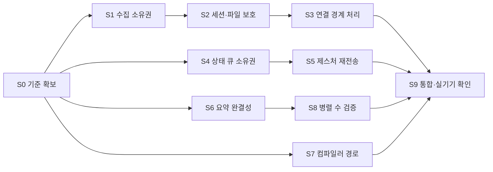
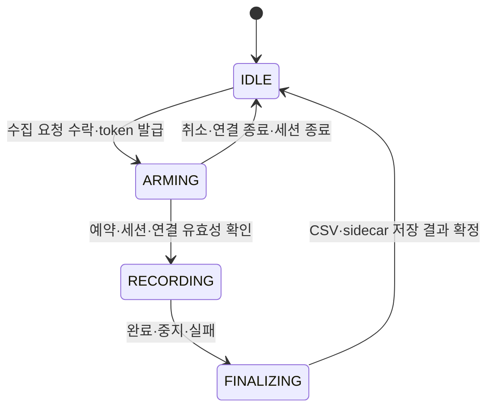

# ECC 리뷰 8건 수정·검증 계획

작성: 2026-11-12, 한국 시간. 상태: **S0~S8 구현 및 S9 PC·에뮬레이터 검증 완료 / 실제 링·휴대폰 시험 미확인**. [수정 결과와 증거](../../reviews/2026-11-12-ecc-fixes-results.md).

개정: **R2 — 코드·공식 코어·독립 검토 교차 검증 반영**. 교차 검증 결과는 [계획 교차 검증 보고서](../../reviews/2026-11-12-ecc-plan-crosscheck.md)에 있다. R1에서 저장 종료 순서, 연결 경계, 제품 조정 계층 검사, 구독 해제 이력, 재개 알림 순서, 검사 실패 전파, 공백 컴파일러 경로의 통합 검사를 보강했다. 이후 사용자 실행 요청으로 구현했으며 아래 체크는 PC에서 확인한 범위다. 실제 기기 표는 미실행으로 유지한다.

목표는 리뷰에서 재현한 8건을 수정하고, 같은 실패 조건을 다시 검사할 수 있는 회귀 검사를 남기는 것이다. 기준 코드는 HEAD `b3abc84`이며 관련 리뷰는 [2026-11-12 ECC 코드 리뷰](../../reviews/2026-11-12-ecc-code-review.md)다. 이 문서는 ECC `intent-driven-development`의 관찰 가능한 완료 조건을 적용한 실행 계획이다.

작업 루트: `C:/Users/zoonc/Desktop/RingPilot`. 아래 코드 경로와 명령은 이 루트를 기준으로 한다. 구현에서는 SessionDirectory·SlotContinuity·연결 세대 검사도 CaptureCoordinatorTest 한 파일에 모아 실제 제품 조합을 검사했다. 세션 객체는 준비 취소를 위한 pending 예약을 먼저 만들고 초기 파일 준비 성공 후 활성 세션으로 확정한다. 폴더 후보는 기본 이름과 접미사 001~1000을 사용한다. 구체 변경·검토 보완·산출물은 수정 결과 보고서에 있다.

## 1. 수정 원칙과 먼저 정할 동작

8건을 Android 수집 안정성, 펌웨어 전송 안정성, Python 실행 도구의 세 묶음으로 진행한다. 같은 파일의 관련 수정은 순서대로 적용하고, 각 묶음마다 기존 검사와 신규 회귀 검사를 통과시킨다.

| 항목 | 이 계획의 기본 동작 | 선택 이유 |
| --- | --- | --- |
| 동시에 들어온 수집 요청 | 먼저 준비·실행 중인 수집을 유지하고 새 요청을 거절한다 | 먼저 시작한 데이터의 소유권을 보장한다 |
| 안내 일시정지 중 수동 기록 | 수동 기록을 허용한다. 수동 기록을 끝내기 전 안내 재개는 거절한다 | 현재 사용 흐름을 유지하면서 캡처 교체를 막는다 |
| 준비 중 세션 종료 | 예약을 취소하고 이후 지연 콜백을 무효화한다 | 종료 뒤 수집이나 새 세션이 저절로 시작되는 것을 막는다 |
| 다른 앱으로 화면 전환 | BLE·제스처 제어와 진행 중 수집을 유지한다. 종료 경계는 실제 client.stop·세션 종료·onDestroy에 적용한다 | 기존 연속 실사용 기록과 다른 앱 조작 흐름을 보존한다 |
| 연속 기록 중 연결 종료 | 받은 행을 저장하고 해당 기록을 종료한다. 재연결 후 사용자가 새 기록을 시작한다 | 부팅이 다른 슬롯을 한 CSV에 섞지 않는다 |
| 방향 안내 중 연결 종료 | 진행 중 회차는 실패 처리하고 같은 방향을 연결 복구 후 다시 시도한다 | 불완전한 4초 클립을 성공 자료로 남기지 않는다 |
| 연결은 유지되는데 슬롯이 역행 | 시간축 이상으로 해당 기록을 종료한다 | 부팅 ID 없이 실제 재부팅 여부를 단정하지 않는다 |
| 세션 이름 충돌 | 기존 폴더를 건드리지 않고 새 폴더를 만든다 | CSV·sidecar·SESSION_DONE의 소유권을 분리한다 |
| 제스처 전송 실패 | 같은 패킷을 짧은 기간 재시도하고, 만료·연결 변경·일시정지 시 폐기한다 | 잠깐의 송신 혼잡을 복구하면서 오래된 명령 실행을 제한한다 |
| 학습 결과 일부 누락 | 요약 파일을 만들기 전에 누락 목록과 함께 실패한다 | 빈 파일을 성공 결과로 남기지 않는다 |

연속 기록을 연결 복구 후 자동으로 재개하지 않는 것은 **이번 계획에서 제안하는 동작 변경**이다. 기존 자료를 보존하고 새 기록 시작을 명확하게 구분하는 기본안이다. 자동 구간 재개가 필요해지면 별도 동작으로 설계한다.

수정 범위는 수집·전송·CLI 오류 처리다. 현재 모델 가중치, 학습 조건, 발행 임계값과 잠금·입력 지우기 규칙, 센서 환산 계수, BLE 패킷 길이·UUID, CSV 열과 10ms 슬롯 단위는 유지한다. 전체 모델 재학습과 과거 실험 결과 재작성은 이 수정의 완료 조건에 포함하지 않는다.

## 2. 문제와 작업의 대응

| 리뷰 번호 | 문제 | 작업 | 완료를 판단할 핵심 증거 |
| --- | --- | --- | --- |
| 1 / P1 | 캡처 덮어쓰기 | S1 | 준비 중 충돌·안내 재개 충돌에서 기존 캡처와 버퍼 유지 |
| 3 / P2 | 같은 초 세션 충돌 | S2 | 고정된 같은 시각에 서로 다른 폴더 생성, 이전 CSV 해시 동일 |
| 2 / P2 | 재부팅 후 샘플 무시 | S3 | 연결 세대 변경 시 기존 CSV 종료, 새 기록의 첫 샘플 수용 |
| 4 / P2 | 상태 큐 동시 제거 | S4 | 큐 변경은 loop만 수행, count 범위 유지 |
| 5 / P2 | 제스처 전송 유실 | S5 | 실패 후 성공 시 같은 패킷 1회 수용, 만료·다른 연결에는 전송 없음 |
| 6 / P2 | 빈 요약 저장 | S6 | 누락 시 출력 미생성, 완비 후 동일 출력 이름으로 성공 |
| 7 / P2 | 컴파일러 경로 인용부호 | S7 | 공백 경로·따옴표·추가 인수에서 의도한 argv 생성·실행 |
| 8 / P2 | parallel 0/음수 대기 | S8 | 잘못된 값은 Popen·로그 생성 전에 즉시 실패 |

의존 순서는 다음과 같다. 기본 실행 순서는 S0 → S1 → S2 → S3 → S4 → S5 → S6 → S7 → S8 → S9다.



Android·펌웨어·Python 묶음은 파일 충돌 없이 나눌 수 있다. `MainActivity.java`를 수정하는 S1~S3, `gesture_infer.ino`를 수정하는 S4~S5, `v2_return.py`를 수정하는 S6·S8은 각각 순서대로 진행한다. 병렬 실행이나 별도 에이전트 사용은 이 계획의 필수 조건이 아니다.

## S0. 기준 코드·자료·검사 결과 확보

목적: 이후 실패가 기존 문제인지 수정의 영향인지 구별할 기준을 확보한다.

- [x] 시작 시 `AGENTS.md`, 진행기록 최신 절, 리뷰 보고서를 읽고 `git status --short`, HEAD를 기록한다.
- [x] 현재 작업 폴더를 사용한다. 기존 문서 변경을 포함해 임의로 정리하거나 덮어쓰지 않는다.
- [x] 기존 재현 파일 `.build/review-repros/android/`, `.build/ecc-firmware-review/`, `.build/ecc-review-2026-11-12/python_repro.py`의 조건을 검토한다. 최종 검사는 실제 제품 클래스·모듈을 호출하도록 만든다.
- [x] `.build/ecc-fixes-2026-11-12/`에 로그와 임시 데이터용 폴더를 만든다. 원본 `data/sessions`, 모델, 실험 결과에는 재현 데이터를 쓰지 않는다.
- [x] Python 전체 검사, Java 검사, Android 빌드를 실행해 기준을 확보한다. 보드 코어가 있으면 두 대상 펌웨어의 수정 전 컴파일 크기도 기록한다.
- [x] 기존 APK·펌웨어 산출물의 해시와 빌드 조건을 기록해 수정 후 산출물과 구분한다.

기존 확인값은 Python 73개 통과, CaptureSidecar·GestureRouter 통과, Android 오프라인 빌드 성공이다. 이 값은 11월 12일 리뷰 시점의 결과이며 구현 시점의 재검사를 대신하지 않는다.

완료 조건: 기존 실패가 있으면 원인과 영향 범위를 기록하고, 새 수정의 검증 결과와 구분할 수 있다.

## S1. 준비부터 저장 완료까지 캡처 소유권 보호

수정 파일:

- `android/app/src/main/java/com/hintringpilot/ringpilot/MainActivity.java`
- 신규 `android/app/src/main/java/com/hintringpilot/ringpilot/CaptureCoordinator.java`
- 신규 `android/tests/CaptureCoordinatorTest.java`
- `android/tests/run-sidecar-tests.ps1`

`CaptureCoordinator`는 제품이 실제 사용하는 수집 조정 계층이다. 수집 요청·준비 예약·샘플 완료·파일 저장 등록·안내 재시도·세션 종료의 순서를 이 클래스가 소유한다. MainActivity는 화면·소리·권한을 담당하는 어댑터로 두고, BLE listener는 경계와 샘플을 조정 계층에 전달한다. 조정 계층 내부의 단일 captureLock으로 상태와 캡처를 함께 갱신하며 MainActivity가 별도로 캡처 상태를 수정하지 않게 한다. 센서 환산 수식과 CSV 형식은 보존하고 화면 전체를 재구성하지 않는다.

실제 제품에서 사용하는 `Clock`, `UiScheduler`, `WriteQueue` 경계를 주입 가능하게 만든다. PC 검사에서는 두 대기열의 실행 순서를 제어하되 검사 대상은 제품의 동일한 CaptureCoordinator와 실제 임시 파일 저장 경로다. 독립적인 token helper 검사나 메서드 복사본으로 연결부 검사를 대체하지 않는다.



상태 계약:

| 상태 | 다른 수집 시작·안내 재개 | 중지·세션 종료 | 수신 샘플 |
| --- | --- | --- | --- |
| IDLE | 허용 | 종료할 작업 없음 | 기록하지 않음 |
| ARMING | 거절 | 예약 무효화 | 기록하지 않음 |
| RECORDING | 거절 | 캡처별 종료 절차 실행 | 현재 token·연결 세대만 수용 |
| FINALIZING | 거절 | 종료 저장 순서에 포함 | 기록하지 않음 |

세부 작업:

- [x] 먼저 두 재현 조건을 실패하는 검사로 고정한다. `IDLE 예약 → 연속 기록 시작`, `안내 일시정지 → 연속 기록 시작 → 안내 계속`을 포함한다.
- [x] 준비·실행·저장을 하나의 token으로 식별한다. token에 세션 세대와 연결 세대를 함께 둔다.
- [x] `startFixedLong()`은 1.2초 예약 전에 ARMING을 점유한다. 같은 버튼 재클릭도 새 예약을 만들지 않는다.
- [x] `startCapture()`는 유효한 token을 소비할 때만 `capture`를 설정한다. 기존 캡처가 있으면 교체하지 않는다. 파일 쓰기 예약도 점유 확인 뒤에 수행한다.
- [x] `togglePause()`의 재개 경로에서 준비·실행·저장 중인 수동 기록을 검사한다. 진행 중이면 현재 기록을 유지하고 “수동 기록을 먼저 끝냅니다”를 표시한다.
- [x] 세션 종료·안내 중지·다시 하기·Activity 종료에서 관련 예약 token을 무효화한다. 늦은 콜백은 새 세션을 만들거나 안내를 진행시키지 못한다.
- [x] 완료·실패·중지는 공통 종료 경로에서 token당 한 번만 처리한다. 이전 캡처의 timeout·성공 콜백이 새 캡처를 지우지 못하게 한다.
- [x] 마지막 샘플 수신·중지·실패를 captureLock에서 확정하는 시점에 불변의 종료 작업을 만들고 fileWriter에 등록한다. 그 등록까지 끝난 뒤 캡처를 분리한다. CSV 저장 등록을 mainHandler의 done 콜백에 맡기지 않는다. 파일 I/O 자체나 작업 완료 대기는 captureLock 밖에서 수행한다.
- [x] 종료 작업은 자신의 세션 객체·폴더·token을 보유한다. 단일 fileWriter에서 남은 CSV → sidecar → 세션별 저장 결과·카운트를 확정한다. 현재 화면의 sessionDir·savedCounts를 이전 작업에서 직접 변경하지 않는다. UI에는 불변의 결과를 보내고 현재 세션·안내 세대가 맞을 때만 표시한다.
- [x] 파일 저장 완료 전에는 FINALIZING을 유지한다. 성공 시에만 저장 개수·안내 index를 증가시키고 REST_MS 뒤 다음 회차를 예약한다. 실패하면 점유를 해제하고 안내를 일시정지하며 저장 실패와 재시도 방법을 표시한다. 느린 저장 중 다음 회차가 거절된 채 안내가 멈추지 않게 한다.
- [x] 세션 종료는 먼저 세션을 CLOSING으로 만들어 새 예약·샘플 수락을 막고, 수락된 모든 종료 작업 뒤에 종료 요약·SESSION_DONE 작업을 등록한다. 세션 종료 요약은 UI 콜백 처리 여부와 무관하게 확정된 저장 결과를 사용한다. 종료 뒤 그 세션에 새 파일 쓰기가 등록되지 않게 한다.
- [x] onDestroy는 UI 예약을 무효화하되 이미 수락한 파일 작업을 취소하지 않는다. 마지막 종료 작업과 세션 종료 작업을 등록한 뒤에만 executor.shutdown()을 호출하며 UI 스레드에서 awaitTermination으로 기다리지 않는다. 이 보장은 프로세스가 살아 있는 정상 Activity 종료 범위이고 강제 종료·전원 손실까지 보장하지 않는다.
- [x] 버튼 활성 상태를 같은 상태 판단에서 계산한다. 버튼 비활성화 외에도 메서드 내부 검사를 유지한다.

회귀 검사:

| 시작 조건·행동 | 기대 결과 |
| --- | --- |
| ARMING 중 다른 모드 요청 | 첫 token 유지, 두 번째 요청 거절, 파일 추가 없음 |
| 연속 10행 수신 후 안내 재개 | 같은 캡처·10행 유지, 안내 index 증가 없음 |
| 준비 중 세션 종료 후 예약 실행 | 캡처·새 세션·파일 생성 없음 |
| 이전 timeout을 새 캡처 시작 후 전달 | 새 캡처 유지 |
| 중지·완료가 연달아 도착 | CSV 종료·sidecar·카운트 갱신 각각 한 번 |
| 저장 대기 중 다른 요청 | 새 요청 거절, 기존 저장 순서 유지 |
| 마지막 400번째 샘플 → UI 대기열 정지 → 세션 종료 → 파일 대기열 실행 | 400행 CSV·sidecar·카운트 확정 뒤 SESSION_DONE 생성 |
| 위 순서에서 Activity 종료·executor shutdown 추가 | 이미 수락한 파일 작업 완료, 종료 UI 호출 없음 |
| 저장을 REST_MS+PROMPT_MS보다 오래 지연 | 저장 완료 전 다음 회차 시작 없음, 완료 뒤 정확히 한 번 시작 |
| CSV·sidecar 저장 실패 | 성공 개수·안내 index 증가 없음, 실패 표시, 점유 해제 |

검사 예시: `reserve(manual)`이 발급한 token과 `activeToken`이 충돌 요청 후에도 같아야 하며, `activate(oldToken)`은 세션 종료 뒤 false여야 한다. 추가로 실제 CaptureCoordinator의 UI·파일 대기열을 따로 멈추고 실행해 위 종료 순서와 파일 행 보존을 자동 검사한다. S2의 파일 I/O 검사와 S9의 실제 앱 흐름 확인을 함께 수행한다.

완료 조건: 원본 캡처 교체 재현 두 조건에서 버퍼가 보존되고, 종료 처리가 한 번만 발생한다.

## S2. 충돌 없는 세션 생성과 덮어쓰기 방지

수정 파일:

- `MainActivity.java`의 `ensureSession`, `nextFile`, CSV 최초 저장, `endSession`
- `CaptureCoordinator.java`의 세션 준비·파일 저장·종료 조정
- 신규 `android/app/src/main/java/com/hintringpilot/ringpilot/SessionDirectory.java`
- `android/tests/CaptureCoordinatorTest.java`의 세션 폴더·파일 소유권 검사
- `android/tests/run-sidecar-tests.ps1`, `android/README.md`

세부 작업:

- [x] 시계를 같은 값으로 고정하는 테스트부터 작성한다. 실제 임시 폴더에 기존 CSV와 SESSION_DONE을 만들고 시작 전 해시를 구한다.
- [x] 세션 루트를 확인한 뒤 `Files.createDirectory(candidate)`로 새 자식 폴더를 확보한다. 기본 이름 `yyyyMMdd-HHmmss`가 있으면 `-001`, `-002` 순으로 새 후보를 시도한다. 기본 이름과 1,000개 접미사 후보를 모두 쓰면 명확한 IOException으로 중단한다.
- [x] 이미 존재하는 이름에 대해서만 다음 후보로 넘어간다. 권한·용량·일반 I/O 오류는 기존 폴더를 재사용하지 않고 호출자에 전달한다.
- [x] 준비 취소를 위한 pending 세션 예약을 먼저 만들고, 폴더 확보와 초기 파일 준비가 성공한 뒤에만 활성 세션으로 확정한다. 초기 session_info 저장과 연속 CSV 헤더 생성이 필요한 경우 그 성공까지 ARMING을 유지한다. 준비 성공 전에는 RECORDING·시작 신호·"지금" 예약을 진행하지 않는다. 실패하면 점유를 해제하고 수집을 시작하지 않는다.
- [x] CSV 최초 쓰기를 `CREATE_NEW`로 바꾼다. 연속 기록의 후속 청크만 append한다. 헤더 생성 실패 후 청크를 계속 추가하지 않는다.
- [x] 기존 sidecar의 exclusive 생성 정책을 유지한다. SESSION_DONE은 신규 폴더에만 생성하며, 기존 세션의 마커를 삭제하지 않는다.
- [x] 세션 초기 메타데이터 생성 실패와 마지막 요약·마커 생성 실패를 성공으로 표시하지 않는다. 데이터가 남으면 실패 상태와 경로를 보여 준다.
- [x] `tools/pull-phone-sessions.js` 및 세션 분석 도구가 접미사 있는 새 이름을 처리하는지 합성 자료로 확인한다. 기존 P1~P5 고정 분할과 데이터 경로는 변경하지 않는다.

필수 검사: 같은 시각 2회 생성의 서로 다른 경로, 기존 CSV 해시 동일, 새 활성 폴더에 SESSION_DONE 없음, 고정·연속 CSV의 기존 파일 덮어쓰기 거부, mkdir·메타데이터 쓰기 실패 시 캡처 미시작.

완료 조건: 같은 초 반복 시작·종료에서도 이전 CSV·메타데이터·마커가 바뀌지 않는다. 폴더/최초 파일 생성 실패가 정상 수집으로 이어지지 않는다.

## S3. 연결·부팅 경계에서 기록 종료

수정 파일:

- `android/app/src/main/java/com/hintringpilot/ringpilot/ImuBleClient.java`
- `MainActivity.java`, `CaptureSidecar.java` 및 기존 sidecar 검사
- `CaptureCoordinator.java`의 연결 경계·안내 재시도 조정
- 신규 `android/app/src/main/java/com/hintringpilot/ringpilot/SlotContinuity.java`
- `android/tests/CaptureCoordinatorTest.java`의 슬롯·연결 세대 검사, `android/README.md`

세부 작업:

- [x] 슬롯 100000~100009 수신 뒤 새 연결의 0~9가 들어오는 검사를 작성한다.
- [x] BLE 연결 시도마다 내부 generation을 발급한다. `onSamples`에 generation을 함께 전달하고, 연결 종료를 전달하는 명시적 listener 메서드를 추가한다. 화면 문구를 파싱해 연결 종료를 추측하지 않는다.
- [x] 연결 시도에 묶인 콜백 식별자를 검사한다. 이전 GATT 객체의 늦은 알림·disconnect 콜백이 새 연결을 닫거나 새 캡처에 들어오지 못하게 한다.
- [x] boundary는 GATT disconnect뿐 아니라 수동 다시 연결의 stop→start, client.stop, 연결 객체 교체, Activity 종료에서도 기존 세대당 한 번 발생시킨다. stop은 GATT close 전에 경계를 발행하며 이후 늦은 disconnect 콜백과 중복 종료하지 않는다.
- [x] boundary 통지는 CaptureCoordinator의 captureLock에서 기존 캡처의 종료 작업 등록과 ARMING 취소를 확정한 뒤 UI 변경을 mainHandler로 넘긴다. UI 작업 순서가 밀려도 새 generation의 샘플을 기존 캡처에 붙이지 않는다.
- [x] 연속 기록은 지금까지 받은 행과 남은 버퍼를 저장하고 `end_status=stopped`, `end_reason=connection_lost`로 종료한다. 세션은 유지할 수 있으나 연속 캡처는 사용자가 다시 시작한다.
- [x] 고정 길이·안내 회차는 불완전하면 CSV 성공 저장을 하지 않고 `end_status=aborted`, `end_reason=connection_lost`로 끝낸다. 안내는 연결 복구 후 같은 회차를 다시 진행한다.
- [x] 캡처 생성 전 ARMING에서 끊겨도 음성 뒤 예약·"지금" 신호를 취소하고 같은 안내 index의 재시도 요청을 보존한다. 재시도는 새 세대 streaming·캡처 IDLE·안내 미일시정지·같은 세션 조건을 모두 만족할 때 한 번만 예약한다. onConnected와 이전 종료 결과가 각각 중복 예약하지 못하게 한다.
- [x] `SlotContinuity`에서 정상 진행, 앞으로의 공백, 직전 패킷 범위의 완전 중복, 역행·부분 겹침을 구분한다. 직전 패킷의 완전 중복만 무시한다. 역행·부분 겹침은 `slot_discontinuity`로 종료한다.
- [x] 연속 기록의 앞으로 발생한 공백은 현재 방식대로 timestamp 간격에 남긴다. 고정 기록의 앞으로 공백은 현재처럼 실패 처리한다.
- [x] `board_boot_id`, `board_restart_observed`를 추측해 채우지 않는다. 내부 연결 generation은 앱의 수신 경계이며 물리적 부팅 ID가 아니다.
- [x] 재연결 후 새 기록은 새 파일의 timestamp 0부터 시작한다. 이전 nextSlot까지 기다리지 않는다.

필수 검사: generation 변경 직후의 샘플 혼입 방지, 늦은 이전 연결 콜백 무시, 순방향 공백 유지, 완전 중복 미계수, 슬롯 역행 즉시 종료, 종료 sidecar 1개, 새 기록의 0~9 수용. 별도로 방향 음성 후 1.2초 준비 중 단절/수동 다시 연결 → 복구에서 같은 방향이 정확히 한 번 시작되는지, stop만 호출하고 disconnect 콜백이 오지 않아도 기존 기록이 종료되는지 확인한다.

완료 조건: 재부팅·재연결이 이전 CSV의 시간축을 오염시키지 않고 새 기록이 즉시 수집 가능하다. 실제 보드 재시작 확인은 S9에 남긴다.

## S4. 펌웨어 상태 큐의 변경 주체를 loop로 통일

수정 파일:

- `firmware/gesture_infer/gesture_infer.ino`
- `firmware/imu_ble_stream/imu_ble_stream.ino`
- 신규 프로젝트 라이브러리 `firmware/libraries/RingPilotTransport/library.properties`
- 신규 `firmware/libraries/RingPilotTransport/src/RingPilotTransport.h`, `RingPilotTransport.cpp`
- 신규 `firmware/tests/transport_state_test.cpp`, `run-transport-tests.ps1`

공통 라이브러리는 고정 크기 큐와 전송 상태만 다룬다. Arduino·Bluefruit 호출과 FreeRTOS 동기화는 스케치의 어댑터에 남겨 host C++ 검사에서 실제 큐 모듈을 사용할 수 있게 한다. 두 스케치가 같은 상태 큐 구현을 사용한다. 기존 코어의 C++ 설정에서 컴파일되는 문법을 사용하고 동적 할당·예외·RTTI 의존성을 추가하지 않는다. Arduino CLI에는 `--libraries firmware/libraries`를 지정한다. IDE에서는 `RingPilotTransport` 폴더를 사용자가 지정한 스케치북의 `libraries`에 설치하는 방법을 문서화한다.

세부 작업:

- [x] 기존 교차 실행 재현을 회귀 시나리오로 고정한다. notify 실패·재시도·포화·연결 종료를 주입할 수 있는 송신 함수를 사용한다.
- [x] `onStatusCccd()`는 handle·구독 값·연결 세대를 작은 mailbox에 기록하고 반환한다. 이 콜백에서 `sendStatus`, `flushStatus`, 상태 큐 추가·제거를 하지 않는다.
- [x] 제스처 특성에도 별도의 CCCD 콜백을 등록한다. 상태 특성 구독과 제스처 특성 구독을 구분하고, 제스처 구독이 해제되면 구독 세대를 증가시키거나 sticky revoke를 기록한다. 한 loop 사이 off→on이 모두 발생해도 해제 사실이 사라지지 않게 한다.
- [x] mailbox 갱신과 읽기/비우기만 짧은 임계 구역으로 보호한다. notify, I2C, Serial, 대기 코드를 임계 구역에 넣지 않는다.
- [x] 연결 콜백에서 linkEpoch와 연결 변경 이력도 같은 임계 구역으로 발행한다. loop는 handle·연결 세대·각 특성의 구독 세대를 일관된 snapshot으로 소비한다. 빠른 disconnect→connect에서 handle이 재사용돼도 이전 연결로 취급하지 않는다.
- [x] loop 시작에서 mailbox를 소비하고 현재 연결·구독과 맞는 이벤트만 상태 큐에 넣는다. 최신 구독 해제가 관찰되면 이전 구독 요청으로 전송하지 않는다.
- [x] `sendStatus()`의 나머지 호출자도 확인해 큐 추가·제거가 loop에서만 일어나도록 한다. 연결 변경 시 오래된 큐를 비운다.
- [x] 큐 count를 0~capacity 안에서만 바꾸는 API로 묶고, 빈 큐 제거는 실패로 반환한다. 포화 정책은 오래된 상태 항목 폐기와 카운터 증가로 명시한다.
- [x] 단, 현재 재개 주기의 RESUMED는 첫 IMU 전송을 여는 필수 상태다. 이 항목은 일반 포화 정책으로 제거하지 않는다. 공간이 없으면 비필수 상태를 제거해 넣고, 이전 재개 주기가 일시정지·연결 변경으로 무효화됐다면 그 주기의 장벽도 함께 무효화한다.
- [x] 상태 특성이 미구독이라고 일반 큐를 비울 때에도 현재 RESUMED의 payload·재개 세대·미수용 상태는 보존한다. 상태 구독 복구 후 같은 장벽 항목을 다시 넣거나 전송할 수 있어야 한다. 장벽만 남기고 대응 패킷을 지워 IMU가 영구 대기하지 않게 한다.
- [x] 한 번의 flush에서 무제한으로 전송하지 않는다. 실패하면 해당 루프의 추가 알림 전송을 중단하고 다음 루프에 재시도한다.
- [x] 두 스케치를 모두 컴파일한다. gesture_infer만 수정하고 수집 전용 펌웨어에 동일 오류를 남기지 않는다.

필수 검사: 빈 큐 pop 불가, 포화 시 count 유지, notify false에서 head 미변경, 성공에서 정확히 한 번 pop, 콜백 mailbox가 송신 중 갱신돼도 큐 count 미변경, 연결 변경 뒤 오래된 이벤트 미전송, 한 loop 사이 제스처 CCCD off→on에서도 이전 대기 항목 폐기, 포화 상태에서도 현재 RESUMED 장벽 보존, 상태 미구독→재구독 후 RESUMED 수용·IMU 재개.

완료 조건: 제품 코드에서 큐를 비우는 실행 주체가 하나이며 원래 재현 조건에서 count=255가 발생하지 않는다. 라이브러리 검사는 실제 태스크 스케줄링·무선 시험을 대체하지 않는다.

## S5. 제스처 패킷 보존·재시도·만료

수정 파일:

- `firmware/gesture_infer/gesture_infer.ino`
- `RingPilotTransport.h`, `RingPilotTransport.cpp`, `transport_state_test.cpp`
- 펌웨어 사용·빌드 문서와 시리얼 통계 설명

정책 기본안:

| 항목 | 제안값·동작 |
| --- | --- |
| 대기열 | 고정 4항목, 동적 할당 없음 |
| 패킷 | 기존 8 bytes, seq·dir·score·slot은 발행 시 한 번 결정 |
| 순서 | FIFO, 같은 패킷의 재시도에는 같은 seq 사용 |
| 유효 시간 | 발행 후 250ms를 재시도 허용 기간의 초기값으로 사용 |
| 포화 | 기존 항목을 유지하고 새 항목을 거절, overflow 카운터 증가 |
| 연결 변경·구독 해제·일시정지 | 대기 항목 폐기, 다음 연결로 넘기지 않음 |
| 구독 해제 이력 | 제스처 전용 CCCD 콜백의 구독 세대/sticky revoke로 보존 |
| 재개 첫 데이터 | 현재 RESUMED가 수용된 뒤 첫 IMU 전송 허용 |
| 성공의 의미 | notify가 true를 반환해 BLE 스택이 수용함. 앱 실행 완료 보장은 아님 |

250ms와 큐 크기 4는 **구현을 위한 초기 제안값**이며 측정으로 입증한 최적값이 아니다. 다른 값을 채택하면 조건과 이유를 진행기록에 남긴다.

세부 작업:

- [x] 발행과 송신을 분리한다. `sendGesture()`는 패킷·발행 시각·연결 세대를 큐에 보관한다. LED와 인식 발행 통계는 지금처럼 모델 발행을 나타낸다.
- [x] notify false에서는 큐 항목을 유지한다. true일 때만 제거하고 tx_accepted를 증가시킨다. 재시도 때문에 issuedCount·gestureSeq를 다시 증가시키지 않는다.
- [x] 연결 세대·제스처 구독 세대/sticky revoke·일시정지·기한을 송신 직전에 확인한다. 폐기 사유별 카운터를 둔다. 새 구독이 켜져 있어도 이전 구독 세대의 대기 항목은 전송하지 않는다.
- [x] 만료 계산은 uint32 시각의 wrap을 견디는 차이 계산을 사용한다. 만료된 앞 항목이 뒤의 새 항목을 계속 막지 않게 한다.
- [x] loop 전송량을 제한한다. 상태 1항목 → 제스처 1항목 → IMU 1묶음을 기본 순서로 하고, notify가 실패하면 그 루프의 나머지 알림은 다음으로 넘긴다. 샘플 처리·버튼 확인을 재시도 while로 막지 않는다.
- [x] 단순 전송 순서 외에 재개 장벽을 둔다. resumeStreaming 때 현재 재개 주기의 RESUMED 항목을 표시하고, 그 항목의 notify가 true가 되기 전에는 IMU 전송을 보류한다. sampler와 추론은 계속 수행한다. 상태 1개 제한을 이전 항목이 소비했더라도 장벽을 건너뛰지 않는다. 현재 앱의 상태 특성 구독이 준비되지 않으면 RESUMED 전달을 기다리며 데이터를 먼저 보내지 않는다.
- [x] 코어의 버퍼 대기 시간을 유효 시간 계산에 포함한다. 남은 시간이 `BLE_GENERIC_TIMEOUT + 여유 20ms` 미만이면 새 notify를 시작하지 않고 해당 항목을 `insufficient_time_budget` 사유로 폐기해 tx_expired에 센다. 대기열에 넣기 전부터 시간이 오래된 항목에도 적용한다.
- [x] `issued`, `tx_accepted`, `tx_retry`, `tx_expired`, `tx_overflow`, `tx_link_discard`, `queueDropped`, `filledSlots`를 분리해 시리얼 통계에 남긴다.
- [x] `gesture_runtime.c`, 가중치, 발행 잠금·erase 규칙은 바꾸지 않는다. 전송 실패를 모델 재발행으로 복구하지 않는다.

중요한 시간 한계: 코어 1.1.13의 `getHvnPacket()`은 semaphore를 기다리며 `BLE_GENERIC_TIMEOUT`은 100ms다. 따라서 단순한 `notify` 재호출은 즉시 반환하는 재시도가 아니다. 위 기한 검사는 전송 시도와 버퍼 대기 예산을 제한하며, 실제 태스크 지연·무선 수신·앱 동작까지 250ms 안에 끝난다고 보장하지 않는다. 근거: [버퍼 대기 구현](https://github.com/Seeed-Studio/Adafruit_nRF52_Arduino/blob/1.1.13/libraries/Bluefruit52Lib/src/BLEConnection.cpp#L232), [timeout 정의](https://github.com/Seeed-Studio/Adafruit_nRF52_Arduino/blob/1.1.13/libraries/Bluefruit52Lib/src/bluefruit_common.h).

필수 검사: 즉시 반환하는 false→false→true에서 같은 8 bytes가 재시도되고 수용은 한 번, true 뒤 추가 시도 없음, 만료 뒤 0회 송신, 연결 handle이 재사용돼도 다른 세대 항목 폐기, 일시정지 후 오래된 대기 스와이프 없음, 큐 포화와 millis wrap에서 순서·count 유지, 버퍼 대기 예산 부족 시 notify 미호출. 별도로 notify 실패가 각각 100ms를 소비하도록 주입해 세 번째 시도가 시간 예산 부족으로 거절되는지도 확인한다. MTU23·이전 상태 항목이 대기 중인 재개에서 RESUMED 수용 → 첫 IMU → FIRST_DATA 순서와 앱 missingSamples에 일시정지 공백을 가산하지 않는 것을 확인한다.

구독·연결 경계 보장의 범위: 아직 제품 대기열에 있는 항목은 해제 이력을 관찰해 폐기할 수 있다. 이미 Bluefruit notify에 들어가 버퍼를 기다리는 전송은 현재 API로 취소할 수 없다. 그동안 경계가 바뀌면 반환 후 이를 별도 진단하고 재시도하지 않지만, 이미 스택이 수용한 패킷을 되돌리거나 앱 실행을 취소했다고 주장하지 않는다. 강한 취소·종단 보장이 필요하면 별도 프로토콜 변경이 필요하다.

완료 조건: 일시적 송신 실패는 유효 기간 안에서 복구하고, 실패·만료를 통계에서 구별한다. 앱이 처리했는지까지 보장하려면 ACK가 필요하지만 이번에는 BLE 프로토콜을 확장하지 않는다.

## S6. 학습 요약 생성 전에 결과 완결성 검사

수정 파일: `ml/v2_return.py`, 신규 `ml/test_v2_cli.py`.

- [x] 새 tag의 모든 결과 누락, seed 하나 누락, split 하나 누락의 실패 검사를 작성한다.
- [x] `(LABEL, split, seed)`로 필요한 경로 목록을 먼저 만들고, 누락 목록을 모아 `FileNotFoundError`로 실패시킨다. 오류에는 tag와 누락 경로를 포함한다.
- [x] `splits`가 빈 직접 함수 호출도 명확히 거절한다. all(empty)가 참인 상태에서 빈 요약을 만들지 않는다.
- [x] 모든 파일 존재를 확인한 뒤 JSON 구조와 요청한 split·seed가 맞는지 검사하고 메모리에서 요약을 계산한다. 잘못된 JSON·구조는 경로를 포함한 오류로 처리한다.
- [x] 계산이 끝나기 전에는 `dump(target, summary)`를 호출하지 않는다. 기존 target 보호를 유지한다.
- [x] 완비된 합성 결과로 기존 점수 계산·selected_E·panels 구조가 유지되는지 검사한다. 테스트는 파일과 작은 메타데이터만 만들고 학습 함수를 호출하지 않는다.
- [x] 이미 생긴 빈 요약이 발견돼도 자동 삭제하지 않는다. 파일을 확인하고 다른 `--out` 이름으로 정상 결과를 만든 뒤 정리 여부를 별도로 기록한다.

완료 조건: 결과 누락 시 출력 파일이 없고, 자료를 완비한 뒤 같은 출력 이름으로 정상 생성할 수 있다. 기존 정상 결과·선택 epoch 계산은 유지된다.

## S7. Windows 컴파일러 실행 인수 처리

수정 파일: `ml/v2_export_c.py`, 신규 `ml/test_v2_compiler.py`, 같은 파일의 사용 설명.

- [x] `RINGPILOT_CC`의 현재 “공백으로 나눈 명령” 계약을 유지하면서 공백이 있는 실행 파일을 지원한다. 환경변수를 실행 파일 경로만 받도록 조용히 축소하지 않는다.
- [x] 전체 문자열 또는 일치하는 바깥 따옴표를 제거한 문자열이 실제 실행 파일 경로라면 한 인수로 취급한다.
- [x] 추가 인수가 있으면 운영체제에 맞게 토큰화한다. Windows에서는 경로의 backslash를 보존하고 각 토큰의 일치하는 바깥 인용부호를 처리한다. shell은 실행하지 않는다.
- [x] 비어 있는 명령·닫히지 않은 따옴표는 명확한 오류로 처리한다. 기본 PATH의 gcc·clang 선택 순서는 유지한다.
- [x] `build_host()`는 계속 인수 목록과 `shell=False`로 실행한다. 진단에는 실행 파일과 인수를 구분해 표시한다.
- [x] 실제 공백 경로의 C 컴파일러를 큰따옴표로 감싼 RINGPILOT_CC로 설정한 상태에서 build_host와 기존 host parity 검사를 함께 실행한다. 작은 Python 실행기 argv 검사와 일반 경로 gcc 빌드 두 결과를 합쳐 이 통합 검사를 대신하지 않는다.

필수 검사: 환경변수 없음, 단순 gcc, 실제 공백 경로, 그 경로의 큰따옴표 버전, 따옴표 경로+추가 인수, backslash 경로, 공백을 포함한 별도 인수, 잘못된 따옴표. 토큰 단위 검사에는 작은 실행기를 사용할 수 있다. 별도의 필수 통합 검사에서는 S0에서 확인한 완전한 C 툴체인의 공백 경로를 사용한다. 현재 존재하는 `C:/Program Files/LLVM/bin/clang.exe`가 실제 링크까지 가능한지 먼저 확인하고, 필요하면 사용 가능한 GCC 툴체인 전체를 가리키는 작업 폴더의 공백 경로 별칭을 사용한다. 컴파일러 exe만 복사해 툴체인을 깨뜨리지 않는다.

완료 조건: 리뷰의 따옴표 경로 재현이 성공 실행으로 바뀌고, 실제 host C 추론·Python parity 검사도 통과한다. 임의 shell 문법 지원을 약속하지 않는다.

## S8. 병렬 실행 개수 검증

수정 파일: `ml/v2_return.py`, `ml/test_v2_cli.py`.

- [x] argparse의 `--parallel`을 1 이상 정수로 제한한다. 0·음수·정수가 아닌 값은 사용법과 함께 종료 코드 2를 반환한다.
- [x] `cmd_run_all()` 첫 부분에도 `parallel < 1` 검사를 둔다. 직접 호출은 ValueError로 거절한다.
- [x] 검사 위치는 `keep_awake`, 로그 폴더 생성, 파일 열기, Popen보다 앞이어야 한다.
- [x] 기본값 8과 유효한 값 1·2의 동작은 유지한다. 기존 작업 실패 집계·종료 코드도 유지한다.
- [x] Popen을 모사해 0·-1에서 호출 횟수 0, 파일 생성 0을 확인한다. 완료·실패한 자식이 있을 때 대기가 종료되는지도 검사한다.

완료 조건: 잘못된 값이 즉시 실패하며 실제 학습 프로세스를 만들지 않는다. 정상 값은 기존 실행 방식대로 완료된다.

## S9. 통합 검사·문서·실기기 확인

### PC에서 먼저 완료할 것

- [x] 각 작업의 실패 검사가 수정 전에는 해당 실패를 보이고 수정 후에는 통과했는지 기록한다. 메서드 복사본만 통과하는 검사에 의존하지 않는다.
- [x] Java 신규 검사들을 기존 PowerShell runner에 연결한다. 실제 CaptureCoordinator + 가짜 UI/파일 scheduler + 실제 임시 파일 저장을 사용하는 조합 검사를 포함한다. Activity와 BLE 어댑터가 같은 조정 계층으로 연결되는지도 확인하며, helper만 통과한 결과로 수집 종료 순서가 검증됐다고 세지 않는다.
- [x] Python 전체 검사를 실행한다. 기존 모델 snapshot 검사는 합성 데이터의 작은 학습을 포함할 수 있으며 전체 334개 모델 재학습과 구분한다.
- [x] host C 추론 parity와 신규 transport 모듈 검사를 실행한다. 컴파일러가 없어서 skip된 검사를 통과로 세지 않는다.
- [x] Android APK와 두 펌웨어를 빌드한다. 펌웨어의 프로그램·전역 변수 크기 변화, 도구 버전과 경고를 기록한다.
- [x] 에뮬레이터에서 수집 탭의 준비·취소·버튼 활성 상태·세션 종료 UI를 확인한다. 링 없는 화면 확인을 BLE 수집 검증으로 기록하지 않는다.
- [x] 합성 세션으로 PC 이동 도구의 목록·복사·해시 검증을 확인한다. 실제 휴대폰 자료의 자동 삭제는 회귀 검사에 사용하지 않는다.
- [x] `android/README.md`, 펌웨어 빌드·상태 통계 설명, 리뷰 보고서의 해결 현황, 진행기록을 갱신한다.
- [x] 새 APK·펌웨어의 해시를 기록하고 전달 파일 이름에 날짜·수정 버전을 넣는다. 기존 ZIP과 혼동되지 않게 한다.
- [x] 모든 외부 검사·컴파일 명령의 종료 코드를 즉시 검사한다. 첫 실패에서 중단하고 단계 이름·종료 코드·로그를 보존한다. 마지막 git status 성공으로 앞선 실패를 덮지 않는다.

구현 시 사용할 명령의 기준 형태다. S0에서 실제 링크가 가능한 공백 경로의 C 툴체인을 확인해 `$spaceCompilerPath`에 지정한다. 현재 PC에서는 아래 clang 실행 파일의 존재만 확인했으며 C 링크·parity는 아직 검증하지 않았다.

```powershell
$ErrorActionPreference = 'Stop'
function Invoke-CheckedNative {
    param([string]$Stage, [string]$Executable, [string[]]$Arguments)
    & $Executable @Arguments
    $stageExitCode = $LASTEXITCODE
    if ($stageExitCode -ne 0) {
        throw "$Stage failed (exit $stageExitCode)"
    }
}

Set-Location 'C:/Users/zoonc/Desktop/RingPilot'
New-Item -ItemType Directory -Force '.build/ecc-fixes-2026-11-12/tmp' | Out-Null
$env:TEMP = (Resolve-Path '.build/ecc-fixes-2026-11-12/tmp').Path
$env:TMP = $env:TEMP
$spaceCompilerPath = 'C:/Program Files/LLVM/bin/clang.exe'

Start-Transcript -Path '.build/ecc-fixes-2026-11-12/validation.log' -Force | Out-Null
try {
    .\android\tests\run-sidecar-tests.ps1
    Invoke-CheckedNative -Stage 'Python tests' -Executable '.\ml\.venv\Scripts\python.exe' -Arguments @('-m', 'unittest', 'discover', '-s', 'ml', '-p', 'test_*.py')
    .\firmware\tests\run-transport-tests.ps1

    if (!(Test-Path -LiteralPath $spaceCompilerPath) -or !$spaceCompilerPath.Contains(' ')) {
        throw 'A verified compiler path containing spaces is required.'
    }
    $previousCompilerCommand = $env:RINGPILOT_CC
    try {
        $env:RINGPILOT_CC = '"' + $spaceCompilerPath + '"'
        Invoke-CheckedNative -Stage 'Quoted compiler C parity' -Executable '.\ml\.venv\Scripts\python.exe' -Arguments @('-m', 'unittest', 'discover', '-s', 'ml', '-p', 'test_v2_c_infer.py')
    } finally {
        $env:RINGPILOT_CC = $previousCompilerCommand
    }

    Push-Location android
    try {
        Invoke-CheckedNative -Stage 'Android build' -Executable '.\gradlew.bat' -Arguments @(':app:assembleDebug', '--offline', '--console=plain')
    } finally {
        Pop-Location
    }

    Invoke-CheckedNative -Stage 'Gesture firmware' -Executable 'arduino-cli' -Arguments @('compile', '--fqbn', 'Seeeduino:nrf52:xiaonRF52840Sense', '--libraries', 'firmware/libraries', '--build-path', '.build/ecc-fixes-2026-11-12/gesture_infer', 'firmware/gesture_infer')
    Invoke-CheckedNative -Stage 'Capture firmware' -Executable 'arduino-cli' -Arguments @('compile', '--fqbn', 'Seeeduino:nrf52:xiaonRF52840Sense', '--libraries', 'firmware/libraries', '--build-path', '.build/ecc-fixes-2026-11-12/imu_ble_stream', 'firmware/imu_ble_stream')
    Invoke-CheckedNative -Stage 'Diff whitespace' -Executable 'git' -Arguments @('diff', '--check')
    Invoke-CheckedNative -Stage 'Working tree' -Executable 'git' -Arguments @('status', '--short')
} finally {
    Stop-Transcript | Out-Null
}
```

`run-transport-tests.ps1`은 S4에서 새로 만드는 검사 진입점이며 내부 컴파일·실행 실패도 throw해야 한다. `arduino-cli`와 Seeed 코어 설치 위치는 S0에서 확인해 실제 실행 경로를 기록한다. 사용할 코어는 기존 1.1.13으로 고정하고, 빌드를 위해 자동 업그레이드하지 않는다. Gradle 캐시 권한 문제가 생기면 기존 리뷰에서처럼 권한 원인과 코드 실패를 구분한다. C 컴파일러 미검출로 skip된 host 검사는 성공 증거로 세지 않으며 해당 단계 완료를 보류한다.

### 실기기를 가진 쪽에서 확인할 것

| 시험 | 절차 | 기대 결과·남길 증거 |
| --- | --- | --- |
| 수집 충돌 A | IDLE 누른 직후 연속 기록 누르기 | 첫 요청 유지 또는 두 번째 명확한 거절, 캡처 교체 없음 |
| 수집 충돌 B | 안내 일시정지 → 연속 기록 → 계속 | 연속 기록 유지, 안내 재개 거절, 중지 후 재개 가능 |
| 세션 반복 | 연속 시작·종료·새 시작을 같은 초 안에 수행 | 서로 다른 폴더, 이전 CSV 해시 동일, 새 SESSION_DONE 없음 |
| 준비 취소 | IDLE 준비 중 세션 종료 | 1.2초 후에도 기록·새 세션 생성 없음 |
| BLE 단절 | 연속 기록 중 Bluetooth OFF | 받은 행·sidecar 저장 후 중지, 이유 기록 |
| 전원 재시작 | 기록 중 링 OFF/ON, 재연결 후 새 기록 | 이전 파일 유지, 새 timestamp 0·즉시 샘플 증가 |
| 안내 복구 | 방향 회차 중 연결 끊고 복구 | 불완전 회차 성공 저장 없음, 같은 방향 재시도 |
| 일시정지·재개 | 링의 기존 센터 스위치 동작 실행 | 기존 사용자 동작 유지, 오래된 제스처 뒤늦게 실행 없음 |
| 정상 수집·제어 | 정지·동작·연속 수집과 앱 스와이프를 각각 확인 | CSV/sidecar·연결 로그·발행/송신 통계 확보 |
| 송신 실패 주입 | 진단용 빌드에서 notify 실패 후 복구·만료를 각각 주입 | 유효한 패킷 재시도, 중복 수용 없음, 만료 사유 증가 |

송신 실패 주입은 실제 무선 손실률 측정과 구분한다. 정상 조건에서 샘플 누락·판정 대기열 overflow가 새로 생기는지 함께 기록한다. 지연 비교는 동일 보드·전원·연결·동작 조건으로 수행하며, 조건이 다른 과거 p95 수치를 그대로 전후 비교하지 않는다.

### 완료를 나누는 기준

- **구현 완료:** 8건의 수정과 신규 회귀 검사, 기존 검사, Android/두 펌웨어 빌드가 통과한 상태.
- **실기기 확인 완료:** 위 시험의 실제 관찰 또는 사용자 확인과 해당 파일·로그를 확보한 상태.
- **남는 한계:** BLE 스택의 알림 수용을 앱 명령 실행 완료로 간주하지 않는다. 영상 동기화·독립 인식 성능·전력 성능은 별도 평가다.

실기기가 없으면 PC에서 가능한 구현·검사를 끝내고 전달 가능한 산출물을 만든다. 실기기 항목은 미확인으로 남기며 8건 전체의 현장 해결을 완료했다고 기록하지 않는다.

## 3. 변경 묶음과 되돌리기

| 변경 묶음 | 내용 | 되돌릴 때 주의할 점 |
| --- | --- | --- |
| A | S1 캡처 소유권 + 검사 | 추후 S2/S3가 의존하므로 역순으로 되돌린다 |
| B | S2 세션·파일 보호 + 검사 | 새 접미사 세션을 삭제하거나 이전 폴더에 합치지 않는다 |
| C | S3 연결 경계 + 검사 | 이미 종료된 CSV를 다시 이어 붙이지 않는다 |
| D | S4 상태 큐 단일 소유자 + 두 펌웨어 검사 | 공통 라이브러리와 스케치 변경을 함께 관리한다 |
| E | S5 제스처 재시도 + 통계 | 대기 패킷은 버전 변경·재부팅·연결 변경에 이월하지 않는다 |
| F | S6/S8 Python CLI + 검사 | 과거 정상 요약·로그·모델은 보존한다 |
| G | S7 컴파일러 파싱 + 검사 | 기존 환경변수의 추가 인수 지원을 유지한다 |
| H | S9 문서·빌드 증거 | PC 통과와 실기기 확인 상태를 따로 유지한다 |

각 묶음에서 수정 → 해당 실패 검사 → 관련 기존 검사 → 변경 검토 → 기록 순서로 진행한다. 커밋한다면 묶음별로 해당 파일만 포함하고 기존 사용자 문서 변경을 자동으로 섞지 않는다. 푸시·병합·업로드를 계획 작성만으로 실행하지 않는다.

## 4. 최종 완료 체크리스트

- [x] 8건 모두 담당 작업·검사·해결 상태가 연결돼 있다.
- [x] 예약·완료·timeout·연결 종료가 겹쳐도 캡처 종료는 한 번이며 기존 행이 보존된다.
- [x] 마지막 샘플 뒤 UI 콜백 실행 없이 세션·Activity를 종료해도 파일 저장과 마커 순서가 보존된다.
- [x] 새 세션은 기존 폴더·CSV를 재사용하지 않고 실패 시 수집을 시작하지 않는다.
- [x] 연결 세대가 다른 샘플을 한 CSV에 넣지 않는다.
- [x] 상태 큐 수정 주체가 하나이며 큐 count가 범위를 벗어나지 않는다.
- [x] 제스처 구독 off→on의 해제 이력이 보존되고, 재개 첫 IMU는 RESUMED 수용 이후에 전송된다.
- [x] 제스처 재시도는 같은 패킷을 사용하고, 오래된 연결·만료·일시정지 패킷을 버린다.
- [x] 누락 결과·잘못된 병렬 개수는 파일·학습 프로세스를 만들기 전에 실패한다.
- [x] Windows 공백 경로를 포함한 실제 C host 검증이 통과한다.
- [x] 기존 CSV 열·BLE 패킷·모델 가중치와 발행 규칙이 유지된다.
- [x] PC 검사, 빌드, 실패 주입, 실제 보드 시험의 증거를 구분해 기록했다.
- [x] 검사 명령 중 하나라도 실패하면 전체 검증이 실패하며, 외부 명령 종료 코드가 뒤의 성공으로 가려지지 않는다.

체크한 항목은 후속 구현에서 완료한 PC 검증 범위다. R1 작성과 R2 교차 검증은 구현 전 작업이었으며, 이후의 코드 변경·독립 검토·전체 검사·빌드·에뮬레이터 관찰은 [수정 결과 보고서](../../reviews/2026-11-12-ecc-fixes-results.md)에 구분해 기록했다. 아래 실제 링·휴대폰 관찰은 아직 수행하지 않았다.

- [ ] 실제 링·휴대폰에서 S9 표의 BLE·전원 재시작·버튼·혼잡·스와이프 조건을 관찰하고 로그를 추가한다(미실행).
